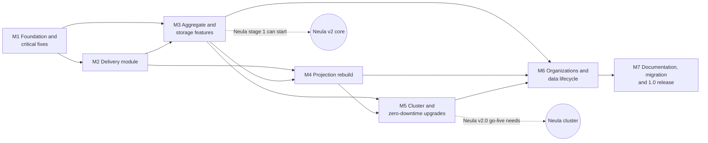

# ReactiveCQRS 1.0 — implementation plan

How the library gets from 0.12.47 to 1.0: goals, milestones, work items, and how each goal
is verified. The decisions (Dn) and issues (Fn, Hn) referenced here are defined in
[KNOWN-ISSUES.md](KNOWN-ISSUES.md); the current architecture is described in
[ARCHITECTURE.md](ARCHITECTURE.md).

| | |
|---|---|
| Status | Approved 16/10/2026 with changes: tests run locally until CI is set up after 1.0; the owner publishes to Nexus after the work is done |
| Line | `master`, from tag `v0.12.47`, straight to 1.0; milestones tagged `v1.0.0-M1` … `-M6`, then `v1.0.0` (D64, D79) |
| Consumer | Neula; production stays on 0.12.47 until 1.0 (D79, D80) |
| Hard constraint | Stored data (D28, D69); API compatibility is not required |
| Working rules | The disciplined-coding guidelines (user-level skill) |

Contents: [1. Goals](#1-goals-of-10) · [2. Working rules](#2-working-rules) ·
[3. Verification toolkit](#3-verification-toolkit) · [4. Milestones overview](#4-milestones-overview) ·
[5. Milestones in detail](#5-milestones-in-detail) · [6. Neula requirements traceability](#6-neula-requirements-traceability) ·
[7. Performance plan](#7-performance-plan) · [8. Risks and spikes](#8-risks-and-spikes) ·
[9. Assumptions](#9-assumptions) · [10. Progress log](#10-progress-log)

---

## 1. Goals of 1.0

Each goal is an observable outcome with the check that proves it.

| # | Goal | Verified by |
|---|---|---|
| G1 | **No known High or Medium issue is open** in KNOWN-ISSUES.md, unless deferred with a stated reason. Every fixed issue has a test that failed before the fix. | Issue index (KNOWN-ISSUES §6) all fixed or deferred; the reproducing tests in the local test run |
| G2 | **Reliable delivery**: every event reaches every subscriber at least once, in order per aggregate, applied exactly once by the subscriber; failures are bounded, visible and repairable; memory stays bounded. | Delivery interface tests, sequence-gate property tests, soak test (M2) |
| G3 | **Stored data stays safe**: everything written by 0.12.47 is readable by 1.0; the upgrade is rehearsed on a production copy. | mpjsons data gate (M1), upgrade rehearsal (M7) |
| G4 | **Neula's requirements are delivered** (R1–R20; R21 not built) with Neula's own acceptance criteria. | Traceability table §6 |
| G5 | **Fast restore and less stored data**: restore from one snapshot plus a short tail; squash into one event, including duplicated and undone histories. | Snapshot and squash equivalence tests (M3) |
| G6 | **Rebuild without downtime**, equal to live, resumable after a crash, faster than today. | Rebuild equivalence and resume tests, throughput measurement (M4) |
| G7 | **High availability and scale-out** on a Pekko cluster with one database; **zero-downtime rolling upgrades** from 1.0 on; a cluster of one behaves like a single node. | Multi-node and fault-injection tests, rolling-upgrade test (M5) |
| G8 | **Organizations are separable**: required space, purge, export/import between installations, complete GDPR rewrite. | Round-trip, purge and rewrite scans (M6) |
| G9 | **Measured performance gains** against the M1 baseline, with no regression between milestones. | Benchmark reports per milestone (§7) |
| G10 | **A library user can succeed from the GitHub documentation alone**: architecture with diagrams, guides, and verified examples, at least a basic setup and a cluster setup. | Examples run as tests; fresh-reader test (M7) |

---

## 2. Working rules

- Every work item follows the disciplined-coding guidelines: explore, ask blocking questions,
  smallest change that fits the existing patterns, edge-case checklist, verify with evidence,
  final report.
- **Bug fixes start with a failing test** at the owning module's interface (D6). The test
  is named after the issue (e.g. `F21 version conflict on a changed document is retried`);
  the issue then moves from *likely* to *confirmed* and, after the fix, to *fixed* in
  KNOWN-ISSUES.md.
- Each issue is fixed in the milestone where its code is reworked (D84; index in
  KNOWN-ISSUES §6). Problems found along the way are added to KNOWN-ISSUES.md, not silently
  fixed, unless they block the work.
- Every schema change follows D28 and D69: additive, idempotent, large indexes
  `CONCURRENTLY`, heavy jobs outside startup.
- Each milestone keeps `ARCHITECTURE.md` accurate. Each work item that changes what a user writes
  or runs (a new option, message, default or host step) updates its chapter of the book
  (`docs/book/`, written by `docs/book/STYLE.md`) in the same commit, so M7 polishes rather than
  writes from scratch; and `README.md` when what it says (features, requirements, coordinates,
  status, the quick start) changes.
- A milestone is done when its exit criteria hold; it is then tagged `v1.0.0-Mn`.

---

## 3. Verification toolkit

Built in M1 and extended where a milestone needs it. New test dependencies are marked
**new** with the reason (approved, §9). Until CI is set up after 1.0, "every commit" means
the local run of `sbt test` before each change is reported as done. The development machine
has PostgreSQL on port 5432 and no Docker.

| Level | What it proves | Tooling | Runs |
|---|---|---|---|
| Interface tests, in-memory | Behaviour of a module through its interface (sequence gate, delivery protocol, command processing) | ScalaTest; in-memory adapters (D6); Pekko TestKit with a controllable clock and scheduler | every commit |
| PostgreSQL tests | SQL procedures, Postgres adapters, transactions, migrations | ScalaTest against the local PostgreSQL (each test run uses its own schema or cleans its tables); **new** Testcontainers PostgreSQL once Docker or CI is available | every commit |
| Property-based equivalence | "Same result" claims: snapshot vs full replay, rebuild vs live, squash before vs after, sequence gate vs in-order application | **new** ScalaCheck (random event logs and delivery orders find cases hand-written tests miss) | every commit |
| Golden schema tests | Stored formats do not change unnoticed; mpjsons 0.6.50 vs 0.7.0 | R20 schema-reference utility (built in M1) | every commit |
| Statement counting | Database round trips per command, per restore, per batch | ScalikeJDBC `GlobalSettings.queryCompletionListener` (no new dependency) | benchmarks, selected tests |
| Soak and memory | Bounded memory, no leaks over long runs | testdomain load driver; heap after GC sampled | per milestone |
| Multi-node | Sharding, singletons, handover, cross-node delivery | Several `ActorSystem`s in one JVM; docker-compose cluster of 3 nodes + PostgreSQL (needs Docker) | M5 onward (compose: when Docker is available) |
| Fault injection | Network partitions, node kills, slow database | **new** Toxiproxy in docker-compose (partitions cannot be simulated reliably in one JVM; needs Docker) | M5 onward (when Docker is available) |
| Upgrade tests | 0.12.47 → 1.0 migration; rolling N → N+1 | Production-copy rehearsal (runbook + script); two testdomain builds in one cluster | M5, M7 |
| Benchmarks | Latency, throughput, restore and rebuild times | `bench` sbt module with an end-to-end load driver over testdomain | per milestone |
| Documentation checks | Examples work, snippets compile, links and diagrams valid | examples as tests; **new** mdoc (snippets in Markdown are compiled); **new** link checker and Mermaid render check, run locally | M7 (examples from their milestone on) |

---

## 4. Milestones overview

| Milestone | Goal | Main decisions | Neula requirements |
|---|---|---|---|
| M1 | Trustworthy test baseline on the new libraries; data-loss and wrong-result bugs fixed on the current architecture; performance baseline | D6, D74, D78, D36, D16, D10, D11, D12, D24, D37, D56 (R5), D21 | R2, R4 (partly), R5, R6, R7, R9 |
| M2 | Delivery that is reliable, visible and bounded | D3, D4, D7, D8, D15, D20a–c | R1, R3, R4 |
| M3 | Features for Neula v2 core; storage reduction; quick performance wins | D29, D30, D31, D32, D33, D17, D34, D35, D47–D52 | R8, R10, R12, R13 |
| M4 | Rebuild without downtime, equal to live, resumable, fast | D57–D63, D70, D56 (R14) | R14 |
| M5 | Cluster, rolling upgrades, id ranges | D39, D42–D46, D53–D55, D65–D73, D68, D75 | R18, R19 (R20's multi-node harness for hosts moved to M7) |
| M6 | Organization operations and migration; complete rewrite; ephemeral aggregates; retention squash | D38, D40, D41, D56 (R17), D76, D77, D52 (R11) | R11, R15, R16, R17 |
| M7 | Library documentation and examples; 0.12.47 → 1.0 migration; release | D81, D79 | all (documentation, migration) |

---

## 5. Milestones in detail

### M1 — Foundation and critical fixes

**Goal:** a green, trustworthy test suite on the new library baseline, stored data proven
readable with mpjsons 0.7, the data-loss and wrong-result bugs of the current architecture
fixed, and a measured performance baseline.

**Work items**

1. **Repository setup.** Tag the current state `v0.12.47`; set the version to `1.0.0-SNAPSHOT`
   (`project/Common.scala`). CI is set up after 1.0; every check runs locally until then.
2. **Step 0, make the tests run (D6, F14).** Fix the test compilation (ScalaTest 3.2 imports
   in `CommonSpec`, `MemoryDocumentStoreSpec`, `PostgresDocumentStoreSpec`, `SubscribableSpec`;
   the `replayed` argument at 5 call sites in `SubscribableSpec`; `Left(version)` at
   `EventStoreStateSpec:41`). Fix the in-memory doubles (F14). Record which existing tests pass.
3. **Library baseline (D74).** Latest Scala 2.13, Pekko 1.7.x, ScalikeJDBC 4.3.x (with
   streams), latest PostgreSQL JDBC, Java 21 bytecode, an explicit slf4j dependency (mpjsons
   0.7 no longer brings it).
4. **mpjsons 0.7 data gate (D78).**
   - Spike F51: does 0.7 serialize the `TypeTag` held by `Event`? If yes, remove it from
     `Event` now (first part of D75).
   - Build the R20 schema-reference utility: given classes and one sample each, compare the
     output with committed reference JSON and with 0.6.50's output, and round-trip it.
   - Build a dry-run tool that reads every stored JSON row (`events`, `sagas`,
     `commands_responses`, projection tables) with the 0.7 codec and reports failures by class
     (F52).
   - Neula: run both against its classes and a production copy; fix `== null` checks on
     `Option` fields (H4, F53).
5. **Production pre-checks** (run by Neula on a production copy): `event_type_version`
   distribution (D29), `space_id = -1` count (F49), the dry run above.
6. **Performance baseline.** `bench` module and load driver; record the metrics of §7 in
   `docs/perf/baseline-M1.md`.
7. **Critical fixes, in this order:**
   1. F21 lost document updates, with F16 (cache only after commit) and stale-entry eviction (D36, D16).
   2. F18 subscription cache after commit.
   3. F7 one timestamp (D10).
   4. F19 reload on external write and F24 bounded concurrent retries (D37).
   5. F10 failed restore fails fast; restore out of the constructor (D11).
   6. F20 configurable async timeout with a reply (D56, R5); F13 executor stops after a failure.
   7. F12 ids read as `Long`.
   8. F9 idempotency: unique key, rollback on collision, stored-response retention (D12, D24, R7); Neula calls `initSchema()` (H5).
   9. Sagas: F35 failures handled in the actor with retry, F36 row counts, F34 index, F17 context use, F40 `println`s.
8. **Documentation hygiene.** CLAUDE.md §7 points to KNOWN-ISSUES.md (D5); ARCHITECTURE.md
   updated for every changed behaviour.

**Verification**

- The full local run is green: compile and all tests, including the PostgreSQL ones (`sbt test`).
- Each fixed issue has its reproducing test; its failure on 0.12.47 code is recorded in the
  change description.
- Neula acceptance criteria pass as library tests:
  - R2: a listener whose transaction rolls back receives the same events again.
  - R4: an external write followed by a command on the same aggregate succeeds; a failed restore does not poison the aggregate (the next command retries the restore).
  - R5: an async handler past its timeout gets `CommandHandlingError`.
  - R6: the timestamp seen live equals the one restored from the store.
  - R7: the same idempotent command sent twice, concurrently, and after a restart creates one set of events and returns the same response.
  - R9: 10 000 commands that produce no events leave the `events` table and the aggregate version unchanged (statement counter: no writes).
- F21: a forced version conflict on a changed document is either retried against fresh data
  or fails after the limit; never a silent success.
- Golden test green for testdomain; Neula's golden test and dry run report zero unreadable
  rows (or converters were added for the reported ones).
- Baseline benchmark report committed.

**Exit criteria:** every M1 issue in KNOWN-ISSUES §6 is fixed or checked; pre-check results
recorded; tagged `v1.0.0-M1`.

**Risks:** mpjsons 0.7 cannot read some stored data (fallback: fix in mpjsons, or stay on
0.6.50 until fixed); ScalikeJDBC 4 or Pekko 1.7 configuration changes.

### M2 — Delivery module

**Goal:** events reach every subscriber at least once, in order per aggregate, applied
exactly once; silence and failures are bounded, visible and repairable; delivery memory
returns to zero when idle.

**Work items**

1. **Delivery interface (D3).** Publisher: "versions a..b of X committed". Subscriber
   protocol: `Deliver`, `Ack(range)`, `Failed(version, error)`. Documented in ARCHITECTURE.md.
2. **Sequence gate (D4).** A pure module deciding ack-only, apply a..b, or fetch a gap; the
   three listener kinds become adapters over it (F5, F15).
3. **Gap fetch (D20c, F45).** Event-store read of a version range for one aggregate; state
   requested from the owner for state-receiving listeners.
4. **Subscriber failure policy (D20a, R1).** Internal retry with back-off; failure recorded
   in the subscription row (new nullable columns: status, failed version, error, since);
   `Failed` reply; `GetProjectionStatus`, `RetryFailedSubscription`, explicit skip of one
   version; automatic, rate-limited retry of failed subscriptions on start.
5. **Bus rewrite (D7, D20b).** Remove the cursor and `EventBusState` (F1, F4, F11, F47);
   ack tracking that ends on ack, failure or deadline; watch subscribers; balanced counters;
   stalled-delivery log lines and summary. The re-delivery limits use the shared `Backoff`
   module (AR6), and the existing retries (executor, sagas, document store) move onto it.
6. **Single retry owner (D8).** One outbox poller for all types (F37) sends re-publish
   messages to owners; owners re-read their outbox rows older than `redeliveryAfter`; every
   outbox row gets fresh attempts at startup; `eventsToPublish`/`pendingPublish` removed;
   batched outbox deletes with failure handling (F26).
7. **Subscriber list registration (D15).** The bus takes the host's subscriber list and
   stashes publications until all answered (F41, F42); Neula drops its 106 count (H2).
8. **`SubscriptionsState` cleanup.** Bounded cache (F29); clearing also clears caches (F6).
   The in-memory mode stays until M4, where rebuild stops needing it.
9. **Delayed queries** keyed and coalesced (F28).

**Refined at the M1 review** (KNOWN-ISSUES §7, review 3):
- Item 6 (D8) separates reloading the state from re-sending the outbox (F72: every reload
  started another re-send chain) and keeps the PermanentDelete trigger, which today runs on
  the acked events of `pendingPublish`; `pendingPublish.distinct` (F33) goes with it.
- Item 3: gap fetches for event listeners keep noop rows, as live delivery sent them (D60);
  the range read is reused by M4.
- The new bus and projection actors follow AR7 (answer per-request failures, never throw from
  `receive`): F79 (the debug timer becomes a tick message), F80 (projection queries).
- Item 8 also evicts the subscription cache when the database compare-and-set fails (F77).
- The controllable clock also drives the timers M1 added: command timeout, concurrent
  retries, saga write retries, `failedRestoreRetryAfter`, response retention.
- Verification adds the end-to-end R6 timestamp check through delivery.

**Verification**

- Sequence-gate property test: for random delivery orders with duplicates, overlaps and
  gaps (at least 10 000 generated cases per run), the listener sees every version exactly
  once, in order, and nothing is buffered without a pending gap fetch.
- Delivery interface tests with in-memory adapters and a controlled clock:
  - a lost message is re-delivered within `redeliveryAfter`;
  - a subscriber that keeps failing replies `Failed` after its retry budget, other aggregates keep flowing, the status shows the failure, `RetryFailedSubscription` resumes from the failed version, and a restart retries it automatically;
  - silence leads to re-deliveries at about 3 and 6 minutes, a stall log line, and "undelivered" at 10 minutes;
  - after a restart every outbox row is delivered again;
  - a gap is filled from the store;
  - a duplicate is acked without being re-applied (F5 regression).
- PostgreSQL test: stop the system right after commit and before publication; after a
  restart every subscriber receives the events.
- Soak test (sizes are estimates, tuned to the test machine): about 1 million events over
  100 000 aggregates, with 10 % of listeners failing for a while and recovering. At the end:
  bus bookkeeping is empty, the outbox is empty, heap after GC is within a fixed bound.
- Startup without fixed waits: bus ready as soon as subscribers answered (time measured
  against the baseline).
- Neula acceptance: R1 (a listener throwing for one aggregate does not block others; failure
  in status and metric; repair resumes), R3 (a lost publication reaches subscribers within the
  re-send interval while the aggregate stays active), R4 (memory stable over restart cycles).

**Exit criteria:** M2 issues fixed; tagged `v1.0.0-M2`; Neula switched to the subscriber
list.

**Risks:** Neula listeners must cope with the new failure status; the controllable clock
needs the scheduler to be injectable.

### M3 — Aggregate and storage features

**Goal:** everything Neula's v2 core needs before it starts (with M1 and M2: R1–R4,
R7–R10, R12, R13), storage reduction by squash, and the low-risk performance fixes.

**Work items**

0. **Aggregate owner (AR1, AR4; KNOWN-ISSUES §7).** Merge `CommandHandlerActor` into the
   repository actor, renamed `AggregateOwner`: one per-aggregate actor for restore,
   idempotency, the command queue, persistence and publication; one map in the bus; a sealed
   reply protocol between owner and executor. Done first because serial mode, snapshots and
   squash all live in the owner, and M5 turns it into the shard entity. With it, explicit
   supervision (AR7): long-lived actors answer per-request failures instead of throwing, and
   each parent states what happens to a failed child.
1. **Remove event versioning (D29).** Remove the API; reader check for non-zero versions.
2. **Snapshots (D30, F44, F22, F38).** `snapshots` table; per-context policy (schema
   version, every N events, on passivation); written after persist; restore from the latest
   compatible snapshot plus tail; invalidation on undo, rewrite, context version and schema
   change; streaming restore; index `events(aggregate_id, version)` built `CONCURRENTLY`.
3. **Serial command mode (D31, R8).** Per-context `Serial(maxQueuePerAggregate, onOverflow)`.
4. **Metadata envelope (D32, R13).** `metadata` column; command trait; `EventInfo.metadata`;
   default envelope for old rows.
5. **Outbox hook (D33, R12).** Typed writer per context inside the persist transaction.
6. **Squash (D47–D52).** Context-defined squash event; `SquashAggregate(id, upTo)`; one
   transaction deleting events, noop rows, snapshots and chain rows; preconditions; detach of
   duplicates, including multi-level chains (D50); undo guard (D49); explicit error for
   historical reads below the squash point; policy run by a scheduler (single node now,
   singleton in M5).
7. **History rewrite contract (D17, F8 first part).** Same-class check; rebuild of the live
   aggregate after a rewrite.
8. **Performance fixes (D34, D35):** blocking dispatcher (F27); id pools of 10 000 with
   asynchronous prefetch (F23); event handlers once (F25); set-based `add_events` and undo
   (F31); type ids and codec serializers cached (F30); no global `AggregateId` lock (F32);
   small hot-path waste (F33); instant reads filtered in SQL (F39); document-store migration
   in one transaction (F43).

**Refined at the M1 review** (KNOWN-ISSUES §7, review 3):
- Item 0 (AR1): the owner takes over the idempotency pre-check, the failed-restore answers
  (F10) and the reload guard (`whenUpToDate`, F19); it drains executors when it is stopped
  or passivated (today stopping a command handler stops its executors and their callers get
  no reply); expired min-version queries get a reply (F81). AR7 applies to the owner and the
  bus (the outbox-scan query still throws in the bus's `receive`).
- Item 2 (snapshots): hook into `assureRestoredState`, which every restore path uses; a
  snapshot that cannot be read falls back to an older one or a full replay instead of a failed
  restore; undo and rewrite invalidate snapshots inside their own transaction; a snapshot
  written after persist must not race that invalidation (version check).
- Item 3 (serial mode): the executor's stop (`Terminated`) is the dequeue signal; the
  idempotency pre-check runs again at dequeue.
- Item 5 (outbox hook): the persist transaction becomes an `AfterCommit` transaction, and
  the hook runs after `idempotency.record`.
- Item 6 (squash) builds the duplicate detach (D50) that F76 (PermanentDelete of a base) also
  needs; item 8's F27 must not bring back F69 (persist synchronously on the blocking
  dispatcher, or stash while a persist runs); F30 also fixes the type-name cache (F78, one
  node) and the type keys for nested classes (F50).
- M3's schema changes (procedures for D32, F31 and D49, the snapshots table, the `events`
  index of F38, F65's explicit UTC) are one schema step built at startup; M5's migration runner
  then takes over all of them.

**Refined at the M2 review** (KNOWN-ISSUES §7, review 4):
- Item 0 (owner): the delivery duties M2 gave the owner move into `AggregateOwner` unchanged:
  publish after commit; `RepublishOutbox` and `RepublishRange` from the store in parts of 1 000
  events with the current state, the outbox continued on each ack the command bus passes on
  (the command bus deletes the delivered rows and carries out permanent deletes, F91). `RepublishSpec`,
  `PermanentDeleteSpec`, `OutboxPollerSpec` and `DeliveryEndToEndSpec` pass unchanged. AR7 for
  the command bus covers re-publish routing too. AR8 (classifiers and the gate) is decided here.
- Item 6 (squash): D51's preconditions (no outbox rows, no failed subscriptions) keep live
  subscribers from needing versions below the squash point; a `RepublishRange` from below it
  starts at the squash event instead of failing.
- Item 8 (F27): the blocking dispatcher also covers the projection actors (their listener
  transactions run on the actor's thread unless `parallelUpdateProcessing` is set), the outbox
  poller's query and the replayer, not only the owner.

**Verification**

- Snapshot property test: for random command logs over testdomain aggregates (including undo
  and duplication), state from full replay equals state from snapshot plus tail at every
  version.
- R10: an aggregate with 100 000 events restores from one snapshot plus at most `every`
  events (row counter); a schema-version mismatch falls back to an older snapshot or a full
  replay, never fails.
- Neula runs its golden event logs both with and without snapshots and gets identical
  handler behaviour.
- R8: 1 000 concurrent commands on one aggregate in serial mode produce 1 000 sequential
  versions with no `AggregateConcurrentModificationError`; throughput across many aggregates
  stays within the benchmark's noise of concurrent mode.
- R12: a failing outbox writer rolls back the events; an idempotent replay does not
  duplicate the rows.
- R13: metadata round-trips through store, replay, projections, history rewrite and squash.
- Squash:
  - state before and after are equal, and the aggregate restores afterwards;
  - duplicates are detached first and restore to identical state;
  - an undo crossing the squash point is rejected;
  - squash is refused while outbox rows or failed subscriptions exist;
  - a historical read below the squash point returns the explicit error;
  - row counts show the removed rows.
- Versioning removal: existing rows (version 0) read unchanged; a synthetic non-zero row
  fails with the clear message.
- Benchmarks against the M1 baseline: statements per command, restore time, persist
  throughput (§7).

**Exit criteria:** M3 issues fixed; tagged `v1.0.0-M3` as "Neula v2 core can start".

**Risks:** squash detach for long duplication chains (release freezing creates many);
snapshot size for large states.

### M4 — Projection rebuild

**Goal:** rebuild without downtime, producing exactly what live delivery produced,
resumable after a crash, and faster than today.

**Work items**

1. **Projection registry and versioned tables (D57, D70).** Active version per projection
   name; tables `projection_<name>_v<N>`; subscription identity = class + version.
2. **Store-direct replay to the target only (D58, F56, F59).**
3. **Commit-order replay (D59, F57).** Bounded cache of replay states restored from
   snapshot plus tail; base-state reuse for duplicates (F62).
4. **Live sequence, including undo (D60, F58).** Neula checks the undo handling of the
   ScreenRelease and ProcessRelease event listeners (H6).
5. **Batches with durable offsets (D61, F60, F3).** Remove the in-memory subscription mode
   and `dump()`.
6. **Final-state rebuild for state-only projections (D62).**
7. **Triggers and targeted rebuild (D63, F61, R14)** for one aggregate, one type or one
   organization.
8. **Shadow orchestration (D57, F54, F55).** Build while live, catch up, build indexes,
   switch in one update, drop the old tables; the rebuild CLI mode uses the same path.
9. **Rebuild throughput (F62, H1):** no bus window, many aggregates per transaction.

**Refined at the M1 review** (KNOWN-ISSUES §7, review 3):
- Batching across aggregates (D61) needs a transaction-local overlay of the subscription and
  document caches: since D16 they change only after commit, so a second update of one
  aggregate in a batch would fail its compare-and-set.
- The `space_id` backfill (F49, D38) moves here, before item 7 rebuilds one organization.
- F43 (document-store migration in one transaction) and F82 (the replayer's `System.exit`)
  are fixed here, where that code is replaced.

**Refined at the M2 review** (KNOWN-ISSUES §7, review 4):
- F93 (no back-pressure on the live path) comes with item 9's projection throughput and is
  measured with the bench's delivery soak of M2 (1 000 000 events: 10 minutes behind at
  about 1 700 events/s); a flow-control window per subscription follows if batching is not
  enough.
- Item 4: a rebuild must not depend on asking live owners for gaps; delivering the full live
  sequence (D60) means a rebuilding projection sees none. The bus's replay back-pressure goes
  with the old replayer.
- Item 5: with the in-memory subscription mode gone, the bench's baseline scenarios move to
  live subscriptions, like M2's delivery soak; compare with that, not with M1.
- Item 1 (projection registry) removes a retired projection's `subscription_failures` rows
  (F94).

**Refined at the M3 review** (KNOWN-ISSUES §7, review 5):
- Item 4: a delivery that starts with an aggregate's squash event starts the gate's sequence there
  (F98), and the rebuild reads each aggregate from its squash event (D51); projections handle
  their contexts' squash events (D48), as the test domain's does.
- Item 3: the restore module (`AggregateRestorer`: snapshot plus tail) is the source of replay
  states; it refuses reads below a squash point, so the rebuild never asks for them.
- The new projection runtime puts its actors on the blocking dispatcher itself; today F27
  relies on the host's `Props(...).withDispatcher(...)`.

**Verification**

- Equivalence property test: for random multi-aggregate logs (testdomain gains a
  projection that combines two aggregate types), the projection built live equals the one
  shadow-rebuilt, and equals one rebuilt after a crash and resume (document tables compared
  row by row).
- Undo and duplication scenarios produce the same projection as live.
- Rebuild under live traffic: queries are answered by the old version throughout; after the
  switch no event is missing (events that arrived during the rebuild are included); the switch
  is one row update.
- Resume: killing a rebuild midway and restarting continues from the saved offsets; work
  repeated is at most one batch.
- A targeted rebuild of one aggregate, type or organization changes only those rows.
- Throughput and peak memory against the M1 baseline; Neula times a full rebuild on a
  production copy while the server keeps running.

**Exit criteria:** M4 issues fixed; tagged `v1.0.0-M4`.

**Risks:** memory of commit-order replay across many open aggregates (bounded cache plus
snapshots); disk space for two projection versions during a switch.

### M5 — Cluster and zero-downtime upgrades

**Goal:** high availability and scale-out on a Pekko cluster with one database, zero-downtime
rolling upgrades from 1.0 on, and a cluster of one that behaves like today's single node.

**Work items**

1. **Spike (D66, D46):** on Pekko 1.7, confirm `app-version`-aware shard allocation and
   singleton handover; configure the Split Brain Resolver with a Kubernetes lease.
2. **Cluster serialization (D45, D68):** mpjsons-based serializer with class-name manifests,
   tolerant reading for messages, Java serialization off.
3. **Sharding per context (D43):** the aggregate owner becomes a shard entity (including
   serial mode); passivation replaces reaping (F46); handover rules (D72).
4. **Singletons (D46, D53):** outbox poller, saga runner, rebuild orchestration, squash
   scheduler, one per projection; state across nodes (D54); transparent queries (D55);
   single-writer projections keep caches valid (F48). The saga runner runs a user-supplied
   `SagaDefinition` instead of user code subclassing the actor (AR5); the caller to answer is
   kept as a serialized `ActorRef` rather than a path string.
5. **Id ranges (D39):** installation number in configuration; sequences moved forward;
   check below 2^53.
6. **Rolling upgrades (D65–D73):** `app-version`; per-feature write switch for new event
   classes (D67); readiness through Pekko Management health checks (D71); an
   expand/contract migration runner separate from startup (D69).
7. **Scala 3 groundwork (D75, F50):** type keys by class name or `ClassTag`.
8. **Metrics interface (D56, R19)** with a no-op default; trace context from metadata.

**Refined at the M1 review** (KNOWN-ISSUES §7, review 3):
- Item 6 (migration runner, F63) comes before item 3: the in-JVM multi-node tests need it. It
  also takes over M1's startup DDL (the `commands_responses` index rebuild, the saga index).
- Item 2 needs AR4's sealed protocol (M3) first: replies are `Try` values and generic types
  today, which class-name manifests cannot carry (see F64).
- Item 3: the failed-restore stop and the bus's watch (F10) become passivation; a `FirstCommand`
  with a caller-chosen id sent to two owners during a handover must map the `aggregates` key
  violation to a conflict, so the caller gets the stored response or the conflict.
- Item 4: the response-retention clean-up becomes a singleton; PermanentDelete deletes
  `subscriptions` rows from the owner's node, which breaks the single-writer premise of F48.
- Item 5 validates `chosenAggregateId` (installation range, below 2^53, not negative).
- F78's cross-node part: a new type name is inserted with `ON CONFLICT`.

**Refined at the M2 review** (KNOWN-ISSUES §7, review 4):
- Items 3 and 4: the bus is per node and `RegisterPublisher` names the local command bus,
  which forwards `RepublishOutbox` and `RepublishRange` to the shard region, so a
  re-publication reaches the owner wherever it runs. The outbox poller singleton's fresh
  attempts after a handover re-publish everything waiting, bounded by its per-poll limit.
- Item 8: the metrics interface reads `GetDeliveryStatus`, `GetOutboxStatus` and
  `GetProjectionStatus`; that is R1's metric part.

**Refined at the M3 review** (KNOWN-ISSUES §7, review 5):
- Item 7 is mostly done: events and listeners carry `ClassTag`s and every type key comes from
  `AggregateType.of` (D75, F50). Left: `SubscribableProjectionActor`'s `TypeTag` keys, the
  document store's `TypeTag` reads, and mpjsons itself, which is reflection-based (porting or
  replacing it is a step of its own). F78's cross-node part is done (`ON CONFLICT`).
- Item 3: the shard entity keeps the owner's dispatcher (`withDispatcher`). Item 5: ids come
  from pools of 10 000 per node now; the range check counts the faster use of the sequences.
- Item 4: the squash scheduler (per system since M3, D52) joins the singletons; it already
  reads in futures and asks one squash at a time. Item 8 reads `GetSquashStatus` too.

**Refined at the M4 review** (KNOWN-ISSUES §7, review 6):
- New item: flow control on the live path (F93), a window per subscription in the bus, with
  the events past it left in the outbox and fetched again (`RepublishRange`) when the
  subscriber catches up; it bounds the traffic between nodes too. Measured in M4: groups bring
  a projection to about 3 000 events/s, a quarter of what the commands give at full load.
- Item 4: a projection's supervisor, its instances and its builder are one singleton; the
  messages between them that carry functions (`ResetForRebuild`) stay inside it. The sweep of
  retired builds at start (F116) must not drop a build that another node still serves during a
  rolling upgrade.

**Verification**

- In-JVM multi-node tests: a command sent on node A to an aggregate owned by node B
  succeeds; a projection singleton receives events from every owner; queries work from any
  node.
- docker-compose cluster (3 nodes, PostgreSQL, Toxiproxy; needs Docker on the test machine):
  - kill the writing node right after a commit: projections still receive the events through the new owner's outbox re-delivery;
  - rebalance under load: a client-side ledger of idempotency keys shows no command lost or applied twice;
  - network partition: the resolver downs the minority side, and a check query over `events (aggregate_id, version)` finds no version appended twice;
  - singleton failover: exactly one instance at any time after a node loss.
- Cluster of one: the full M1–M4 test suites pass with a one-node cluster configuration.
- Rolling upgrade (D73): testdomain version N → N+1 (N+1 adds an event class behind the write
  switch) under load: no failed command except retryable ones, projections caught up, no
  deserialization errors, a projection version switch completes.
- Serialization: every command, response, event and state class round-trips; old-shape
  messages are read by new code and the reverse.
- Id ranges: new ids fall in the installation's range and stay below 2^53.
- Neula acceptance: the R18 table (opt-in contexts, transparent bus, single owner, delivery
  after writer loss, state rebuilt for listeners, singletons, split-brain safety, rolling
  upgrade, node-local ephemeral aggregates when M6 adds them).

**Exit criteria:** M5 issues fixed; tagged `v1.0.0-M5`; Neula can run its cluster tests.

**Risks:** size of aggregate state sent across nodes for state-receiving listeners; Pekko
upgrade behaviour differences found by the spike.

### M6 — Organizations and data lifecycle

**Goal:** organizations can be purged, exported and imported between installations;
history rewrites are complete; ephemeral aggregates and retention squash are available.

Design, with the order of the work and each step's failure circumstances: `docs/design/M6-organizations.md`
(17/10/2026). The archive (item 6) comes second, as the purge, the export and the rewrite each
cover archived events; F124 comes first, as every organization operation ends with a rebuild of
one space.

**Work items**

1. **Required space and backfill (D38, F49):** backfill tool for `space_id = -1` rows,
   using a per-context space function; space required for new aggregates.
2. **Purge per organization (D56, R17):** every framework table and document store.
3. **Export and import (D40):** export format (aggregates, events, squash events);
   cross-organization duplication bases materialized by detach; import with fresh ids where
   legacy ids collide; codec remap for `AggregateId` and registered wrapper types; per-context
   rewriter for untyped references; rebuild of that organization's projections (D63).
4. **Complete history rewrite (D76, F8):** squash events, snapshots, outbox-hook rows on
   request, duplicates through recorded lineage; targeted rebuild; audit entry.
5. **Ephemeral aggregates (D77, R16):** in-memory only, negative ids, `Materialize` with a
   squash-style first event under a new id; loss reported.
6. **Retention squash with audit archive (D52, R11):** keep audit-class events in a
   readable archive; "who still uses this class" report.
7. **The book (added 17/10/2026, at the user's request):** the user documentation as a book,
   `docs/book/`, *ReactiveCQRS, Step by Step*: it teaches the library step by step, in chapters of
   growing complexity, in light language with examples from the test domain, in the manner of the
   "For Dummies" books. Written now for what M1–M5 and the first M6 steps built (19 chapters and
   three appendices); each later step updates its chapters (organizations: purge, export and
   import; the complete rewrite; a chapter of its own for ephemeral aggregates).
8. **The README (added 17/10/2026, at the user's request):** `README.md`, the GitHub landing
   page: what the library is, its features, requirements, installation, a quick start from the
   book's first chapters, the modules, building and testing, the project status, the license, and
   links to the book and the documentation. `ReadmeQuickStartSpec` compiles and runs its quick
   start, so it cannot drift from the code. M7's README item brings it to the release.

**Refined at the M1 review** (KNOWN-ISSUES §7, review 3):
- Purge and complete rewrite need `commands_responses` rows tied to their aggregate (add the
  column before Neula stores responses, H3) and saga orders tied to a space.
- Purge detaches duplicates first (F76).
- Ephemeral aggregates (D77) need their own in-memory store: `MemoryEventStoreState` is a test
  double (no synchronization, no rollback).
- The import round trip can use two schemas of one database (F71).
- The F49 backfill moved to M4.

**Refined at the M3 review** (KNOWN-ISSUES §7, review 5):
- Export, import (D40) and the complete rewrite (D76) use the context's squash event factory
  (`SquashPolicy.toEvent`) and take the chain lock of F96 whenever they change a base's history.
- Retention squash (R11) builds on `SquashScheduler` and `squashCandidates` (per-run limit,
  cursor); its audit archive is written in the squash transaction.

**Refined at the M4 review** (KNOWN-ISSUES §7, review 6): imports and purges work by organization
through the targeted rebuild of one space, which lists its aggregates where it resets them (F112)
and is refused while aggregates of the projection's types have no space: the backfill (F49) runs
first. A purge clears the organization's documents in every build the registry lists.

**Refined at the M5 review** (KNOWN-ISSUES §7, review 7): in a cluster, a purge, an import or a
complete rewrite changes aggregates under owners on other nodes: `Local` owners catch up through
the stored version and history generation (F131), sharded ones are stopped through their shard
(`PassivateAggregate`), and the operation itself runs once (a singleton, or under the schema
lock). New event classes it adds go through the write switch (D67). The commit-order pass of one
organization's rebuild still walks the whole store (F124), which M6 fixes.

**Verification**

- Export → import into a second database: every aggregate restores to the same state
  (compared through the id remap table); the organization's projections, rebuilt, equal the
  source's; a reference check finds no typed id pointing at a missing aggregate.
- Purge: a per-table query finds no row of that organization in any framework table or
  document store; other organizations' row counts are unchanged.
- Rewrite: after rewriting a value, a full-text scan of events, squash events, snapshots,
  the archive, outbox-hook rows and duplicates finds no occurrence; affected projections were
  rebuilt; the audit entry exists and holds no values.
- Ephemeral: an ephemeral aggregate answers commands like a persistent one; the statement
  counter shows no writes; after `Materialize`, a restore gives the same state; node loss is
  reported.
- Retention squash: audit events remain readable, technical events are gone, the aggregate
  restores, projections rebuild, and the "who uses class X" report is empty after squashing
  every user of X.

**Exit criteria:** M6 issues fixed; tagged `v1.0.0-M6`.

**Risks:** untyped id references in Neula events (raw `Long`, `"u#123"` strings, variable
data, encrypted ids) need a complete per-context rewriter; legacy id collisions between
installations.

### M7 — Documentation, examples, migration and 1.0 release

**Goal:** a library user can understand the architecture and set the library up from the
GitHub documentation alone; the 0.12.47 → 1.0 migration is rehearsed on production data;
1.0 is released.

Design, with the order of the work, the owner's decisions and the failure circumstances:
`docs/design/M7-release.md` (17/10/2026). Code first (the findings left for M7), then the test kit,
the examples and the documentation, so that they describe the final API.

**Work items**

1. **README** (GitHub landing page, written in M6): brought to the release: when to use the
   library, requirements as released (Java 21), the release's coordinates and repository, the
   quick start checked again.
2. **The book** (`docs/book/`, begun in M6), completed and polished; each topic below has a
   chapter or a section:
   - getting started;
   - concepts: aggregate model, `AggregateContext`, command kinds and results, event kinds,
     event handlers, evolving events with `V<n>` classes;
   - persistence: tables, migrations, the stored-data rules;
   - delivery guarantees and projections: listener kinds, failure policy and status, delayed
     queries, subscribable projections;
   - rebuild: shadow rebuild, triggers, targeted rebuild;
   - snapshots and squash, with duplication and undo;
   - serial mode, idempotent commands, outbox hook, metadata and tracing;
   - sagas; ephemeral aggregates;
   - organizations: spaces, purge, export and import;
   - cluster: sharding, singletons, split brain and lease, serialization, Kubernetes;
   - upgrades: rolling upgrades, expand/contract, two-step event introduction;
   - operations: metrics, logs, alerts, troubleshooting, VACUUM and `pg_repack`;
   - testing with the test kit; configuration reference; migration guide 0.12.47 → 1.0.
3. **Architecture for users**, an appendix of the book, with Mermaid diagrams (GitHub renders
   them natively):
   - component overview (modules, actors, database);
   - write path, sequence diagram (command → events → commit → publish → reply);
   - delivery, sequence diagram (deliver, ack or failure, re-delivery, deadline, gap fetch);
   - sequence-gate decisions;
   - storage, entity-relationship diagram (events, aggregates, noop events, outbox,
     snapshots, subscriptions, command responses, sagas, projection tables);
   - duplication chain, detach and squash;
   - shadow rebuild, state diagram;
   - cluster topology (nodes, shards, singletons, database) and the rolling-upgrade sequence;
   - organization export and import flow.
4. **Examples** (`examples` sbt module; each example is runnable and has a test):

   | # | Example | Shows |
   |---|---|---|
   | E1 | **Basic single-node setup** | connection pool, schema initialization, one aggregate, one projection, a command and a query |
   | E2 | **Cluster setup** | three nodes, sharded contexts, singletons, split brain resolver with lease; docker-compose with PostgreSQL; Kubernetes manifests with the lease permissions |
   | E3 | Projections | the three listener kinds, failure policy and status, delayed queries |
   | E4 | Saga | multi-aggregate process with idempotent steps |
   | E5 | Snapshots and squash | snapshot policy, squash, duplication and detach, undo |
   | E6 | Command processing | serial mode, idempotent commands, outbox hook |
   | E7 | Metadata | actor, correlation and trace context through events |
   | E8 | Ephemeral aggregate | in-memory aggregate and `Materialize` |
   | E9 | Organizations | export, import and purge of a space |
   | E10 | Rebuild | shadow rebuild and targeted rebuild |
   | E11 | Testing | test kit with in-memory adapters, golden schema test |

5. **Scaladoc** for the public API (`api` module and the public parts of `core`).
6. **Contributor documentation:** ARCHITECTURE.md describes 1.0 internals; CLAUDE.md
   updated; KNOWN-ISSUES.md closed items archived; CHANGELOG.
7. **Migration (D81):** runbook for 0.12.47 → 1.0; rehearsal on a production copy; Neula's
   wiring changes for 1.0.
8. **Release:** version `1.0.0`, tag `v1.0.0`; the owner publishes to Nexus.

**Refined at the M1 review** (KNOWN-ISSUES §7, review 3): the upgrade runbook carries M1's
prerequisites (`PostgresCommandResponseState.initSchema()`, H5; no duplicate `sagas` rows, F34;
`StoredDataCheck` and the F76 query on a production copy) and the later format changes (AR5's
`respond_to`, M4's projection tables, M3's procedures). The user guide states the one-writer
rule (I1) in practice: a running owner never sees writes made around it, so repairs and
imports run while the aggregate's owner is stopped (queries do not reload).

**Refined at the M2 review** (KNOWN-ISSUES §7, review 4): the runbook carries M2's wiring
changes (H7: the subscriber list, one outbox poller, the new `subscription_failures` table);
the operator guide explains failed subscriptions (status, retry, retry all, skip), the
"undelivered" logs of the bus and the poller, and stopped subscribers.

**Refined at the M3 review** (KNOWN-ISSUES §7, review 5): the runbook carries M3's host steps (H8:
the dispatcher for projections, the id sequences, squash and its scheduler, snapshots, serial
mode, metadata, the outbox writer, type keys) and squash's operations notes (VACUUM, D51's
refusals and what clears them, F98 until M4).

**Refined at the M4 review** (KNOWN-ISSUES §7, review 6): the runbook carries M4's host steps
(H9: managed projections, one cache per build, the members step 6 removed, the space backfill)
and the operations of managed projections (`GetBuilds`, `RebuildProjection`, `RebuildAggregates`,
`ToBuildInProgress`, `Projections.retire`, what a stopped instance or a failing build looks like).

**Refined at the M5 review** (KNOWN-ISSUES §7, review 7): E2 carries the part of M5's verification
that needs Docker: a writer killed right after a commit (its events still reach the projections
through the outbox), a rebalance under load with a client ledger of idempotency keys (nothing lost
or applied twice), a network partition (the resolver downs the minority side; no version appended
twice) and singleton failover after a loss. AR5 moves here: saga definitions run by a
framework-owned runner, with the migration of Neula's sagas in the guide (the runner already runs
as a singleton and stores its callers with their addresses, F137). E11's test kit gets a
multi-node harness for hosts (R20's multi-node part; the library's `TestCluster` is test-scoped).
The runbook carries M5's host steps (H10) and the cluster's operations notes (`docs/SCALING.md`;
types read often are `Sharded`, F131; a change of placement or `numberOfShards` needs a full stop;
the bus's window is per node).

**Verification**

- Every example compiles and its test passes in the local test run; E2 also runs as a
  docker-compose smoke test where Docker is available.
- Code in the book is compiled by mdoc or included from example sources; nothing is
  hand-copied.
- Link check and Mermaid render check pass; `sbt doc` produces no warnings for public
  packages; every public type and method in `api` is documented.
- Fresh-reader test: someone who has not worked on the library (or a fresh Claude session
  given only the repository docs) follows the quick start on a clean machine with Docker
  and reaches a working command and projection; the same for the cluster example. Target
  for the basic setup: under 15 minutes (estimate, to be measured).
- Migration rehearsal on a production copy: duration measured; every aggregate restores,
  every projection rebuilds, every saga resumes, the dry run reports zero unreadable rows.
- Every High and Medium issue in KNOWN-ISSUES.md is fixed or deferred with a stated reason.

**Exit criteria:** `1.0.0` released; Neula's migration date can be planned from the
measured rehearsal.

---

## 6. Neula requirements traceability

| R | Requirement | Milestone | Decisions | Acceptance check (Neula's criteria) |
|---|---|---|---|---|
| R1 | Listener failures retried, marked failed, reported | M2 | D20a, D27 | One failing aggregate does not block others; failure in status and metric; repair resumes from the failed version |
| R2 | Offsets updated after commit | M1 | F18 fix | A rolled-back listener transaction receives the same events again |
| R3 | Re-publish for live aggregates | M2 | D8, D20b | A lost publication arrives within the re-send interval while the aggregate stays active |
| R4 | No unbounded maps, no dead repository actors, no stale actors | M1, M2 | D11, D37, D7, D20b | Memory stable over restart cycles; a failed restore does not poison an aggregate; external write then command succeeds |
| R5 | Configurable async timeout with a reply | M1 | D56 | Timeout returns `CommandHandlingError` |
| R6 | One timestamp | M1 | D10 | Live timestamp equals restored timestamp |
| R7 | Idempotent commands that work | M1 | D12, D24 | Twice, concurrently, after restart: one set of events, same response |
| R8 | Serial command mode | M3 | D31 | 1 000 concurrent commands → 1 000 versions, no conflicts |
| R9 | No events, no write | M1 (test) | already true | 10 000 no-event commands leave events and version unchanged |
| R10 | Fast restore from snapshot | M3 | D30 | 100 000 events restore from one snapshot + at most `every` events; identical handler behaviour |
| R11 | Squash with retention | M6 | D52 | Audit events readable, technical gone, restore and rebuild work, class report empty |
| R12 | Transactional outbox hook | M3 | D33 | Writer failure rolls back events; no duplicate rows on replay |
| R13 | Event metadata envelope | M3 | D32 | Round trip through store, replay, projections, rewrite, squash |
| R14 | Projection API | M2 (status), M4 | D56, D63 | Status, targeted rebuild, batches, start from snapshot (slices after 1.0) |
| R15 | Complete history rewrite | M6 | D76 | No copy of the value anywhere; projections rebuilt; audit entry |
| R16 | Ephemeral aggregates | M6 | D77 | Same behaviour as persistent; same state after `Materialize` |
| R17 | Organization operations | M6 | D56, D38, D40 | Purge leaves no rows; rebuild of one organization leaves others untouched |
| R18 | Cluster behaviour | M5 | D42–D46, D53–D55, D65–D73 | Neula's R18 table |
| R19 | Metrics and tracing | M5 | D56 | Metrics emitted through the interface; trace context propagated |
| R20 | Test kit and schema test utility | M1 (schema), M3–M6 (features), M5 (multi-node) | D56, D78 | Utility rejects a renamed class or changed field |
| R21 | Durable scheduled commands | not built | D56 | — |

---

## 7. Performance plan

Measured at M1 (baseline) and re-measured at the end of every milestone with the `bench`
module; results committed under `docs/perf/`. A regression beyond the measurement noise
blocks the milestone until explained.

| Metric | How | M1 baseline (measured, `docs/perf/baseline-M1.md`) | M2 (measured, `docs/perf/baseline-M2.md`) | Expected direction |
|---|---|---|---|---|
| Command latency p50/p95/p99, many aggregates | bench | 2.4 / 5.0 / 7.2 ms with two projections; 1.6 / 2.3 / 2.8 ms without | 2.2 / 4.5 / 6.2 ms with two projections; 1.2 / 2.7 / 7.7 ms without | unchanged; lower with the blocking dispatcher under load |
| Command latency, one contended aggregate | bench | p50 0.6 ms, p99 190–320 ms, max 0.7–1.1 s (retries) | p50 0.7 ms, p99 197 ms, max 0.65 s | much lower tail in serial mode (M3) |
| Database statements per command | statement counter | 2 + 2 per subscriber (2.0 without, 6.0 with two projections) | 1 + 2 per subscriber (1.0 without, 5.0 with two projections): outbox deletes are batched | fewer with projection batching (M4) |
| Persist throughput | bench | 5.5k commands/s with two projections, 9k without; 21–22k events/s through the store in batches | 6.0k commands/s with two projections, 9.7k without; 22k events/s through the store; 11k commands/s over 100 000 aggregates (delivery soak) | higher with set-based `add_events` (M3) |
| Restore time and peak heap | bench | 1k: 14 ms; 10k: 46 ms; 100k: 0.4 s / 132 MB; 500k: 2.3 s / 452 MB | 1k: 12 ms; 10k: 47 ms; 100k: 0.36 s / 125 MB; 500k: 2.2 s / 450 MB (no snapshots yet) | with snapshots: one snapshot + at most `every` events (Neula target: snapshot + 200 events); streaming restore (F22) flattens the heap |
| Projection throughput (one projection) | bench | about 1.7k events/s, 1.3 s behind after a 3 200-command load | about 1.8k events/s, 1.3 s behind after a 3 200-command load; about 1.7k events/s each over the 1 000 000-event delivery soak (all projected 10 minutes after the start) | higher with batching across aggregates (M4); back-pressure on the live path (F93) |
| Rebuild throughput and peak memory | bench | 0.12 replayer: about 3.1k events/s, peak heap about 200 MB for 108k events | unchanged replayer: about 3.2k events/s, peak heap about 200 MB | much higher with the shadow rebuild (M4) |
| Memory after a soak run | bench | heap after GC 15 → 36 → 19 MB (before, after 215k commands, after 20 s idle) | 14 → 288 → 18 MB (before, right after 348k commands with the projections' backlog, caught up and 20 s idle); delivery soak: 41 MB idle after 1 000 000 events, 21 MB after each of 5 restarts; bus bookkeeping and outbox empty | flat |
| Startup time to ready | bench | first command answered in about 0.5 s, first projected event 0.5–0.65 s | first command 0.53 s, first projected event 0.56 s; no fixed waits | unchanged |

Neula's own targets (verified by Neula's load tests, not by the library): task completion
p95 below 150 ms excluding scripts and jobs; restore from at most one snapshot plus 200
events.

### 7.1 Short JSON keys with mpjsons `@jsonName` (planned 17/10/2026, at the user's request)

**Question:** how much would short JSON keys save in storage and time, for events, projection
documents and messages between nodes, and is it worth giving Neula's classes short keys?

**What mpjsons 0.7.0 does** (read in its sources): `@jsonName("n")` on a case class parameter, a
`val` or a `var` (inherited ones too) names the field's JSON key; reading also accepts the Scala
field name when the two differ, so JSON stored before a rename still reads; two fields of one class
must not share a name.

**Variants**, run alternately on one machine and day, three runs each, medians and spread:
- *long keys*: a bench event and a document of eight fields with descriptive camelCase names (8 to 20
  characters) and short values, as Neula's business events look;
- *short keys*: the same classes with one- or two-character `@jsonName`s;
- *control*: the counter's 200-character note, where values outweigh keys.

**Measures** (a bench scenario `jsonNames`):
1. Size: JSON characters per event; `events` bytes per event (`pg_total_relation_size` over the row
   count); WAL bytes per 100 000 events (`pg_wal_lsn_diff`); projection document bytes (JSONB).
2. CPU: microseconds to serialize and to deserialize one event, after warm-up, over 1 000 000
   calls.
3. Write path: commands and events per second and latency p50/p95/p99 for 100 000 commands from
   16 callers.
4. Restore: an aggregate of 50 000 events, time and peak heap.
5. Rebuild: an events-based managed projection over 1 000 000 events, events per second.
6. Between nodes: the bytes of a delivery of 1 000 events through the cluster serializer, so how
   many events fit Artery's 256 KiB frame.
7. Document queries: a query on an indexed JSON path (the path is the JSON name), latency.

**Expected** (estimated, to be checked): small events with long keys shrink by 30 to 60 % (their keys
are about half of their JSON); rows under about 2 kB are not compressed by TOAST, so the saving
reaches the table, the WAL, the buffer cache and the network; serialization gets a little faster;
the control shows no difference.

**Risks the report must weigh:**
- Rolling upgrades: a node without the annotation cannot read the short keys a newer node writes
  (events, documents, messages between nodes, F135): the switch needs a full stop, or a release that
  reads short keys before one that writes them (to be asked of mpjsons: a reading-only mode).
- Document queries and indexes name JSON paths: a renamed field changes its path (`Seq("name")`
  becomes `Seq("n")`), so queries change and indexes are rebuilt.
- Stored JSON gets harder to read for support and operators: a dictionary of the short names.
- Mixed histories (long and short keys) read; a squash or the complete rewrite (D76) writes old
  events again in the short form.

**Deliverable:** `docs/perf/jsonnames-M6.md`, every number labelled measured (machine, date) or
estimated, with a recommendation for Neula: whether, for which classes, and how to roll it out.
**When:** right after export and import (M6), before the M6 close.
**Done** (17/10/2026): `docs/perf/jsonnames-M6.md`, with its findings and recommendation; the log
below sums it up.

---

## 8. Risks and spikes

| Risk | Where | Mitigation |
|---|---|---|
| mpjsons 0.7 cannot read some stored rows or serializes the event `TypeTag` (F51, F52) | M1 | Spike and dry run first; converters or fixes in mpjsons; fallback to 0.6.50 until fixed |
| Library upgrades change behaviour (Pekko 1.4 → 1.7, ScalikeJDBC 3.5 → 4.3) | M1 | Upgrade before the fixes, with the step-0 suite green first |
| Pekko `app-version` behaviour differs from the documentation (D66) | M5 | Spike at the start of M5 |
| State-receiving listeners send large states across nodes (D54) | M5 | Measure in the cluster tests; state only to subscriptions that need it |
| Commit-order replay keeps many aggregates open (D59) | M4 | Bounded state cache with snapshot restore |
| Long duplication chains make detach expensive (D50) | M3 | Detach lazily, one duplicate per transaction; measure with release-freezing data |
| Neula's untyped id references (D40) | M6 | Per-context rewriter written with Neula; reference check in the round-trip test |
| Production-copy rehearsals need Neula's operations time | M1, M7 | Plan the dry runs together with Neula early |

---

## 9. Assumptions

Confirmed by the owner on 16/10/2026:

1. `master` becomes the 1.0 line; the current state is tagged `v0.12.47` first.
2. CI is organized after 1.0. Until then every check runs locally (`sbt test` against the
   local PostgreSQL). Checks that need Docker (Testcontainers, docker-compose cluster,
   Toxiproxy) wait until Docker is available on the test machine.
3. The new test and tooling dependencies of §3 are approved.
4. The owner publishes to the Neula Nexus after the work is done; milestones are git tags.

Still open:

5. Neula runs the production-copy checks (M1 pre-checks, M4 rebuild timing, M7 rehearsal)
   and the Neula-side items H1–H6.
6. Java 21 bytecode (D74) needs JDK 21 on the build machine; only JDK 17.0.8 is installed.
   Until JDK 21 is available the build targets Java 17, which also runs on Neula's Java 21.

---

## 10. Progress log

### M1

**16/10/2026: repository setup and step 0**
- Tagged `v0.12.47` (`4b5060f`); version set to `1.0.0-SNAPSHOT`.
- Test compilation fixed: ScalaTest 3.2 imports in four specs, the `replayed` argument at five
  call sites, `Left(version)` in `EventStoreStateSpec`.
- F14 fixed, with tests (see KNOWN-ISSUES.md).
- Local test baseline (`sbt test`): all 18 in-memory tests pass. The 13 PostgreSQL-backed
  scenarios and one suite cannot run yet: the local server has no `reactivecqrs` role
  (password authentication fails). They need the test role and database the specs expect
  (`jdbc:postgresql://localhost:5432/reactivecqrs`, user and password `reactivecqrs`).

**16/10/2026: local database, library baseline, mpjsons 0.7, F21**
- Test infrastructure: one shared `TestDatabase` helper for every PostgreSQL spec; suites run
  one at a time (`Test / parallelExecution := false`, one test task across modules), because
  parallel suites raced on schema initialization (now F63).
- Pre-existing test bugs fixed so the suite measures the library, not the tests:
  `PostgresDocumentStoreSpec` dropped its table from inside its own transaction and hung;
  `EventStoreStateSpec` wrote to PostgreSQL without a session, ignored the failure, and did not
  start aggregates with a `FirstEvent`; `SubscribableSpec` gave two listeners the same
  subscription id and re-sent an already-processed version.
- F9 index part fixed (it blocked every testdomain spec on a fresh database).
- Library baseline (D74): Pekko 1.7.1, ScalikeJDBC 4.3.5 (`.apply()` after `execute`,
  `update`, `single`, `list` removed throughout), PostgreSQL JDBC 42.7.14, Scala 2.13.18,
  `-release 17` (JDK 21 not installed yet). Test results unchanged by the upgrade.
- mpjsons 0.7.0 adopted in the build. D78 gate: part 1 (golden test) passes for the test
  domain (`StoredFormatsSpec`, references recorded with 0.6.50); F51 closed. Parts 2 and 3
  (production-copy dry run, Neula `== null` grep) remain Neula's, before Neula moves to 1.0.
- F21 fixed with `PostgresDocumentStoreConflictSpec`; new findings F63 and F64.
- `sbt test`: 40 of 41 pass. The failure is `EventsReplaySpec`, a reproduction of F4 (fixed
  in M2); it passes on a database without events from earlier runs.

Open test-infrastructure items:
- Specs share one persistent database and accumulate data across runs, so some results
  depend on earlier runs (`EventsReplaySpec`). Per-run isolation (a fresh schema per run) is
  planned with the next PostgreSQL-heavy work.
- Older specs use deprecated ScalaTest and Pekko TestKit methods (warnings only).

**16/10/2026: F16 and F18**
- New module `AfterCommit` (`core/util`): actions registered for a transaction run after it
  commits and are dropped on rollback; `PostgresSubscriptionsState.localTx`, used by every
  projection update, is such a transaction. Subscription versions and document-store cache
  entries now change only after commit. Tests: `CachesAfterRollbackSpec`, `AfterCommitSpec`.

**16/10/2026: F7**
- One timestamp per event: the executor takes it once per command, truncated to
  microseconds, and the store writes it instead of its own `Instant.now`. Test:
  `EventStoreStateSpec` (both stores). New follow-up F65 (time zone of `event_time`).
- `sbt test`: 50 of 51 pass; the failure is still the F4 reproduction (`EventsReplaySpec`).

**16/10/2026: F19 and F24**
- The repository actor reloads when a command expects a newer version and after an SQL
  conflict; concurrent commands retry with jittered back-off, at most 10 times (D37). The test
  domain gains `AddItemConcurrently`, its first `ConcurrentCommand`. Test:
  `ConcurrentModificationSpec`, with an event store that writes behind the actor's back.
- `sbt test`: 53 of 54 pass; the failure is still the F4 reproduction.

**16/10/2026: F12, F66, F13, F20**
- F12: outbox scan reads aggregate ids as `Long`. Writing its test exposed F66: the periodic
  outbox check (`oldOnly = true`, every 60 s) never ran its query. Both fixed.
- F13 and F20: `AggregateContext.commandTimeout` (default 60 s); on timeout the caller gets
  `CommandHandlingError`; the executor stops after failures and timeouts. Test:
  `CommandOutcomesSpec`.
- `sbt test`: 57 of 58 pass; the failure is still the F4 reproduction.

**16/10/2026: F10**
- The repository actor restores on its first message instead of in its constructor. A failed
  restore answers queries with `AggregateRestoreFailedException` and commands with
  `CommandHandlingError` at once, and the actor stops after `failedRestoreRetryAfter` (5 s);
  the command bus watches its repository actors and forgets stopped ones together with their
  command handler, so the next request restores again. Command-handler names now carry the
  spawn counter, like repository names, so a replacement never clashes with a stopping one.
  Test: `FailedRestoreSpec` (no reply at all before the fix).
- `sbt test`: 59 of 60 pass; the failure is still the F4 reproduction.

**16/10/2026: architecture review 1; F9, F64, F67, F68, F69**
- First architecture review (KNOWN-ISSUES §7, at the user's request reviews now follow each
  work item): one aggregate owner instead of two per-aggregate actors (AR1) and a typed
  owner-executor protocol (AR4) go first in M3; AR2 and AR3 were done here.
- Idempotent commands (D12, R7): new `Idempotency` module; the response is stored in the
  persist transaction with `ON CONFLICT (key) DO NOTHING`, a copy that finds the key taken
  or meets a version conflict gets the stored response; retention 30 days by default,
  removed hourly. `FirstCommand.chosenAggregateId` and the `ReserveAggregateId` message give
  callers safe creation retries. F64: response info stored in new `info` columns.
- Every persist outcome is one reply (AR3); doing that exposed F68 (a persist failing
  part-way committed what it had written) and F69 (a reload after a conflict applied the
  previous command's events twice; introduced today by the F19 fix). F67 (no reply for a
  command on a missing aggregate) came out of the review. All three fixed.
- Tests: `IdempotentCommandsSpec`, `CommandResponseStateSpec`, `PersistTransactionSpec`,
  new scenarios in `CommandOutcomesSpec` and `ConcurrentModificationSpec`; all failed before
  the fix (no reply, two events instead of one, version 3 instead of 2).
- `sbt test`: 81 of 82 pass; the failure is still the F4 reproduction.
- Neula: `PostgresCommandResponseState.initSchema()` is now required (H5), or idempotent
  commands fail.

**16/10/2026: sagas (F35, F17, F36, F34) and F40**
- `SagaActor`: step results and progress writes come back as messages, so decisions and
  replies run on the actor's thread; failed writes are retried with back-off and then left
  for the next start, which resumes the saga at its last stored step; an order that cannot
  be stored is answered with `SagaFailureResponse`; pending sagas are read completely before
  any starts. `updateSaga`/`deleteSaga` report whether the row existed. Unique index on
  `sagas (name, saga_id)`, built `CONCURRENTLY`.
- F40: the uid generator answers failures (`Status.Failure`) and logs instead of printing;
  the event bus no longer prints.
- Tests: `SagaRecoverySpec`, `PostgresSagaStateSpec`, `UidGeneratorActorSpec`; all failed
  before the fix.
- `sbt test`: 88 of 89 pass; the failure is still the F4 reproduction.
- Neula, before upgrading: check `sagas` for duplicate `(name, saga_id)` rows (the index
  build refuses them), and that saga steps send idempotent commands (H3), since a resumed
  saga repeats its last step.

**16/10/2026: architecture review 2; F70**
- Review 2 (KNOWN-ISSUES §7): saga definitions instead of subclassing the runner (AR5, M5),
  one `Backoff` module for all retries (AR6, M2), explicit supervision so per-request
  failures never restart long-lived actors (AR7, M3 with AR1). Plan items extended.
- F70 found by the review and fixed: an unknown message restarted the command bus, which
  stopped every command in flight for that aggregate type. Test in `CommandOutcomesSpec`.
- `sbt test`: 89 of 90 pass; the failure is still the F4 reproduction.

**16/10/2026: per-run test schemas; F71**
- `TestDatabase` gives each test run (per module) a new schema `test_run_<epoch>_<n>` through
  the JDBC `currentSchema` parameter; run schemas older than six hours are dropped;
  `-Dreactivecqrs.test.schema=<name>` keeps a fixed one for debugging. Every run now also
  creates the whole schema from scratch.
- That exposed F71: catalog lookups by name only (uid generator, projection indices, event
  count, and the saga index check added the same day). Fixed with `current_schema()` and
  `to_regclass`; test `SchemaAwareCatalogSpec`.
- `sbt test`: 92 of 93 pass. The failure is still the F4 reproduction: within one run, the
  specs before `EventsReplaySpec` write ShoppingCart events into the run schema.

**16/10/2026: performance baseline, simplification pass, R9, stored-data check**
- `bench` module and `docs/perf/baseline-M1.md` (§7 metrics, measured): 5.5k commands/s with two
  projections (8.5–9k without), p99 about 7 ms; 2 SQL statements per command plus 2 per
  subscriber; projections are the bottleneck (about 1.7k events/s, 1.3 s behind after the
  load); contended aggregate p99 190–320 ms from retries; restore about 210k events/s with
  peak heap growing with history (452 MB at 500k events); the 0.12 replayer about 3.1k
  events/s; no heap growth over a 60-second soak. Startup: first command in under 0.5 s.
- Simplification pass over the M1 code (no behaviour change): one retry loop in the document
  stores, the reload as a dispatch guard, `finish()` in the executor, named stored values.
- R9 acceptance test `CommandsWithoutEventsSpec` (10 000 no-event commands: no statement
  about the aggregate).
- D78 dry-run tool `StoredDataCheck` (with the F49 and D29 pre-check counts), for Neula to
  run on a production copy; test `StoredDataCheckSpec`.

**16/10/2026: M1 review (review 3) and close**
- Architecture description, plan and decisions checked against the code (two read-only
  audits plus our own reading; every finding verified in the code). No decision is reversed;
  D11 and D12 are worded as implemented. Findings and the refinements per milestone are in
  KNOWN-ISSUES §7 (review 3) and in the "Refined at the M1 review" blocks above; the §7
  performance table now holds the measured baseline.
- Fixed from the audits: F73 (concurrent rewrite retried without its events), F74 (a leaked
  actor per historical events query), F75 (id-generator failures restarted the command bus
  and the saga actor). New issues F76–F82; F43, F50, the F49 backfill and part of F33 moved.
- `docs/ARCHITECTURE.md` brought up to date with M1; `CLAUDE.md` §7 now points to
  KNOWN-ISSUES (D5).
- `EventsReplaySpec` (the F4 reproduction) runs as `pendingUntilFixed`.
- `sbt test`: 98 passed, 1 pending, 0 failed.
- Neula acceptance in M1: R4, R5, R6, R7 and R9 pass as library tests; R2 is covered at the
  state level (`CachesAfterRollbackSpec`: a rolled-back listener leaves the subscription at
  its version, so the re-sent events are applied), its timely re-delivery comes with M2.
- Exit criteria: every M1 library issue is fixed; the checks on a production copy are
  Neula's and still open (`StoredDataCheck` for F52 with the F49 and D29 counts, the H4 grep
  for F53, the F76 query; H3–H5). They gate Neula's move to 1.0 (M7 runbook), not M2, so M1
  is tagged `v1.0.0-M1` with them open.

### M2

**16/10/2026: delivery design, `Backoff`, sequence gate, re-publication by the owner**
- `docs/design/M2-delivery.md`: the delivery decisions as modules, messages, flows and the
  order of the work. Refined: subscribers fill gaps by asking the owner to re-publish, for
  all listener kinds (D20c); the outbox poller alone counts re-delivery attempts and the
  deadline (D8, D20b).
- `Backoff` (AR6) in `core/util`; the saga write and load retries use it (`BackoffSpec`).
- `SequenceGate` (D4), pure: duplicate, apply from the next version (the F5 overlap), or
  gap. Property test with 10 000 generated delivery histories per run (`SequenceGateSpec`).
- The event store reads a range of an aggregate's own events, undone ones included (D60),
  and the oldest outbox version. Owners answer `RepublishOutbox` and `RepublishRange` (to
  one subscriber) with their current state (`RepublishSpec`, `EventStoreStateSpec`).

**16/10/2026: bus rewrite (D7, D15, D20b; F1, F4, F11, F41, F42, F47, F79)**
- `EventsBusActor` keeps no cursor. It keeps one delivery per event until every subscriber
  has acknowledged or failed it (`MessageFailed`, D20a), the deadline passes (then
  "undelivered": no ack, logged, listed by `GetDeliveryStatus`), or the subscriber stops
  (watched). Only then does it ack the owner, grouped per owner and aggregate. A delivery
  still waiting goes again only to the subscribers it waits for; a re-publication to one
  subscriber never acks the owner. Stalls are logged once, with a periodic summary; the
  timers are `Tick` messages (F79).
- Start-up (D15): `RegisterSubscribers` from the host, `GetSubscriptionRequests` to each
  subscriber, publications stashed until all have answered; command buses send
  `RegisterPublisher`, and the bus routes `RequestRepublish` and `Republish` to them.
  `EventBusState`, `EventBusSubscriptionsManager` and the bus schema initializer are deleted
  (the unused tables stay, D24). Projections answer `GetSubscriptionRequests`; subscription
  requests lost their unused message id.
- AR7 for the bus: a message the bus fails on is logged and dropped. Before, a throwing
  classifier restarted the bus, which then waited for a registration that never came again
  (`EventsBusActorSpec`, 11 scenarios, red first with the old wrapper).
- `EventsReplaySpec` (the F4 regression) replays notes of its own aggregate type after a
  live projection applied them. Written after the fix; the M1 version of the spec had
  reproduced F4. The M1 version, made a plain test again, failed in the full run for two
  other reasons: it reused the read-model tables of `ReactiveTestDomainSpec`, and it replayed
  carts with an undo, whose hidden versions stall a rebuild. F58 is raised to High (M4).
- `FailedRestoreSpec` and `StoredDataCheckSpec` repair the events they damage, so later
  specs in the run schema can read every stored event.
- `sbt test`: core 87, testdomain 41, all pass.

**16/10/2026: outbox poller, the single retry owner (D8; F2, F26, F33 part, F37, F72)**
- `OutboxPollerActor` (one per system, created by the host) reads every aggregate waiting in
  the outbox with one query for all types every 30 s (F37) and sends `Republish` through the
  bus. The pure `RedeliveryPolicy` decides: re-publish at 3 and 6 minutes after the live
  publication, report "undelivered" once at 10 minutes (the rows stay for the next start),
  and give rows from before the start a fresh set of attempts, the first at the first poll.
  At most 1 000 aggregates are re-published per poll, the longest waiting first, so a backlog
  after an outage does not start every owner at once (found in this step's review); the
  command buses count re-publications as activity, so those owners are reaped when idle.
- Owners no longer keep `eventsToPublish`/`pendingPublish` or re-send timers, and a restore
  only reads the state (F2, F72, F33 part); the command buses' outbox scans are gone. A
  permanent delete is triggered by a marker the owner sets when it applies or restores a
  `PermanentDeleteEvent`, carried out when the bus acks that version (`PermanentDeleteSpec`,
  red with the marker disabled). The store's permanent delete skips `subscriptions` when the
  table does not exist (a system without projections failed the whole delete before).
- The PostgreSQL store deletes delivered outbox rows in batches on one thread, at most 20 ms
  late (F26); a failed batch is logged with its cause and only means a later re-publication.
  `MemoryEventStoreState` now changes its state under a lock, since the poller reads it from
  another thread.
- Controllable time: the policy takes the time as a parameter and the poller a `Clock`
  (`TestClock` in testutils); tests send `Poll` themselves. The other timers keep short real
  durations in tests. A Pekko scheduler that tests drive is not needed for M2.
- Tests: `RedeliveryPolicySpec` (6), `OutboxPollerSpec` (restart, the F2 lost delivery, silence
  until "undelivered"), `PermanentDeleteSpec` (2), event store outbox scenarios.
- Still to come with the subscription failure state (next steps): a permanent delete must wait
  while a subscription of the aggregate is failed (F76 note, D20a).

**16/10/2026: subscription state (D20a storage; F6, F29, F77)**
- Failures (D20a) are stored in a new table, `subscription_failures` (subscriber, subscription
  type, aggregate, failed version, error, since), with `recordFailure`, `failures` and
  `clearFailure` on `SubscriptionsState`; a later failure of the same subscription replaces the
  earlier one. Refined from "new columns of `subscriptions`": same content, apart from the
  version rows that the cache and the replay dump manage (D20a in KNOWN-ISSUES). New table only,
  so stored data is untouched.
- Live mode caches the versions of at most 10 000 aggregates, least recently used out (F29); the
  replay mode keeps everything until `dump()`, as before. Clearing a subscriber also clears its
  cached versions and failures (F6). A failed database compare-and-set evicts the aggregate's
  cached versions, so the next attempt starts from the stored one (F77). F6 and F77 were red
  first against the old code.
- A permanent delete waits while a subscription of the aggregate is failed: the store returns
  false, the owner keeps that event's outbox row, and the next re-publication's ack tries again
  (`PermanentDeleteSpec`, 3 scenarios).
- Next: the projection actor uses this (failure policy, status, retry, skip).

**16/10/2026: projections over the sequence gate (D4, D20a, D20c; F5, F15, F28 part, F33 part, F45, F80, AR7)**
- `ProjectionActor` keeps one queue per (listener kind, aggregate), removed when idle (F15).
  The gate runs over the waiting deliveries in version order: duplicates are acknowledged,
  the versions after the applied one are applied as one batch with the new subscription
  version in one transaction, and only the new part of an overlapping delivery reaches the
  listener (F5). A gap is asked from the owner with `RequestRepublish`, again every 10 s while
  it lasts; only the deliveries in flight wait (F45). All three listener kinds share this path.
- A failing batch is retried with `Backoff` (1 s doubling to 30 s, nine attempts, about two
  minutes); deliveries arriving meanwhile wait. Then the failure is recorded (version, error,
  since), the waiting deliveries and every later one of that aggregate are answered
  `MessageFailed`, and other aggregates keep flowing (R1). `GetProjectionStatus` lists the
  failures, the aggregates under retry and those waiting for a gap; `RetryFailedSubscription`
  clears a failure and asks for the failed version again; `SkipFailedVersion` marks it applied
  and asks for the next ones; failures recorded before a start are retried at the start, one
  per second. A store that cannot be read is retried every 30 s without becoming a failure.
- Grouping (`groupUpdatesDelayMillis`, `minimumDelayVersion`, `eventsToProcessImmediately`) and
  parallel processing keep their meaning: grouped deliveries wait for the delay unless one
  must not wait; in parallel mode one batch per aggregate runs at a time on the pool, which is
  shut down on stop.
- AR7, F80: a message the projection fails on, a query included, is answered with
  `Status.Failure` and never rethrown; `delayIfNotAvailable` no longer rethrows. Waiting queries
  are replayed once per burst of applied updates (F28, coalesced only).
- Tests: `ProjectionDeliverySpec` (12 scenarios, in memory, a probe as the bus; three runs in a
  row). They test new behaviour, so they were not red first; the old code fails them by
  construction (it passed all delivered events, buffered gaps without asking, and only logged
  listener failures). `SubscribableSpec` now creates the types table itself: run alone, it
  failed because only an earlier spec had created it.

**16/10/2026: M2 verification and the review's fixes (F83–F92; F93, F94 open)**
- End to end through the real bus and owner (`DeliveryEndToEndSpec`): a projection that
  starts behind asks for the missing versions, applies each version once and in order, and
  sees the stored timestamps (R6). The bench gained a delivery soak (failing listeners that
  recover, bookkeeping, outbox, heap over load and restarts) run with subscriptions in the
  database, as live nodes keep them.
- The first full-size soak (1 000 000 events over 100 000 counters) ran out of a 2 GB heap: a
  projection starting behind 30 000-event counters (left in the outbox by the previous
  scenario, correctly) got each whole history in one message, and its 10-second re-requests
  multiplied them (F83). Fixed with re-publication in parts of 1 000 events and doubling
  re-requests; the bench scenarios now wait for an empty outbox before stopping.
- The second full-size soak finished: every event projected 10 minutes after the start
  (commands at about 12 000/s, projections at about 1 700 events/s), bookkeeping empty, heap
  after GC 45 MB and flat over 5 restarts. It showed outbox deletes falling behind (555 666
  rows left, F91), log floods (about 960 000 stall lines, F92) and the missing back-pressure
  on the live path (F93, open, M4).
- A read-only audit of the M2 code found F84 (one kind's ack ended another kind's delivery),
  F85 (an unstorable failure still answered as failed), F86 (covered deliveries acked before
  their batch), F87 (a stopped subscriber silently missed later events), F88 (a retry lost
  with its single request), F89 (parallel mode: a second batch during a running one), F90
  (endless gap waits) and F94 (open, M4). All fixed except F94; each test was red first or
  red under a mutation restoring the old behaviour (five mutations, each caught by exactly
  its scenario). The audit's idea to skip the poller's re-publication while a delivery waits
  was tried and dropped: it saves little load and loses the recovery of a delivery lost
  while waiting.
- Smaller: the memory test doubles keep replay order and lock their state; the subscription
  cache updates the versions cached at commit time; `SubscribableProjectionActor.sendUpdate`
  reaches its maps through a message (listeners run on pool threads in parallel mode).
- `sbt test`: core 124, testdomain 50, all pass.

**16/10/2026: M2 review (review 4), simplification and close**
- Architecture description, plan and decisions checked against the code (KNOWN-ISSUES §7,
  review 4, which also weighs the changes the later milestones and Neula's requests bring).
  No decision is reversed; the refinements are in the "Refined at the M2 review" blocks of M3,
  M4, M5 and M7.
- F91's real cause, found with the final baseline: acknowledgements went to owners that the
  command bus had reaped while the projections caught up. Owners now publish on behalf of an
  actor passed to them (`publicationAcks`, the command bus), which deletes the delivered rows
  and carries out permanent deletes; a live owner gets the acknowledgement passed on only to
  continue a re-publication in parts. Test red first (`OutboxPollerSpec`).
- Simplification pass over the M2 code, without behaviour change except F95: the bus takes a
  new delivery's subscriptions directly (it compared every event of a re-published part with
  every other, quadratic in the part's 1 000 events); `RepublishOutbox` and `RepublishRange`
  share the `RepublishRequest` type, so the command bus, and M5's routing to shards, handle one
  kind of message; `SubscriptionsState`'s six per-kind version methods became `lastVersion` and
  `newVersion` with a `SubscriptionType` (the projection's per-kind matches go, and M4's
  batching across aggregates adds one method, not three; H7 notes the one Neula test that
  calls the old ones); the three listener maps share one helper; F95 (a subscribable
  projection's timer was never cancelled, its cache trimmed only by new updates) is fixed;
  deprecation warnings and an unused parameter are gone.
- `docs/perf/baseline-M2.md` (measured, commit 8858190; §7 has the M2 column). Against M1:
  one database statement fewer per command (outbox deletes batched); 6.0k commands/s with two
  projections and 9.7k without (M1 5.5k and 9k); restore, rebuild and startup unchanged. The
  delivery soak (1 000 000 events over 100 000 aggregates, a tenth of one listener failing for
  30 s) ran at 11k commands/s; every event was projected 10 minutes after the start, the bus
  waited for nothing, the outbox was empty (546 704 rows before the F91 fix), no failure was
  recorded (the listener recovered within its retries), and the heap after GC was 41 MB idle
  and 21 MB after each of 5 restarts. The memory soak's load varies widely between runs on the
  same machine (348 000 to 917 000 commands in 60 s over four runs: two full runs, and two runs
  of the soak alone, one of them on the simplified code), depending on how far the projections
  fall behind early (F93); its heap after catching up and 20 s idle was 18–19 MB every time
  (M1: 19 MB).
- The plan's M2 verification, item by item: the sequence-gate property test
  (`SequenceGateSpec`, 10 000 generated histories per run); a lost message re-delivered
  (`OutboxPollerSpec`, F2, 3 minutes); a subscriber that keeps failing (`ProjectionDeliverySpec`:
  recorded after its retries, other aggregates keep flowing, listed by `GetProjectionStatus`,
  `RetryFailedSubscription` resumes from the failed version, retried at a restart); silence
  (`RedeliveryPolicySpec`, `OutboxPollerSpec`: re-publications at 3 and 6 minutes, "undelivered"
  at 10; the bus's deadline, `EventsBusActorSpec`; its stall lines and summary are seen in the
  bench logs, not asserted by a test); every outbox row delivered again after a
  restart, on PostgreSQL (`OutboxPollerSpec`: events committed before a restart reach the
  subscribers at the first poll); a gap filled from the store (`ProjectionDeliverySpec`,
  `DeliveryEndToEndSpec`); a duplicate acknowledged without being applied again
  (`ProjectionDeliverySpec`, `SequenceGateSpec`, F5); the soak (above); startup without fixed
  waits (above).
- Neula acceptance in M2: R1 (a listener failing for one aggregate does not block others; the
  failure is in the status and can be retried or skipped; its metric comes with M5's metrics
  interface, R19), R3 (a lost publication is re-published at 3 minutes while the aggregate stays
  active), R4 (memory flat over 5 restarts, delivery soak) pass as library tests and bench runs.
- Exit criteria: every M2 library issue is fixed; F93 (back-pressure on the live path) and F94
  moved to M4. Neula's part is open: the subscriber list instead of the hard-coded count (H2)
  and the new wiring (H7). Like M1's production checks, it gates Neula's move to 1.0 (M7
  runbook), not M3, so M2 is tagged `v1.0.0-M2` with it open.
- `sbt test`: core 125, testdomain 51, all pass.

### M3

**16/10/2026: M3 design and event versioning removed (D29)**
- `docs/design/M3-aggregates.md`: the owner, restore and snapshots, serial mode, the schema
  step, metadata, the outbox hook, the rewrite contract, squash and the performance fixes, with
  the order of the work. Refined from AR1/AR4: the per-command executor actors go too; the owner
  runs a handler as a `Future` with a timer, so a command that timed out is never persisted
  afterwards, and the owner–executor protocol disappears instead of being typed. Stopping an
  owner follows Cluster Sharding's passivation (the command bus keeps the messages that arrive
  meanwhile), so M5 swaps the bus for a shard without changing the owner.
- D29: `EV`, `eventsVersions`, `EventVersion` and `EventTypeVersion` are gone from the API, and
  the version maps from the stores, the command bus, the repository actor and the replayer.
  Events are written with type version 0; reading a row with another version fails with
  `UnsupportedEventVersionException`, naming the class, aggregate and version
  (`PostgresEventStoreStateSpec`); `StoredDataCheck` reports such rows as unreadable and no
  longer takes the contexts. Neula defines no `eventsVersions`.
- `sbt test`: core 126, testdomain 51, all pass.

**16/10/2026: the aggregate owner (AR1, AR4, AR6 part, AR7; F25, F81)**
- `AggregateOwner` (`core/aggregate/`) replaces `CommandHandlerActor`, the per-command
  `CommandExecutorActor`s and `AggregateRepositoryActor`: one actor per aggregate restores it,
  checks idempotency and versions, runs command handlers as futures with a timer per command (a
  result after the timeout is dropped, never persisted), persists, publishes, re-publishes and
  answers queries. The command bus keeps one map; `OwnerSettings` holds what the owners of a
  type share; `AggregateRestorer` reads states for the owner and answers historical reads in the
  bus, without the temporary actors of before. An id just taken from the pool makes a fresh
  owner that skips the restore query.
- Stopping is passivation: the bus sends `StopOwner` and keeps the messages that arrive
  meanwhile; the owner answers the commands it started and stops; a new owner gets the kept
  messages. Used for reaping, permanent deletes, failed restores (`OwnerPassivate`, D11) and the
  new `PassivateAggregate(id)`. Before, a reaped command handler took its running executors with
  it, and messages sent to a stopping actor were lost.
- AR7: the owner answers per-command failures and, on an unexpected failure, reads its state
  again; the command bus stops a failed owner instead of restarting it. AR4 is solved by
  construction. AR6: concurrent retries use `Backoff`. F25: event handlers run once per
  persisted event. F81: a min-version query whose deadline passes is answered with a failure.
  The store takes the events of one command as `NewEvents` (`PersistEvents` carried the
  executor's reply fields).
- Tests: `AggregateOwnerSpec` (timeout without a late persist; a stop with a command in flight
  and one kept meanwhile; both min-version outcomes; handlers once), with F25 and F81 red under
  mutations restoring the old behaviour; `PersistTransactionSpec` goes through the command bus
  (`AddItems`, a command with two events); `OutboxPollerSpec` stops the owner with
  `PassivateAggregate`; the other specs pass unchanged.
- `sbt test`: core 126, testdomain 56, all pass.

**16/10/2026: restore and snapshots (D30; F22, F38, F39, F44)**
- Snapshots, opt-in per context: `snapshots = Some(SnapshotPolicy(every = 200, onPassivation =
  true, schemaVersion = 1))`. Table `snapshots` (one row per aggregate: its latest state as the
  root's JSON, with the context and schema versions). The owner writes one after a commit that
  reaches the next multiple of `every`, and at its stop; the restorer uses it when the versions
  fit and it lies at or before the version asked for, then reads the aggregate's own events
  after it; a missing, unfitting or unreadable snapshot means a full replay, never a failure
  (R10). An undo, a rewrite (also the duplicates' snapshots) and a permanent delete delete the
  snapshots they make wrong, in their transaction. Refined from D30's table: one row per
  aggregate (the latest; full replay is the fallback) and a `context_version` column.
- F22: restores stream the rows (autocommit off, fetch size). F39: a read at an instant finds
  the version at that instant in SQL and reads as for that version; this also fixes its undo
  flags, which were today's. F38: `buildIndexesConcurrently()` builds `events(aggregate_id,
  version)` online, for the host to run once after the upgrade (H8).
- The command bus takes the whole `AggregateContext`; `OwnerSettings` is built from it.
- Tests: `SnapshotSpec` (a seeded property test of random histories with undo and duplication
  comparing restores with and without snapshots at every version, red under a tail off-by-one
  and under an undo that keeps the snapshot; R10 with 100 000 events: one snapshot and at most
  `every` events read; fallbacks for another schema or context version and an unreadable
  snapshot; invalidation by undo and by rewrite, the duplicate's too); `EventStoreStateSpec`
  (both stores: the tail read, snapshot invalidation); `PostgresEventStoreStateSpec` (instant
  reads, the online index).
- `sbt test`: core 132, testdomain 63, all pass.

**16/10/2026: serial command mode (D31, R8)**
- `AggregateContext.commandProcessing`: `Concurrent` (default, D37) or `Serial(maxQueuePerAggregate
  = 1000, onOverflow = Reject)`. In serial mode the owner starts one command at a time, in arrival
  order, the next when the current one is answered; the idempotency check runs when a waiting
  command starts; a command beyond the limit gets the new `CommandRejected(id, reason)` at once;
  a command's timeout counts from its arrival, waiting included. The owner's queue lives with its
  pending commands, so a stopping owner drains it and M5's shard entity gets the same mechanism.
- Tests: `SerialCommandsSpec` (R8: 1 000 commands sent at once give versions 2–1001 with no
  conflict, while the same load in concurrent mode ends partly in conflicts; the queue limit;
  the timeout from arrival; an idempotent copy waiting behind its original gets the stored
  response). Throughput across aggregates against concurrent mode is for the M3 bench.
- `sbt test`: core 132, testdomain 68, all pass.

**16/10/2026: the schema step and the metadata envelope (D32, D49 guard, R13; F31, F65)**
- Metadata (R13, D32): `EventMetadata(actor, correlationId, causationId, traceContext, spaceId,
  custom)`; a command mixing in `WithMetadata` gives it to each of its events; it is stored in
  the new `events.metadata JSONB` column and travels as `EventInfo.storedMetadata`, with
  `EventInfo.metadata` giving the user as the actor for events stored without one. Live
  publication, re-publication (gap fills), replay and event queries carry it; event handlers
  do not see it; a history rewrite keeps it. Restores do not read it.
- The procedures, rewritten once: `add_events` updates the aggregate's row once per command
  and loops the inserts (F31), and `add_event` calls it; `add_undo_event` walks back the index
  instead of sorting, refuses an undo reaching the new `aggregates.squashed_version` (the D49
  guard, used by squash later) and deletes the snapshot itself; all take the metadata and write
  type version 0. Only old signatures are dropped at startup, so a starting node never drops a
  function others use. Event times are bound and read as UTC (F65). A new or small
  installation builds the F38 index at startup.
- Tests: `EventStoreStateSpec` (both stores: metadata through range reads, reads with
  metadata, replay reads, and the default), `PostgresEventStoreStateSpec` (UTC storage, red
  under a mutation binding with the JVM's zone; the undo guard), `MetadataSpec` (a command's
  envelope reaches a projection live and through a gap fill; event queries; a rewrite keeps it).
- `sbt test`: core 136, testdomain 70, all pass.

**16/10/2026: the outbox hook (D33, R12)**
- `OutboxWriter[R]` with `write(aggregateId, version, events)(session)`, given by a context that
  mixes in `WithOutboxWriter` (in core, so the api module stays free of ScalikeJDBC). The owner
  calls it inside the persist transaction, after the idempotency record, with the events as
  `EventInfo` (metadata included); a failure rolls the events back, and a copy whose key is
  taken rolls back before it. The PostgreSQL store's transactions are `AfterCommit`
  transactions now, so cache updates made in them apply after the commit.
- Tests: `OutboxHookSpec` (rows written with the events; a failing writer rolls them back and the
  aggregate carries on; an idempotent copy writes nothing).
- `sbt test`: core 136, testdomain 73, all pass.

**16/10/2026: the history rewrite contract (D17; F8 first part)**
- The store rewrites an event only where the stored one has the same class; otherwise it throws
  `RewriteChangesClassException` inside the persist transaction, so the command gets
  `EventHandlingError` and nothing of it is stored (the memory store checks before changing
  anything). With the owner (re-read after a rewrite) and snapshots (deleted for the aggregate
  and its duplicates), D17 is complete. Left for M6 (D76): the live owners of duplicates keep
  their state until reloaded; projections learn of a rewrite only through a compensating event.
- Tests: `HistoryRewriteSpec` (the live aggregate shows the rewritten history without a
  compensating event; a class-changing rewrite stores nothing), `EventStoreStateSpec` (both
  stores).
- `sbt test`: core 138, testdomain 75, all pass.

**16/10/2026: squash (D47–D52; F76, F96, F97)**
- A context opts in with its squash event (`squash = Some(SquashPolicy(toEvent, automatic))`).
  `SquashAggregate(id, upTo)` goes to the owner, which checks D51's preconditions, restores the
  state at `upTo` and each duplicate reading below it at version 1, and calls the store's
  `squash`. In one transaction, under a lock of the aggregate's chain and its duplicates' rows
  to it, the store checks the preconditions again and that the duplicates are the ones given,
  detaches them (D50), deletes the history below `upTo`, its noop rows, outbox rows and
  snapshot, and puts the squash event at `upTo` with event `upTo`'s id and time and the
  request's user and metadata. Versions stay; reads below the point fail with
  `AggregateSquashedException`; a `RepublishRange` from below it starts at the squash event.
- Refinements of D51 (recorded there): no outbox rows *at or below* N; detached duplicates must
  have no outbox row at version 1 and no failed subscription; a later undo that reached N
  blocks it.
- F96 (found in this step): `add_duplication_event` now locks the base's chain and refuses a
  version below its squash point or a missing base; a squash or a permanent delete that ran
  meanwhile is seen either way. F76: a permanent delete detaches the duplicates first, with the
  type's squash event; a type without one keeps the event in the outbox, with an error log.
- F97 (found with the tests): the in-memory store's undo flags now follow `add_undo_event`, and
  its versions come from the last event (a squash removes events).
- The squash scheduler (D52): `SquashScheduler`, one per system, reads per type the
  aggregates `AutomaticSquash(afterEvents, keepLast)` selects (`squashCandidates`), `perRun` at
  a time from where the last run stopped, and asks for their squashes one at a time.
- Tests: `SquashSpec` (state, rows and metadata; multi-level detach; undo and duplication
  guards; snapshots; random histories with undo and duplication, every state at and above the
  point equal; the refusals; the scheduler end to end), `EventStoreStateSpec` (both stores:
  squash, refusals, detach, candidates, undo after undo), `PostgresEventStoreStateSpec` (the
  lock in both orders), `SquashSchedulerSpec` (runs, limits, timeouts), `PermanentDeleteSpec`
  (F76), `RepublishSpec`. Mutation checks: the old memory undo flags and versions, no chain
  lock or re-check, and the old delete each fail the new tests.
- `sbt test`: core 153, testdomain 88, all pass.

**16/10/2026: the performance fixes (D34, D75; F23, F27, F30, F32, F33, F50, F78; AR8)**
- Type keys (D75, F30, F50): events and projection listeners carry a `ClassTag` of their root
  instead of a `TypeTag`, and one key, `AggregateType.of[R]`, is used everywhere: Scala's full
  name of the class, which is what the store has always kept, so no stored name changes and a
  nested root class is routed like any other. The persist path no longer reflects per event;
  mpjsons 0.7 already caches its codecs. The types-names cache is a concurrent map with a
  conflict-safe insert (F78); `AggregateId` has no instance pool (F32); the events logger
  builds its lines only when debug is on (F33).
- Id pools (F23): sequences step by 10 000 (an older one is changed at start, safely); the
  command bus and the saga actor take ids from an `IdPool` that asks for the next pool when a
  fifth is left. Commands and orders that arrive while no id is at hand wait in order; the
  actors keep answering other messages; a pool that does not come fails the waiting ones.
- Blocking dispatcher (F27): `reactivecqrs.blocking-dispatcher` in core's `reference.conf`.
  Owners run on it (persist stays synchronous, F69); command handlers run on the default
  dispatcher; the bus, the uid generator, the saga state, the poller and the squash scheduler
  run their JDBC in futures on it. Projections, made by the host, should use it: one on the
  default dispatcher warns at start. The test domain and the bench do.
- AR8: subscription classifiers are removed (every subscription takes every event).
- F43 stays in M4 with the document-store rework, as the issue list has it (the plan's item 8
  listed it here).
- Tests: `IdPoolSpec`, `PostgresTypesNamesStateSpec` (F78, red before), `EventStoreStateSpec`
  (a nested root class), `CommandOutcomesSpec` (a query answered while a command waits for a
  slow pool, red against the old bus; where owners and handlers run, red without the change).
- `sbt test`: core 159, testdomain 90, all pass.

**16/10/2026: the squash check (D85, at the user's request)**
- Every squash event, and every event that detaches a duplicate (on a squash or a permanent
  delete), is built and checked by the restore module: the event handlers apply it to the
  initial state as a restore will (by the user it is stored by, at the time of the event it
  replaces), and the result must equal the state it replaces; otherwise the squash is refused
  and a permanent delete waits. A squash event class that mixes in `SquashMayChangeState` may
  differ on purpose: it is only applied; it takes every snapshot of its aggregate, the owner
  reads its state again, and the command bus stops the owners of the duplicates it detached
  (`HistoryChanged`) so they read theirs again.
- Tests: `SquashEventCheckSpec` (the check, the user and time it applies the event with,
  failing handlers, duplicates), `SquashSpec` (a refused squash changes nothing; an allowed
  difference reaches the live owners, the snapshot and a detached duplicate), `PermanentDeleteSpec`
  (a detach that would lose data makes the delete wait). Mutation checks: without the
  comparison, the reload, the snapshot deletion or the owners' stop, the new tests fail.
- Also simplified: one query for the squash point in the PostgreSQL store, the in-memory store's
  versions, the command bus's unused type name.
- `sbt test`: core 164, testdomain 93, all pass.

**16/10/2026: M3 closed (review 5, `baseline-M3`, tag `v1.0.0-M3`)**
- The plan's M3 verification: the snapshot property test and R10 (`SnapshotSpec`); R8
  (`SerialCommandsSpec`: 1 000 commands, 1 000 versions in a row; the bench: serial mode not
  below concurrent mode); R12 (`OutboxHookSpec`); R13 (`MetadataSpec`, `SquashSpec`); squash
  (`SquashSpec`, `EventStoreStateSpec`, with the random-history equivalence test); the
  versioning removal (`PostgresEventStoreStateSpec`); the benchmark (`baseline-M3.md`). Left
  to Neula: its golden event logs with and without snapshots (H8).
- Review 5 (KNOWN-ISSUES §7): a read-only audit found F100–F107, all fixed with tests that failed
  before; new open issues F98 (M4) and F99 (M5); refinements for M4–M7 recorded above.
- `baseline-M3.md`: 11 151 commands/s without subscribers (M2: 9 738); serial mode 12 793 on
  many aggregates and 2 501 on one contended aggregate; restores from a snapshot in 2–7 ms up
  to 500 000 events; clean soaks. Concurrent commands on one contended aggregate are slower
  than in M2 (F99).
- `sbt test`: core 170, testdomain 97, all pass.

### M4

**17/10/2026: M4 design, the subscription state and the projection's feed (F3, F98, D58, D61)**
- `docs/design/M4-rebuild.md`, written after a read-only survey of how Neula builds and uses its
  projections (counts measured in its source): stores and state tables named per build, a
  supervisor per projection whose `ActorRef` replaces the projection's, `rebuilding` and
  `onActivated` instead of the hosts' rebuild-mode flags, reactors left unmanaged, builds
  rather than versions owning tables, and the reconciliation after `GoLive` as the cut-over
  from the store to live delivery. Refinements of D57, D61, D70 and D58 recorded there.
- F3: the in-memory subscription mode and `dump()` are gone; one transaction may move a
  subscription several times (`AfterCommit.local`), and an uncached aggregate is not loaded
  for the early version check, so a chunk costs no read per aggregate.
- F98: a re-publication from the squash point says so through the bus, and the gate starts a
  subscription below it there.
- The projection takes `ApplyChunk` (many aggregates in commit order, one transaction),
  `BuildFromStore` and `GoLive`; a failing chunk is handed to the queues.
- `sbt test`: core 185, testdomain 97, all pass.

**17/10/2026: the builder (D59, D60, D62; F57, F58, F59, F62 part, F82 part)**
- `ProjectionBuilder` and `ReplayStates` (`core/rebuild/`): the bulk pass in commit order with
  bounded replay states (or final states for state-only projections), `GoLive`, then the
  reconciliation; gaps read again by version; the position saved after each chunk; unreadable
  rows and unrestorable states fail their subscription and the build goes on. The store reads
  `readCommitted` and `aggregatesOf`, the subscription state `lastVersions`.
- Tests: `ProjectionBuilderSpec` (built equals live for the three listener kinds over undo,
  duplication, deletion and a squash; resume after a stop; a late row; events during the build;
  the reconciliation alone; an unreadable row). Mutation checks: without the run split at a
  missing version, the reconciliation, or the undo in the replay states, a test fails.
- `sbt test`: core 186, testdomain 103, all pass.

**17/10/2026: builds, the registry and the projection supervisor (D57, D63 triggers, D70; F43, F54, F55, F56, F57, F58, F59, F60, F94)**
- `Projections` and `ProjectionSupervisor` (`core/rebuild/`): a managed projection runs one instance
  per build, its tables named by the build (`ProjectionBuild`), under a supervisor whose `ActorRef`
  the host uses for queries; a new version, a changed context version (D63) or a request starts a
  build, which the builder feeds while the active build serves (live by default); once caught up and
  without failed subscriptions the registry switches in one update, push subscriptions move to the new
  instance, the old one leaves the bus and its tables, subscriptions and failures are dropped. A
  projection 0.12 built is adopted as build 0 (D81). At most two builds run at once.
- `ProjectionRegistry` (PostgreSQL and in memory); the bus adds and removes subscriptions after its
  start (`AddSubscriptions`, `RemoveSubscriber`); the projection takes `BindSubscriber`, `ConnectedTo`,
  `Activate`, `Retire`, and offers `rebuilding` and `onActivated()`; the document store migrates its
  table in one transaction (F43) and refuses names PostgreSQL would cut.
- Tests: `ProjectionsSpec` (a new projection, a version bump served live meanwhile, resume, adoption,
  push subscriptions across the switch, a context version bump, retirement), `ProjectionRegistrySpec`
  (both registries), `EventsBusActorSpec`. Mutation checks: without the drop, the context check, the
  routing to the active build, the adoption or the subscription handover, a test fails.
- `sbt test`: core 200, testdomain 110, all pass.

**17/10/2026: targeted rebuild and the space backfill (D63, R14; F49, F61)**
- `RebuildAggregates(target)` on a projection's supervisor rebuilds one aggregate, one type or one
  organization in place: the projection's `clearForRebuild` and the reset of its versions run in one
  transaction (`ResetForRebuild`), then a builder scoped to the target (`AggregateScope`) delivers
  their events in commit order and reconciles them; the target waits in the registry, so a stop does
  not leave it half done. A projection without `clearForRebuild` refuses.
- F49: `PostgresEventStoreState.backfillSpaces(spaceOf)` gives legacy aggregates the space of their
  first event, or the host's for one that does not know it, online in batches (D69).
- Tests: `ProjectionsSpec` (one aggregate, one organization after the backfill, the host's space
  function, a refusal). Mutation checks: without the version reset, or with a space target read as
  everything, a test fails.
- `sbt test`: core 200, testdomain 114, all pass.

**17/10/2026: live groups and the old replayer out (D61 on the live path; F62, F82, F93 throughput)**
- Without parallel processing, a projection drains the queues that get deliveries while deliveries
  keep arriving together: their versions in one read per listener kind (`lastVersions(..., cache =
  true)`), their batches up to 100 per transaction (`ProjectionActorOptions.maxBatchesPerTransaction`).
  A group runs once the mailbox's deliveries are taken, when full, or before any other message; a
  group that fails runs again one batch at a time; a `noDBSession` listener runs alone.
- Measured on one machine (bench, same scenarios before and after, one run each): 200 000 events of
  20 000 counters, every tenth listener failing for the first 30 s, all projected after 62 s instead
  of 96 s; 3 200 commands on 16 counters projected at 2 600 to 2 900 instead of 1 500 events/s, with
  3.4 instead of 7.0 statements per command. Flow control on the live path (F93) stays open.
- The 0.12 replayer is gone with what only it used: `EventsReplayOrchestrator`,
  `EventsReplayerActor`, `ReplayAggregateRepositoryActor`, `BackPressureActor`, `VersionsState`, the
  bus's replay back-pressure (`PublishReplayedEvents`, `DeliveryOptions.maxReplayBuffer`), the command
  bus's `eventsReplayMode`, the projections' `version`, `ClearProjectionData` and
  `GetSubscribedAggregates`, the `replayed` flag of the delivery messages and the store's replay
  reads. The bench's rebuild scenario starts two managed projections over the stored history.
- Tests: `ProjectionGroupsSpec` (one transaction for a burst, a failing group applied one batch at a
  time with the others written once, a query after the burst sees it, a `noDBSession` listener run
  once), `PostgresSubscriptionsStateSpec` (a cached many-aggregate read). Mutation checks: without
  groups, the one-at-a-time fallback, the flush before other messages, the separate `noDBSession`
  runs, the batched reads, or the cache fill of every subscriber's versions, a test fails.
- `sbt test`: core 205, testdomain 113, all pass.

**17/10/2026: M4 closed (review 6, `baseline-M4`, tag `v1.0.0-M4`)**
- The plan's M4 verification, item by item:
  - Equivalence property test (`RebuildEquivalenceSpec`): a seeded random history of two
    aggregate types of the spec (lists with undo, duplication, deletion and squash; tags renamed)
    and one projection that combines them in a document per organization, read through a
    document cache. The build applied live, a build made while the active one serves and the
    history goes on, and a build stopped midway and started again hold the rows of a reference
    projection applied live (JSONB documents compared row by row). The history must contain
    every feature; red under mutations of the undo and duplication replay and the squash start.
  - Undo and duplication as live: the same test and `ProjectionBuilderSpec`.
  - Rebuild under live traffic: `ProjectionsSpec` (the old version answers throughout, live with
    the new code; after the switch no event is missing; the switch is one registry update) and
    the equivalence test.
  - Resume: `ProjectionBuilderSpec` (nothing applied twice), `ProjectionsSpec`, the equivalence
    test; what is repeated is at most the chunks in flight (two by default).
  - A targeted rebuild changes only its rows: `ProjectionsSpec` (one aggregate, one organization,
    an aggregate made while its target is listed).
  - Throughput and memory (`baseline-M4.md`): a rebuild of 112 211 events in 16.6 s, 6 769
    events/s (M3's replayer: 3 044); the delivery soak of 1 000 000 events projected in 330 s
    (M3: 663 s); idle heap flat. Left to Neula: timing a full rebuild on a production copy while
    the server runs (H9).
- Review 6 (KNOWN-ISSUES §7): two read-only audits and our reading found F108–F118, all fixed
  with tests that failed before; F93's flow control moved to M5; refinements for M5–M7 recorded
  above.
- The bench's rebuild scenario gives its managed projections classes of their own (it had
  adopted the earlier scenarios' unmanaged ones as 0.12 builds) and polls its table only once it
  exists.
- `sbt test`: core 214, testdomain 122, all pass.

**17/10/2026: M5 design, the spike and the schema lock (D46, D66; F63)**
- `docs/design/M5-cluster.md`: the cluster's shape (sharded owners per context, a bus per node,
  singletons for projections, the poller, the scheduler, sagas and the clean-up), the order of
  the work, and the serialization plan from a survey of the messages that cross nodes and of what
  mpjsons can type.
- The spike, kept as `ClusterBehaviourSpec` (three nodes in one JVM, Pekko 1.7.1): new shards go
  only to the newest app-version; a singleton runs on the oldest node and moves once when it
  leaves; the split brain resolver downs a lost node with `keep-majority` and, with a lease, with
  `lease-majority` (D46, D66 confirmed). Java serialization is off, so library messages need the
  serializer of step 3.
- Docker is not available on the development machine: the plan's docker-compose scenarios are
  prepared as files for a machine that has it; in-JVM multi-node tests cover the rest.
- F63: every schema initialization runs under a PostgreSQL advisory lock (`SchemaLock`), so nodes
  that start together no longer fail on concurrent DDL (`SchemaLockSpec`, red before: a duplicate
  `pg_type` key).
- Build: the core module gains `pekko-cluster`, `-cluster-sharding`, `-cluster-tools` and
  `-coordination` (1.7.1).
- `sbt test`: core 220, testdomain 122, all pass.

**17/10/2026: cluster serialization (D45, D68)**
- `cluster/ClusterSerializer`, bound to `java.io.Serializable` in core's `reference.conf` (Java
  serialization stays off), is the one serializer of the messages between nodes. Library
  messages go field by field with their names: an `ActorRef` as its serialized path, a
  polymorphic field as its runtime class with its JSON (F64), case objects by name, tuples by
  position. The application's values go as the mpjsons JSON of their runtime class. The
  library's exceptions keep their class and fields and have bindings of their own, as Pekko
  binds `java.lang.Throwable` to Java serialization (a `Status.Failure` reply would bring them as
  `ThrowableNotSerializableException`); any other exception arrives as a `RemoteFailure` with its
  class name and its message as it was.
- Tolerant reading (D68): a library message is matched by field name (a field the reader lacks is
  skipped, a missing one takes its Scala default, else `None`, zero or null), so a library
  upgrade may add a field with a default in a rolling upgrade; the application's JSON is read
  with `ignoreNonExistingFields`. A changed field type fails the message (a new class). A message
  defined inside a class (an actor's own) is refused on the sending node.
- `SubscriptionType` has value equality: a deserialized copy must equal the constants.
- Tests: `ClusterSerializationSpec` (testdomain) round-trips the messages of every conversation
  that crosses nodes (the command bus and owners with the routed queries, the bus and its
  subscribers, the questions and answers of projections, supervisors, the poller and the
  scheduler, the application's values, exceptions also inside `Status.Failure`), checks which
  serializer is chosen and tolerant JSON reading, and sends messages with refs through a second
  node; `ClusterSerializerSpec` (core) reads messages that another version wrote. Mutations
  caught: no binding, refs read as dead letters, strict reading, the first exception codec,
  names never matching, no defaults, no exception bindings, the prefixed remote message, no
  check on the sender.
- An exploratory run of the testdomain suites with `pekko.actor.serialize-messages = on` (actors'
  own messages passed through by a temporary patch): no message that crosses nodes failed;
  `ResetForRebuild` (a function) and a test's own message did, both local by design. It showed
  that a `RemoteFailure`'s message carried its class name, which callers comparing messages
  would see: the class name is a field of its own now. Not a standing setting, as actors' own
  messages would need markers; the multi-node tests of the next steps send the real traffic.
- Build: testdomain and bench kept a cached resolution without core's new cluster modules;
  deleting their `target/scala-2.13/update` refreshed it.
- `sbt test`: core 224, testdomain 130, all pass.

**17/10/2026: sharded owners (D43, D72; F46, F99, F119, F120)**
- `AggregateContext.placement`: `Local` (the default: the command bus's own owners, one per node)
  or `Sharded(numberOfShards)`: every node's command bus of the type starts the type's shard
  region (`owner-<type>`), whose entity is the owner, and sends its owners everything as
  `ToOwner`. An owner takes its id from its entity name; `fresh` moved from the owner's
  constructor into `CommandEnvelope`. Sharded owners tell their node's bus they run
  (`OwnerStarted`), and acknowledgements reach an owner only there.
- Stopping goes through the shard: `StopOwner` is the region's hand-off message and its idle
  passivation's (F46, for sharded types); a stop the bus asks for travels as
  `PassivateOwner(stale)`, which the owner turns into `Passivate(StopOwner)`; an owner started
  only to stop stops without reading; `HistoryChanged` goes to the node's command bus. Core's
  `reference.conf` sets `handoff-timeout` and the regions' shutdown phase to 90 s, above the
  default command timeout, so a hand-over waits for the command at work (D72).
- F119: `aggregates.history_generation`, raised with every snapshot delete that a possibly
  wrong state causes; a snapshot is written only at the generation its state was read at.
- F120: a key violation on `aggregates` (a chosen id created by two owners at once) is a
  conflict: the stored response or the conflict error, not `EventHandlingError`.
- F99: a concurrent command that conflicts with its own owner's commit runs again at once, in
  turn, and new ones wait behind it; measured (single runs, 16 callers, one aggregate): 887
  commands/s, p99 36 ms, max 48 ms, against M4's 1 133/s, p99 339 ms, max 613 ms; serial mode in
  the same run 1 646/s (M4: 2 384/s), a run about 30% slower throughout.
- Tests: `ShardedOwnersSpec` (three nodes in one JVM over one schema, `TestCluster`: commands
  from any node, one owner per aggregate under concurrent commands from every node, outbox
  deletes, acknowledgements, passivation asked on another node, a rewrite stopping a
  duplicate's owner elsewhere, idle passivation, a node leaving under load while an owner runs a
  twelve-second command); `ChosenIdRaceSpec`; `ContendedCommandsSpec`; `EventStoreStateSpec`'s
  F119 scenario (both stores). Mutations caught: placement ignored, the owner asking the bus
  instead of its shard, acknowledgements not passed on, history changes ignored, no generation
  check (each store), a rewrite or an undo not raising the generation, the key violation as an
  error (by constraint, then by table), own conflicts backing off, Pekko's hand-over timeouts.
- At the user's request, the work was reviewed for the circumstances it could fail in before
  committing (the table in `docs/design/M5-cluster.md`): that review matched F120 by table rather
  than by the key's name, added the hand-over timeouts with the slow-command test, and left out
  a deadline set by the sending node (clock skew could time out every command one node routes).
- Test changes: `ConcurrentModificationSpec`'s simulated other writer commits before a rewrite's
  first statement (a rewrite now updates the aggregate's row early, and a writer waiting on it
  from inside the same process deadlocked); `SerialCommandsSpec`'s concurrent-mode comparison now
  expects no conflict (F99).
- `sbt test`: core 226, testdomain 141, all pass.

**17/10/2026: delivery across nodes and what runs once (D44, D46, D53, D55; F48)**
- Before the code, the circumstances it could fail in were written down (`docs/design/M5-cluster.md`,
  the table under "Delivery in the cluster"); the work follows it.
- The registration protocol names the ref the bus asked: `GetSubscriptionRequests(registered)`
  and `SubscriptionRequests(requests, registered)` (and `AddSubscriptions(..., registered)`), so a
  projection's supervisor behind a singleton proxy answers for the proxy. A bus asks again every
  tick until answered, takes answers while running too, and asks a registered ref again when
  the subscribers it answered with stop; the new answer replaces the stopped ones without
  acknowledging, so their rows wait in the outbox for the poller.
- The supervisor answers every bus that asks and keeps them all: a later build is added on each,
  a replaced build stops only once every bus removed it. `ProjectionsSettings` loses its event
  bus: the buses come to the supervisor.
- `cluster/Singletons.start`: a singleton manager on every node and a proxy returned (a plain
  actor on a system that is not a cluster). `Projections.start` makes each supervisor a
  singleton on a cluster; the host starts the outbox poller, the squash scheduler and each saga
  runner with it. `Projections.retire` runs under the schema lock (every node calls it as it
  starts). A projection loads its failures once per start, not once per bus.
- Sagas store their caller with its node's address and answer through `resolveActorRef`.
- The response clean-up stays with the command buses (a refinement of D53: idempotent and hourly).
- Tests: `ClusterDeliverySpec` (three nodes: a projection singleton gets every node's owners'
  events and answers on any node, one instance in the cluster; a rebuild switches across every
  bus; a saga runner answers a caller on another node; the oldest node leaves and the
  projection, the poller and the saga runner move, and what was published meanwhile reaches the
  projection); `EventsBusActorSpec` (asking again every tick; an answer naming the proxy; an
  instance that stops and is replaced); `ProjectionsSpec` (a replaced build stops only once both
  of two buses removed it). Mutations caught: a supervisor on every node, answers taken from
  their sender, a supervisor answering one bus, no ask again when instances stop, no ask again
  every tick, retiring after the first bus.
- `sbt test`: core 229, testdomain 146, all pass.

**17/10/2026: aggregate ids across installations (D39)**
- The circumstances it could fail in were written down first (`docs/design/M5-cluster.md`, Ids).
- `IdRange` and `reactivecqrs.installation-number` (0, the legacy range below 10^12, by default);
  `PostgresUidGenerator(sequence, range)` moves the sequence forward into the range, refuses to
  start past it and refuses pools past its end (or 2^53 without a range);
  `UidGeneratorActor.postgres(system)` makes the three generators from the setting the command
  buses use, eagerly; the command bus refuses chosen ids that are not positive, not below 2^53,
  or in another installation's range (`FailureResponse`).
- Found on the way: `MemoryUidGenerator` handed out id 0 first; it starts at 1001 now, as the
  sequences do.
- Tests: `IdRangeSpec` (core: ranges, moving forward and never back, refusing to start, refusing
  pools); `ChosenIdRaceSpec` (chosen ids through the bus). Tests that choose ids take them from
  `TestIds` (testutils), in the legacy range, instead of `System.nanoTime()`.
- Neula's host steps for M5 are collected in H10 (KNOWN-ISSUES §4).
- `sbt test`: core 235, testdomain 147, all pass.

**17/10/2026: rolling upgrades (D65–D67, D71, D73)**
- The circumstances it could fail in were written down first (`docs/design/M5-cluster.md`).
- The write switch: `AggregateContext.writtenFrom` and `everyNodeRuns(version)`; `AppVersions`
  keeps the lowest app-version among the members in the command buses' contexts; an owner
  refuses an event of a class not every member reads yet (`CommandRejected`), and a squash such
  a squash event (`SquashRefused`). Found by the rolling test: the members are taken from the
  cluster events themselves, as `Cluster.state` may not yet have taken in a removal when the
  event arrives (the switch stayed shut after the old nodes left).
- Readiness: `Readiness(system)` and `ReadinessCheck` for Pekko Management.
- Tests: `RollingUpgradeSpec` (two nodes of 1.0.0 with the carts made then, two of 2.0.0 joined
  later; load from every node with clients retrying through another node with an idempotency
  key; the old nodes leave, the oldest last; nothing lost or applied twice, the projection has
  every item, the new class written only after); `AppVersionsSpec`; a readiness scenario in
  `EventsBusActorSpec`. Mutations caught: no persist guard, every node taken to run every
  version. The test cluster gained per-node app-versions and contexts, and nodes that join later.
- `sbt test`: core 238, testdomain 148, all pass.

**17/10/2026: high volume and load (docs/SCALING.md)**
- Asked for at M5: how the library throttles, what it holds in memory and how it fails or stalls
  with 10 000 command requests at once, aggregates of 50 000 events and 100 million events, and
  what a host should do. Two bench scenarios were added (`burst`, `long`) and run as
  `docs/perf/load-M5.md`; `docs/SCALING.md` covers the throttling points with their defaults,
  each scenario (measured where the bench ran it, estimated with the arithmetic otherwise), the
  messages between nodes, memory per node, the signals to watch and recommendations.
- Measured: 10 000 commands at once all succeed (on new aggregates in 2.3 s, on existing ones in
  0.9 s, on one aggregate in 3.8 s); serial mode answers the 8 997 past its queue at once with
  `CommandRejected`; an aggregate of 50 000 events restores in 392 ms, or 12 ms from a snapshot.
- New issues: F121 (messages between nodes above Artery's 256 KiB frame are dropped silently: a
  re-publication part of 1 000 events is 470 KiB), F122 (the outbox poll groups the whole outbox
  and keeps every waiting aggregate in memory), F123 (given-up aggregates wait for the poller's
  next start), F124 (a commit-order build walks every type's events, M6), F125 (the
  per-aggregate limit lets one event too many through). F121, F122, F123 and F125 are fixed in
  M5, F122 and F123 with the flow control of F93.
- F125 fixed: an event is refused once the aggregate's version has reached
  `aggregateVersionLimit` (`PostgresEventStoreStateSpec`, red before the fix).

**17/10/2026: messages that fit the frame (F121)**
- The circumstances it could fail in were written down first (`docs/design/M5-cluster.md`).
- `MessageSize`: the limit (Artery's frame, or the large frame when the host sets
  `large-message-destinations`, less 8 KiB) and a value's serialized size. The bus sends a
  subscriber on another node several events in parts of at most half the limit;
  `GetEventsForAggregate` is answered on the asking node from the store (the owner's `GetEvents`
  is gone); a command of a sharded type over the limit is refused with `FailureResponse` wherever
  its owner runs; the cluster serializer writes any message over the limit as a marker read as
  `Status.Failure(MessageTooLargeException)`, and logs it.
- Tests: `ClusterMessageSizeSpec` (five scenarios on two nodes, all red before: Pekko discarded
  the oversized payloads and the asks timed out), `ClusterSerializerSpec` (the marker, the
  failure's round trip).

**17/10/2026: commands and events of 5 MB (docs/SCALING.md §7)**
- Asked for at M5: large commands and events. A bench scenario (`large`) sends commands carrying
  a 5 000 000-character document stored in one event, with the per-class limit raised
  (`docs/perf/large-M5.md`): 90 ms per command (p50), about 12 MB of heap per command in flight,
  5.0 MB per event on disk, 206 MB of heap to restore 20 such events, 4.8 MB per delivery between
  nodes (over the limit, so such events cannot reach a projection on another node without a
  larger frame). SCALING §7 recommends the claim-check pattern and what to set otherwise.
- New issue: F126 (batches counted in events hold whatever their events weigh: a re-publication
  part of 1 000 such events is about 5 GB), fixed in M5 with F93, whose window counts bytes too.

**17/10/2026: flow control on the live path (F93), batches by bytes (F126), the poller (F122, F123)**
- The circumstances it could fail in were written down first (`docs/design/M5-cluster.md`).
- The bus keeps a window per subscriber (`FlowControl`): 10 000 events and 64 MB of their stored
  sizes not yet answered. What does not fit is held, its aggregate behind for that subscriber (its
  later events held too), and pulled from the owners (`RepublishRange`) once half the window is
  free, at most 100 at once; held deliveries complete when the subscriber answers the pulled part,
  so the outbox is the queue and a slow projection's mailbox stays bounded.
- F126: the event store reports each event's stored size (`persist`, `readPart`,
  `readCommittedPage`), cutting ranges in SQL by `octet_length`; re-publication parts are at most
  16 MB, rebuild pages 64 MB and chunks 16 MB; the owner passes the sizes to the bus.
- F122: the poller holds at most 100 000 waiting aggregates, the oldest first. F123: given-up
  aggregates are re-published every 30 minutes.
- Found in review, before committing: an aggregate held while its owner moved to another node would
  be pulled again every minute, as the parts go out through the other node's bus; one held since
  the deadline is dropped (its held deliveries ended then; gap requests and the poller deliver it).
- Tests and mutations as listed in the design; `sbt test`: core 260, testdomain 155.
- Measured with flow control (`docs/perf/flow-M5.md`, commit 5541e9a): a 60 s soak committed
  671 768 commands (475 403 in baseline-M4), the projections caught up 89 s after the load (201 s),
  and the heap held 128 MB after GC right after it (177 MB); a delivery soak of 200 000 events was
  projected 54 s after the load started, with nothing waiting or undelivered and the outbox empty.
  Single runs on one machine.

**17/10/2026: metrics (D56, R19)**
- `metrics/Metrics` (`count`, `time`, `gauge`) with a no-op default, set per actor system with
  `ReactiveMetrics(system).use(...)`; `RecordingMetrics` keeps them in memory for tests (R20).
- Measured: command times by type, class and outcome (from the arrival at the owner, timeouts and
  rejections included); events stored and their bytes; restores by source; the bus's deliveries
  waiting and held and each subscriber's aggregates behind, every tick; projections' applied and
  failed counts; the outbox's levels and re-publications at each poll; messages too large to cross
  nodes. The table is ARCHITECTURE §14. Tracing stays with the metadata envelope (R13).
- Test: `MetricsSpec` (a running system; red when the host's metrics are not used). `sbt test`: core 260,
  testdomain 156.

**17/10/2026: Scala 3 groundwork (D75)**
- `StoredDataCheck.ProjectionTable` takes a `ClassTag` and reads by class name. What still uses
  Scala 2's `TypeTag` is bound to mpjsons, which reads by it: the document store's typed reads and
  `SubscribableProjectionActor`'s update keys (a `ClassTag` would erase type arguments and mix the
  subscriptions of `List[A]` and `List[B]`). They move when mpjsons is replaced, a step of its own
  after 1.0 (recorded with D75). `StoredDataCheckSpec` passes.

**17/10/2026: command handlers that take minutes (docs/SCALING.md §8; F127)**
- Asked for at M5: heavy command handlers, such as 5 minutes of processing. A bench scenario
  (`heavy`, handlers of 5 s standing in for minutes) measured four cases: many handlers holding
  their threads, the same work on the application's own pool (`AsyncCommandResult`), one on an
  aggregate changed meanwhile (it conflicts and runs again at its turn, F99), and one longer than
  its timeout (an error, nothing stored).
- F127, found by it: handlers ran on Pekko's default dispatcher, so 16 handlers of 5 s on 12
  threads held a light command on another aggregate for 4.9 s (`docs/perf/heavy-before-F127.md`),
  and the buses and projections with it. Handlers now run on `reactivecqrs.handler-dispatcher`
  (32 threads): with 36 such handlers the event bus answered in 8 ms (`docs/perf/heavy-M5.md`).
  `HandlerDispatcherSpec` (red under the default dispatcher).
- SCALING §8 explains a 5-minute handler: the 60 s timeout, the caller's own timeout, threads,
  conflicts in concurrent mode, queues in serial mode, hand-overs of sharded owners; and
  recommends moving long work out of the command, or giving it its own threads and timeouts.

**17/10/2026: audit of delivery and the cluster at the M5 close (F128–F142)**
- Two audits (delivery and flow control; the cluster) before closing M5, each finding checked
  against the code before fixing. In the bus and flow control: a re-publication could send a
  subscription added later a message with a hole, which the sequence gate applies as a range, so
  a version was never applied (F128, high); a singleton's proxy was asked once for its new
  instances, and a lost ask left them unsubscribed until a restart (F129); flow control let live
  traffic starve the held aggregates, did not count what pulls asked for, dropped an aggregate a
  deadline after its first hold, counted bytes held again twice, and logged pulled deliveries as
  stalled at once (F130). The window is one bus's: documented (SCALING §5).
- Tests: `EventsBusActorSpec` (three scenarios) and `FlowControlSpec` (five), each red under a
  mutation that restores the old rule.
- The cluster: `Local` owners on several nodes answered reads, min-version queries,
  re-publications and gap fills from states the others had moved past (F131, high for clusters of
  several nodes): an owner on a node that is not alone now compares the stored version and history
  generation first (`Members`, as `AppVersions` is now named, says whether the node is alone).
  `Projections.retire` dropped a projection that the old version still served during a rolling
  upgrade; it now waits (F132). A renewal of a push subscription the projection does not know is
  answered as cancelled (F133). A permanent delete's detach events pass the write switch (F134).
  H10 and D68 said an added field of an application class may have a default; mpjsons applies none,
  so it must be an `Option` (F135). Saga answers stay at least once, documented (F136). A saga
  stores an ask's caller with its node's address (F137). The write switch writes nothing new before
  the node knows its cluster (F138).
- Tests: `LocalOwnersSpec` (two nodes, four scenarios), `MembersSpec`, `RollingUpgradeSpec` (the
  removed projection), `SubscribableSpec`, `PermanentDeleteSpec`, `SagaCallerPathSpec`; each red
  under a mutation that restores the old code.
- The builder and the poller: a range read by version stopped at a squash far above its start
  (F139); bulk runs and ranges are cut to fit a chunk, chunks end before an item that would not
  fit, and a range restores its state once (F140); retries of given-up aggregates take at most
  half of a poll's budget while others are due (F141). Tests: `ProjectionBuilderSpec` (two
  scenarios), `RedeliveryPolicySpec`; each red under its mutation.
- The store reported a written event's size in characters and a read one's in bytes; both are
  UTF-8 bytes now (F142, `PostgresEventStoreStateSpec`, red before).

**17/10/2026: M5 closed (review 7, `baseline-M5`, tag `v1.0.0-M5`)**
- The plan's M5 verification, item by item (the table under "Verification" in
  `docs/design/M5-cluster.md`):
  - In-JVM multi-node tests: `ShardedOwnersSpec`, `ClusterDeliverySpec`, `LocalOwnersSpec`,
    `ClusterMessageSizeSpec`, `RollingUpgradeSpec`: a command on any node reaches its owner, a
    projection singleton receives every owner's events, queries work from any node, nodes leave
    under load and singletons move without a command lost or applied twice.
  - The docker-compose cluster (a writer killed after a commit, a rebalance with a client ledger,
    a partition, failover after a loss): not run, as the machine has no Docker; moved to M7's E2.
    The in-JVM tests cover nodes that leave gracefully only.
  - Cluster of one: the full suites pass with `-Dreactivecqrs.test.clusterOfOne=true` (core 274,
    testdomain 164).
  - Rolling upgrade: `RollingUpgradeSpec` (1.0.0 → 2.0.0 with a new event class under load); a
    projection version switch across nodes in `ClusterDeliverySpec`.
  - Serialization: `ClusterSerializationSpec`, `ClusterSerializerSpec`. Id ranges: `IdRangeSpec`,
    `ChosenIdRaceSpec`.
  - Neula's acceptance: R18 with Neula's cluster tests and H10's host steps; R19 done (metrics,
    tracing with the metadata envelope); R20's multi-node harness for hosts moves to M7's test kit.
- Review 7 (KNOWN-ISSUES §7): the audits found F128–F142, all fixed but F136 (accepted and
  documented), each with a test that failed before it or under a mutation. The full suites found a
  stale assertion of the default dispatcher left from F127 and a start-up race in a bus test. AR5
  moved to M7.
- `baseline-M5` against `baseline-M4` and M4's code run the same day: no throughput regression;
  commands with projections, contended commands and both soaks faster (F99, F93); startup about
  100 ms slower, from the cluster libraries' configuration (found by elimination).
- `docs/perf/README.md` describes the M5 reports and the same-day comparison.
- `sbt test`: core 274, testdomain 164, all pass, also as a cluster of one.

### M6

**17/10/2026: the M6 design, the surveys, and fixes they found (F143, F144, F145)**
- Three read-only surveys (the tables and how an organization's rows are found; the squash,
  detach and rewrite machinery; ids, mpjsons and running in memory) fed
  `docs/design/M6-organizations.md`: what each operation touches, the order of the work (the
  archive before the purge, the export and the rewrite, which cover it), and the failure
  circumstances of each.
- Found and fixed on the way: a permanent delete detached duplicates whose first event subscribers
  did not have yet (F143; acknowledged outbox rows are now deleted before the check); owners of
  contexts without snapshots never matched the stored history generation after an undo, so a
  `Local` owner on a node that is not alone restored before every read (F144, a regression of
  F131); commands on another node's `Local` owner ran on a state changed without a new version
  (F145). Recorded for the rewrite step: a rewrite without a new event is dropped (F146).
- A new aggregate's first event must give a space; the owner refuses one without (D38).

**17/10/2026: the commit-order pass by type and space (F124)**
- `event_keys` (each event's aggregate type and space, written by the procedures, deleted with
  the event) and `schema_steps`; `backfillEventKeys()` for the rows from before; the page reads
  one index scan per type (in a space by its space) once the step is recorded, and named
  aggregates through `events (aggregate_id, id)`. An index on `aggregates (space_id)`. Measured
  first: the extra insert per event cost nothing measurable.
- Tests: `PostgresEventStoreStateSpec` (three scenarios, each red under its mutation); the builder,
  rebuild and equivalence specs read through the keys.

**17/10/2026: the archive and retention squash (R11)**
- `SquashPolicy.keep` names audit event classes: a squash moves its events of them at or below the
  point (the event at the point, before the squash event replaces it, and a detached duplicate's
  first event too) into `events_archive` with their undo marks, in its transaction; a permanent
  delete deletes the archive with the aggregate. `GetArchivedEvents(id)` reads it on the command
  bus like the historical reads; restores, re-publications and builds never do.
- `AutomaticSquash.keepNewerThan` keeps the recent history. Found while building it: walking back
  through each aggregate's newer events would read most of a busy type's recent events on every
  run; the rule finds one boundary per run instead (the first event id not older, by a binary
  search of the primary key) and probes `events (aggregate_id, id)` once per aggregate.
- `StoredDataCheck` reads the archive; `usersOf(className)` lists who still uses a class.
- Tests: `EventStoreStateSpec` (the archive with undo marks and the delete; retention by age; both
  stores) and `SquashSpec` (through the command bus: the archive read, a restore, the class
  report); nine mutations, each caught.

**17/10/2026: the book**
- At the user's request, the user documentation is a book, `docs/book/`, *ReactiveCQRS, Step by Step*:
  19 chapters in six parts (first steps; commands and events; read models; processes; long
  histories; organizations, clusters and production) and three appendices (a glossary, the messages
  and their answers, troubleshooting), about 9 600 lines in light language with examples from the
  test domain. `docs/book/STYLE.md` says how to write for it and keep it current.
- Seven writers drafted it in parallel from one brief, checking each name and default against the
  code; the review aligned the chapters (names, references, the purge) and a script checks every
  code name against the sources.
- Writing it was a code review too: 23 problems recorded (F147–F169), among them a value written
  into SQL by `findDocumentByObjectInArray` (F158) and copies made at a version their base had not
  reached (F147). M6 fixes ten, review 8 decides F155, M7 takes the rest. Stale statements in
  ARCHITECTURE, the M4 and M5 designs, KNOWN-ISSUES, SCALING and CLAUDE.md were corrected.

**17/10/2026: the purge of an organization (R17)**
- `SpacePurge` as refined in the design: a plan that refuses before anything changes, the
  detaches of other organizations' copies (`DetachDuplicates`, `EventStoreState.detachDuplicates`),
  batches with the host's `PurgeHook`s, owners stopped (`ForgetAggregates`), projections told
  (`PurgeCheck`, `PurgedAggregates` with a drop window, `PurgeSpace`), tagged sagas deleted, a
  `PurgeReport`. Written from now on: `commands_responses.aggregate_id`, `sagas.space_id`
  (`SagaActor.spaceOf`). The space index became `(space_id, id)`.
- Found while building it: a copy of a copy in another organization is listed under both bases,
  and the second detach would refuse the purge; each copy is detached once.
- Tests: `PurgeSpec` (everything stored for an organization goes, nothing of another; refusals;
  a late delivery; an aggregate made during the purge), `EventStoreStateSpec` (detaching some
  copies, both stores), `PostgresEventStoreStateSpec` (a purge batch), `PurgedIdsSpec`. A mutation of each step is
  caught; the first run found "each copy once" written twice (either alone passed the tests), now
  one filter whose mutation is caught; an empty detach list checks nothing.
- The core specs take their aggregate ids from `TestIds`: ids from `System.nanoTime()` made back
  to back can be equal on Windows, which made the purge batch's scenario fail once.

**17/10/2026: the M6 findings of the book**
- Fixed, each test red first: a copy "at" a version its base has not reached (F147, the procedure and
  the memory store refuse it); a value written into SQL by `findDocumentByObjectInArray` (F158, now
  bound as JSON); document queries that made invalid SQL or could not read string parts (F159); one
  unreadable saga order keeping every saga of its name from resuming (F151); squash, detach and
  rewritten events skipping the size limits (F154); a permanent delete leaving the aggregate's
  stored responses (F167). The user-facing texts of F149 and F168 and the comment of F150 were
  corrected; the book's chapters 6, 8 and 12 and appendix C with them.

**17/10/2026: moving an organization (D40)**
- `SpaceExport` writes a space as JSON lines (`SpaceFormat`), streaming its events; a copy whose
  chain reaches outside the space is written detached, with its type's checked squash event.
  `SpaceImport` checks the whole file first and writes nothing on a refusal, then writes the rows
  in commit order under new event ids, mapping `AggregateId`, `UserId` and the space with
  post-deserialization transforms of an `MPJsons` of its own, and untyped references through an
  `ImportRewriter` per type; a fresh id for every exported id the target has.
- Tests: `ExportImportSpec` exports from one schema and imports into a second
  (`TestDatabase.inSchema`), with a squashed, archived and undone history, a copy within the
  organization, a copy of another organization's folder, a taken id and a reference outside;
  refusals of the export and of the import. Six mutations, each caught (one first survived: the
  detached copy's chain row; the test now checks the rows).

**17/10/2026: a rebuild's pages read the whole store (F172)**
- Found while measuring short JSON keys (§7.1): once PostgreSQL had analyzed the tables, the
  builder's page query joined events to their aggregates' rows in a plan that read every event of
  the store for each page (786 ms a page over 2 000 000 events). Each event's row is now looked up
  by key in a `LATERAL` subquery (5 ms a page); the same in the named-aggregates page, the walk
  before event keys and the key backfill. Verified with `EXPLAIN ANALYZE` on the bench's data; the
  specs pass unchanged. A like problem in the walk over a type's aggregates is smaller (about 80 ms
  a page at a million aggregates) and recorded for M7 (F173).

**17/10/2026: short JSON keys measured (§7.1)**
- A bench scenario (`jsonNames`, run only when listed) compares one order event and one document
  with descriptive keys and with mpjsons `@jsonName` keys of one character, three runs of each,
  alternately: `docs/perf/jsonnames-M6.md`. Measured: the JSON −56 %, the events table −34 % per
  event, the WAL −6 to −11 %, deserialization −54 % (so restores −32 %, document lists −24 %);
  commands, rebuilds and lookups unchanged within the noise; a control event with a long value
  unchanged. The report recommends short keys only for the few classes that hold most of the
  volume, in one release with a full stop and new projection versions, after the delivery envelope
  (F170), which costs about 275 bytes per event between nodes, more than short keys save.
- Found while measuring: F172 (fixed the same day), F170, F171 and F173 (M7).

**17/10/2026: the complete rewrite (D76, R15; F8, F146)**
- A `HistoryChange` (data) and the context's `historyChanges` and `metadataChanges`; `RewriteEverywhere`
  to the command bus runs in the owner between commands: `EventStoreState.rewriteEverywhere` reads
  the aggregate's own events and archived events, refuses (writing nothing) a change of class or of
  an undo or a duplication, writes the changed rows in batches under the chain lock, raises the
  history generation of the aggregate and of the duplicates reading it, and inserts an audit row
  (`history_rewrites`: classes and fields, never values); the host's `OutboxWriter.rewrite` runs in
  the same transaction. `HistoryRewriter` walks the copies (chain rows, and `aggregate_lineage`,
  which every detach now writes, a permanent delete clears and an export carries), then has each
  projection given rebuild the changed aggregates one by one (`OneAggregate`, so hosts'
  `clearForRebuild` needs no new case). F146: a rewrite without a new event is stored.
- Tests: `EventStoreStateSpec` "D76" (both stores: rows, archive, envelopes, generation, a second
  run, refusals, copies and bases, the delete), `CompleteRewriteSpec` (a folder, its archive, an
  attached and a detached copy, a managed projection, the audit rows, a second run; a refusal),
  `HistoryRewriteSpec` "F146" (red before), `ExportImportSpec` (a detached copy's lineage moves),
  `ClusterSerializationSpec` (the new messages). Eleven mutations, each caught.
- Docs: ARCHITECTURE §4.9 (and §4.1, §4.5, §4.8), the book's chapter 15 (the complete rewrite), its
  chapter 2 and appendices A and B, KNOWN-ISSUES (D76, F8, F146, H11), SCALING, the design note,
  CLAUDE.md. Cleaned on the way: `SpaceImport` took an `ActorSystem` it never used.

**17/10/2026: the README (at the user's request) and the license**
- `README.md` presents the library on GitHub: what it is, its features, requirements, installation,
  a quick start from the book's first chapters, the modules, building and testing, the status, and
  links to the book and the documentation. `ReadmeQuickStartSpec` compiles and runs its quick start.
- Writing it found F174: `LICENSE` was the Apache License 2.0 while the POMs said MIT. The user
  chose MIT; `LICENSE` is now the MIT license.

**17/10/2026: ephemeral aggregates (D77, R16)**
- `AggregateCommandBusActor.ephemeral(context, persistentBus, uidGenerator, mpjsons, ...)`: the command bus
  with its owners on its node, an `EphemeralEventStoreState` (the in-memory store without its
  commit-order list, with PostgreSQL's size and version limits, refusing copies, squash and
  rewrites), responses in memory and an event bus of its own without subscribers. Ids
  `-(token × 2^24 + n)` with a random token per start (changed from the start-second sketch: two
  nodes started in one second shared every id; |id| stays below 2^53, D39); `EphemeralAggregateLost`
  and `EphemeralAggregateUnknown` answered by the bus. `Materialize` makes the squash event of the
  state, rejects commands until the answer, and stores it through the persistent bus with
  `StoreFirstEvent`, idempotent under the ephemeral id. `maxAggregates`; an idle sweep that waits the
  command timeout too, found by the test: a command could otherwise write into a dropped aggregate.
- Tests: `EphemeralAggregatesSpec` (commands, the optimistic lock, nothing written, materialization
  with the same state, lost and unknown ids, commands held during a materialization, refused and
  accepted answers, idempotence, no squash event, the size limit, the maximum, the idle drop),
  `ClusterSerializationSpec` (the new messages). Eight mutations, each caught.
- Docs: the book's chapter 20 (a part of its own), ARCHITECTURE §4.10, KNOWN-ISSUES (D77, H11),
  SCALING, the design note, the README, appendices A and B, CLAUDE.md.

**17/10/2026: M6 closed (review 8, `baseline-M6`, tag `v1.0.0-M6`)**
- The plan's M6 verification, item by item:
  - Export and import: `ExportImportSpec` compares every aggregate's state through the id remap and
    reports the references to aggregates neither exported nor in the target; that the space's
    projections, rebuilt, equal the source's is not tested yet (it needs a second installation in
    the test kit, M7), and holds as long as states and events do.
  - Purge: `PurgeSpec` counts the space's rows in every framework table and projection
    (`StoredDataCheck.spaceRows`), none left, other organizations unchanged.
  - Rewrite: `CompleteRewriteSpec` scans the events, archive, snapshots and the host's outbox-hook
    rows of the aggregate and its copies for the erased value (present before, absent after),
    checks the rebuilt projection and the audit rows, which hold no value.
  - Ephemeral: `EphemeralAggregatesSpec` counts the writing statements while an ephemeral cart
    takes commands (none), restores the materialized cart to the same state, and reports lost ids.
  - Retention squash: `SquashSpec` (R11) and `StoredDataCheck.usersOf`.
- Review 8 (KNOWN-ISSUES §7): F155 decided (D85 holds); found and recorded for M7: F170, F171,
  F173, F175. F175 corrects F124's log: the event key costs about 8 % of the plain write path.
- `baseline-M6` against `baseline-M5`, with same-day alternating runs of the M5 tag: see review 8.
- `sbt test`: core 301, testdomain 184, all pass, also as a cluster of one.

### M7

**17/10/2026: the M7 design**
- `docs/design/M7-release.md`: the order (the findings, the test kit, the examples, the book with
  code from the examples, Scaladoc, the contributor documents, the runbook and its rehearsal, Java
  21, the release), the decisions that are the owner's (F175, AR5's scope, JDK 21 on the build
  machine, the rehearsal on a production copy, F165's rename) and the failure circumstances.

**17/10/2026: F148, undo events need no handler**
- The owner's trial run of a command's events (`nextRoot`) skips undo events, as restores do; a
  command with an undo event has its state read from the store after the commit, as before. The
  test domain's `ShoppingCartChangesUndone => shoppingCart` case is gone; four undo scenarios
  failed without the fix. The book's chapter 6 says handlers need no case for undo events.

**17/10/2026: F162, late and failing subscribers of the event bus**
- A second `RegisterSubscribers` before the start adds to the first (it replaced the first list's
  waiting subscribers, so the bus could start before they answered); one after the start registers
  its subscribers, asked every tick until they answer, and warns that they missed what was published
  before; a `Status.Failure` answer is logged with its cause, not stashed, and the subscriber asked
  again. Three scenarios in `EventsBusActorSpec`, red before the fix. Book: chapter 18 and appendix C.

**17/10/2026: F164, two listeners of one kind for one type refused**
- A projection with two listeners of one kind for one aggregate type answers the bus's question
  (or its supervisor's) with a failure naming them, as one with a listener for `Any` does; the bus
  keeps waiting and logs the cause. Before, the second silently replaced the first.
  `ProjectionDeliverySpec` "F164", red before the fix. Book: chapter 8.

**17/10/2026: F166, a permanent delete runs once its failure is cleared**
- A projection that clears a failure (a retry reaching the failed version, or a skip) sends the bus
  `Republish` for the aggregate, as the poller does, so a permanent delete the failure held is
  carried out at once, not at the poller's next turn (up to 30 minutes). `ProjectionDeliverySpec`
  "F166", red before the fix; the rest of the way (bus, command bus, owner, delete) is covered by
  `EventsBusActorSpec` and `PermanentDeleteSpec`. Book: chapter 9.

**17/10/2026: F169, the outbox status counts what waits**
- `OutboxStatus.waiting` is the number of aggregates the last poll read, as the
  `reactivecqrs.outbox.waiting` gauge is; it was the poller's tracked aggregates, which leave out new
  ones postponed beyond `maxRepublishPerPoll`. `OutboxPollerActorSpec` (new, against a stub outbox),
  red before the fix. Book: appendix B.

**17/10/2026: F160, the finders read in the listener's transaction**
- `findDocumentByPaths` takes `(implicit session: DBSession = null)` as the other finders do;
  `findDocumentByPath(value: ExpectedValue)` takes an implicit `CallerSession` (the caller's implicit
  session, or none), as only one alternative of the overloaded method may have a default argument.
  Callers compile unchanged. Inside a listener both read in its transaction, and take no second
  connection. `PostgresDocumentStoreSpec` "F160", red before the fix. Book: chapter 8.
- KNOWN-ISSUES H12 collects M7's host steps for Neula: F148, F160, F162, F164 (a scan of Neula's
  code found no projection with two listeners of one kind for one type), F166.

**17/10/2026: F152, a host watches a build's progress**
- A projection's supervisor forwards `GetBuildStatus` to the running builder (a full build's or a
  targeted rebuild's) and answers `Waiting` or `NoBuild` without one; `GetBuilds` gives the
  building record with the position the builder saved in the registry. `ProjectionsSpec` "F152",
  red before the fix (the ask went unanswered). Book: chapters 10 and 18, appendix B; SCALING §10.

**17/10/2026: F153, ServeStale for a build begun at run time**
- With `ServeStale`, a `RebuildProjection` removes the active instance from the buses after the new
  build joined them, and tells it `ServeUnchanged` (deliveries on their way answered unapplied, no
  gap requests), as a start during a build leaves it unsubscribed. `ProjectionsSpec` "F153", red
  before the fix. Book: chapter 10.

**17/10/2026: F161, pushes after the commit, to each subscription on its own**
- `ProjectionActor.afterCommit` runs what a listener asks once its transaction has committed, and
  drops it on a rollback (kept per thread for the attempt at work, so it holds in parallel mode);
  `sendUpdate` pushes through it. Each subscription's filter runs on its own; an id used again
  replaces its subscription and tells the listener it replaced. `SubscribablePushSpec` (new, four
  scenarios, serial and parallel), red before the fix. Book: chapter 11.

**17/10/2026: F163, delayed queries with a Future**
- The projection counts applied updates; an async search that answers "not yet" after one was
  applied runs again instead of being parked. At its deadline every delayed query gets a last
  search, and the custom variant answers its `T` rather than `None`. `ProjectionDeliverySpec`
  "F163" (two scenarios), red before the fix. Book: chapter 8 and appendix B.

**17/10/2026: F171, a changed document index is built again**
- `PostgresDocumentStore.init` compares each declared index with `pg_indexes.indexdef`, both
  reduced to uniqueness, method and expressions, and builds a changed one again with a warning.
  Plainly, not concurrently as the design planned: the projection is the table's only writer and
  waits for its store, while reads go on. The statements' shapes date from 0.10.12 and 0.11.46, so
  existing indexes match. Indexes are found by their exact name (`'%_idx_%'` also matched a primary
  key). `PostgresDocumentStoreSpec` "F171", red before the fix. Book: chapter 8.

**17/10/2026: F173, the walk over a type's aggregates**
- A partial index `aggregates (type_id, id) WHERE id = base_id`, at start on a small installation and
  by `buildIndexesConcurrently()` on a large one, and a page read per type (`LATERAL`) then merged:
  an `IN` over the types gave no order and read all their rows. Measured with `EXPLAIN ANALYZE` on
  2 000 000 aggregates (single runs, this machine): one type 110.8 → 0.28 ms a page, two types 174
  → 0.94 ms, one space 94 → 10 ms. `buildIndexesConcurrently` now builds each index through one
  helper. `PostgresEventStoreStateSpec` "F173" (the index, at start and online), red before the fix;
  `EventStoreStateSpec` checks a page of several types in id order. Book: chapter 18; H12.

**17/10/2026: F157, the dead API removed**
- `OnConcurrentModification` (`Retry`, `Fail`) and `SimulateEvent` are gone; a scan of Neula's code found
  no use. `NoEventsForAggregateException` stays, thrown since D77. `ApiSurfaceSpec` (new) checks that the
  classes do not exist, red before the removal.

**17/10/2026: F170, a compact form for a delivery's events between nodes**
- A sequence of `EventInfo` crosses nodes under a tag of its own: the classes once, then version,
  user, time, class index, JSON and envelope per event, 33 bytes besides the JSON (computed; the
  spec measured 287 before), so a part holds about 466 events of 239 characters instead of 248
  (computed). Without the planned version switch: 1.0.0 is the first release that runs as a
  cluster; a milestone cluster is upgraded with a full stop (book, chapter 17; H12).
  `ClusterSerializationSpec` "F170", red before the fix.

**17/10/2026: F156, the memory document store keeps spaces**
- Each document's space is kept as the `space_id` column keeps it (set at the insert, kept after), and
  `clearSpace` removes that space's documents, in both memory stores. `MemoryDocumentStoreSpec`
  "F156", red before the fix. Book: chapters 16 and 19. The first piece of the test kit (E11).

**17/10/2026: the test kit, published (E11, R20)**
- `testutils` became `testkit` (`reactivecqrs-testkit`, package `io.reactivecqrs.testkit`), with what
  an application's tests can use in its main sources, published: `TestDatabase` (its database from
  `-Dreactivecqrs.test.url`, `.user`, `.password`, the library's as defaults; a URL with parameters
  takes the schema too), `SchemaReference`, `TestSystems` (a cluster of one on request), `TestCluster`
  (nodes in one JVM, each built by the application: R20's multi-node part), `TestClock`, `TestIds`,
  `ActorAskSupport` (without ScalaTest). No test framework in it; the library's `CommonSpec` stays in
  its test sources. The testdomain's harness is `CartCluster`, on `TestCluster`. Design: M7-release.md,
  "The test kit". Book: chapters 2, 17, 19 and appendix C; README.

**17/10/2026: M6's verification gap closed with the second installation**
- `ExportImportSpec` builds a managed projection of an organization's folders in the source
  installation, exports and imports the organization into a second installation
  (`TestDatabase.inSchema`) where one of its ids is taken, builds the same projection there, and
  compares: the same documents under the moved ids, and the target's own folder untouched. Each
  installation's projection actors stop, waited for, before the pool points elsewhere.

**17/10/2026: the design of the examples and of the book's code**
- `docs/design/M7-release.md`, "The examples and the book's code": an `examples` module (one package
  per example, a runnable `main` and a spec each), the book's code blocks marked with the example
  region they show and checked by `BookSnippetsSpec` (or written from the regions on request), E1
  first, E4 after the decision on AR5.

**17/10/2026: the examples module and E1**
- `examples` (not published): E1, a basic single-node setup (the pool, the tables, one aggregate
  type, one projection, a command and a query that waits for its own write), runnable
  (`sbt "examples/runMain io.reactivecqrs.examples.e1.BasicSetup"`, run once against a schema of its
  own: "Some(CartSummary(Groceries,1,2))") and tested by `BasicSetupSpec`. `BookSnippets` and
  `BookSnippetsSpec`: a book code block marked `<!-- snippet: e1/BasicSetup.scala#wiring -->` must be
  that region of the example; the checker's own scenario covers a differing block, a missing region
  and a missing source, and the writing of regions into a chapter. No chapter is marked yet.

**17/10/2026: the owner's decisions**
- F175 accepted (the event key's cost on the bare write path, explained with the measurements and
  the two ways to slim it); AR5 now, in M7 (a saga runner of the library, with the migration of
  Neula's sagas; a design first); F165: `io.reactivecqrs.api.Nothing` renamed to `NoInfo`. Still the
  owner's: JDK 21 on the build machine (D74; until then Java 17 bytecode, which Neula's Java 21
  runs) and the rehearsal on a production copy.

**17/10/2026: F165, `api.Nothing` renamed to `NoInfo`**
- The case class and its `empty`, the result types (`CommandSuccess[R, NoInfo]`, `CommandResponse`,
  `CommandResult`), the responses' type parameter and the owner's match. No stored format holds the
  class (a plain success is answered with `SuccessResponse`; the schema references name none), so
  stored data reads as before; Neula's signatures that name `api.Nothing` change (H12). `ApiSurfaceSpec`
  checks the old name is gone. Book: chapter 3.

**17/10/2026: AR5, sagas as definitions run by the library (D86)**
- `SagaDefinition` (name, `handleOrder`, `handleRevert`, `spaceOf`, `persistRetries`), not an actor, with
  what its steps need in its constructor; `SagaRunner` (`props`, `start` as a singleton named after the
  definition) runs it on the state machine of before, now `SagaRunning`; `SagaActor` deprecated on the
  same machine, so 0.12's sagas run unchanged and move under the same name. The testdomain's sagas
  are definitions; `SagaRunnerSpec` (new) runs a definition's saga, a deprecated `SagaActor`'s, and
  resumes a saga a `SagaActor` stored under the definition of its name. Design: M7-release.md, "Saga
  definitions run by the library". Book: chapter 12 (with the move in five changes), 17, appendices.

**17/10/2026: E4, a checkout saga, and the first chapter block from an example**
- E4 (`examples/.../e4`): a stock and a payment account, and `CheckoutSaga`, a `SagaDefinition` that
  reserves items, charges the customer and gives the items back when the charge is refused; a
  runnable main and `CheckoutSagaSpec` (both paths). Chapter 12's checkout saga is now E4's region
  (`<!-- snippet: e4/CheckoutSaga.scala#saga -->`), checked by `BookSnippetsSpec`.

**17/10/2026: E3, projections**
- E3 (`examples/.../e3`, on E1's carts): one read model filled by the three kinds of listener (the
  state, the events, both), a delayed query that reads its own write, and a listener that keeps
  failing on one cart: recorded, shown by `GetProjectionStatus`, the other listeners going on, cleared
  by `SkipFailedVersion`. A runnable main and `ProjectionsSpec`.

**18/10/2026: E5, an aggregate's history**
- E5 (`examples/.../e5`): a shopping list with snapshots on, an undo, a copy at an earlier version
  that then lives on its own, and a squash that folds the oldest events into one after detaching
  that copy; the history below the squash point is refused to reads and gone from `events`. A
  runnable main and `HistorySpec`.

**18/10/2026: E6, command processing**
- E6 (`examples/.../e6`): a concert scheduled with a key the client chooses (sent twice: one concert,
  the same answer), seats booked one at a time (`Serial`: eight bookings of five seats sent at once
  give five tickets and three "Sold out"; sixty at once overflow the queue of twenty, the rest
  answered `CommandRejected`), and each booking's ticket row written with its event (`WithOutboxWriter`).
  A runnable main and `CommandsSpec`, stable over three runs and as a cluster of one.

**18/10/2026: E7, metadata**
- E7 (`examples/.../e7`): a support ticket opened by a user and noted by an assistant with an envelope
  (`WithMetadata`: the actor, the case as correlation id, the W3C trace context); a read of the history
  and an audit-trail projection read it from each event, and an event stored without one reads as
  its user. A runnable main and `MetadataSpec`.

**18/10/2026: E8, ephemeral aggregates**
- E8 (`examples/.../e8`, on E5's shopping lists): an ephemeral bus next to the type's bus; a draft list
  under a negative id with nothing in `events`, materialized from the type's squash event into a stored
  list at version 1, after which the draft's id is `EphemeralAggregateUnknown`. A runnable main and
  `DraftsSpec`.

**18/10/2026: E9, organizations**
- E9 (`examples/.../e9`): memos of two organizations; one is exported (`SpaceExport`), imported into an
  empty space of the same installation, where every id it brings is taken and moves (`SpaceImport`,
  `remapped`), and purged (`SpacePurge`; `StoredDataCheck.spaceRows` counts nothing left), the other
  organization as it was. A runnable main and `OrganizationsSpec`.

**18/10/2026: E10, rebuilding projections**
- E10 (`examples/.../e10`, on E1's carts): `CartNames`, a managed projection, released at version 1 and
  then at version 2 (names in capitals), each release in an actor system of its own as a redeploy
  starts the application again. Version 2 is built in tables of its own while version 1 serves, and
  takes over (`GetBuilds`); a cart's document damaged by hand-written SQL is repaired by
  `RebuildAggregates(OneAggregate)`. A runnable main and `RebuildSpec`, also as a cluster of one.

**18/10/2026: F176, no errors from an orderly stop**
- Found writing E10: a cluster node's bus logged each singleton instance and proxy that stopped as
  the node left at ERROR, and the other nodes' buses the moved instance (four errors per leave in
  `ClusterDeliverySpec`). The bus now logs a stop at ERROR only when nothing replaces the
  subscriber before the next start; a stop during its node's coordinated shutdown, or while the
  registered subscriber that answered with it is asked again, is INFO. `EventsBusActorSpec` (two
  scenarios) and `ClusterDeliverySpec`, red first. Book: chapters 9 and 18.

**18/10/2026: E11, testing, and F177, a typed ask in the test kit**
- E11 (`examples/src/test/.../e11`, specs only, on E1's carts): the base class an application writes
  (`ShopSpec`), a cart's rules as functions (`CartRulesSpec`, both edges of the five-item rule), a
  history replayed with a fold and E5's squash event checked (`ReplaySpec`), the carts and their
  read model over the in-memory doubles (`CartsInMemorySpec`), the read model fed by a probe playing
  the bus (`CartsListAloneSpec`), E1's own wiring on PostgreSQL with `RecordingMetrics`
  (`CartsOnPostgresSpec`), the golden test of every example's stored classes (`StoredFormatsSpec`,
  22 references) and a round trip of E1's messages through the cluster serializer (`CrossNodeSpec`).
  Chapter 19's code is now these specs (the snippet checker reads the examples' test sources too);
  E4's internal order `Charge` is package-private, so the golden test can make one (chapter 12).
- F177, found writing E11: `val x: T = actor ?? message` made `-Wdead-code` warn at every line (135 in
  the library's specs). The test kit's ask is now `askFor[T](message, timeout = 10.seconds)`, typed,
  checking the answer's class; `??` and `askActor` are gone and the specs use `askFor`.

**18/10/2026: E2, a cluster**
- E2 (`examples/.../e2`, on E1's carts): `ShardedCartContext` (30 shards), `ClusterSetup.startNode`
  (what every node runs: the stores, a uid generator, an event bus, the sharded carts, and once in
  the cluster the carts list as a managed projection and the outbox poller), `nodeConfig` from the
  environment, and `main` with Pekko Management's health checks (the library's `ReadinessCheck`).
  `ClusterSpec` runs three nodes in one JVM (`TestCluster`): one owner per cart, the carts list on
  every node, the oldest node leaving; `NodeSpec` checks the configurations main makes and `/alive`
  and `/ready` of a node alone. `examples/deploy/e2`: a Dockerfile (sbt on JDK 21), Docker Compose
  (three nodes and PostgreSQL, keep-majority) and a Kubernetes manifest (StatefulSet, headless
  service, probes, lease-majority with a native Kubernetes Lease and its role). New dependencies of
  the examples only: `pekko-management` and `pekko-lease-kubernetes` 1.2.1, whose Pekko 1.1.5
  modules give way to 1.7.1. The Docker and Kubernetes files are checked by reading and by
  `NodeSpec`, not run: this machine has no Docker (M7 design, failure circumstances); run them before
  the release. Book: chapter 17 (its code from E2, a section on the deployments).
