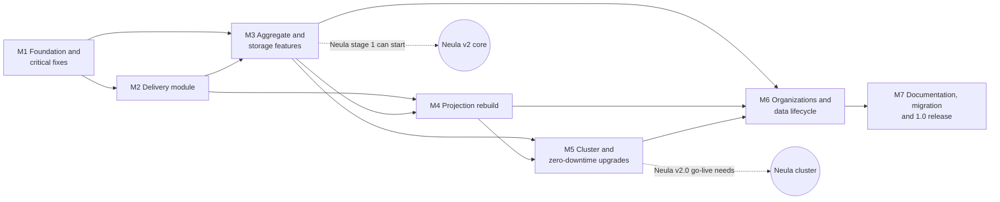

# ReactiveCQRS 1.0 — implementation plan

How the library gets from 0.12.47 to 1.0: goals, milestones, work items, and how each goal
is verified. The decisions (Dn) and issues (Fn, Hn) referenced here are defined in
[KNOWN-ISSUES.md](KNOWN-ISSUES.md); the current architecture is described in
[ARCHITECTURE.md](ARCHITECTURE.md).

| | |
|---|---|
| Status | Approved 16/10/2026 with changes: tests run locally until CI is set up after 1.0; the owner publishes to Nexus after the work is done |
| Line | `master`, from tag `v0.12.47`, straight to 1.0; milestones tagged `v1.0.0-M1` … `-M6`, then `v1.0.0` (D64, D79) |
| Consumer | Neula; production stays on 0.12.47 until 1.0 (D79, D80) |
| Hard constraint | Stored data (D28, D69); API compatibility is not required |
| Working rules | The disciplined-coding guidelines (user-level skill) |

Contents: [1. Goals](#1-goals-of-10) · [2. Working rules](#2-working-rules) ·
[3. Verification toolkit](#3-verification-toolkit) · [4. Milestones overview](#4-milestones-overview) ·
[5. Milestones in detail](#5-milestones-in-detail) · [6. Neula requirements traceability](#6-neula-requirements-traceability) ·
[7. Performance plan](#7-performance-plan) · [8. Risks and spikes](#8-risks-and-spikes) ·
[9. Assumptions](#9-assumptions) · [10. Progress log](#10-progress-log)

---

## 1. Goals of 1.0

Each goal is an observable outcome with the check that proves it.

| # | Goal | Verified by |
|---|---|---|
| G1 | **No known High or Medium issue is open** in KNOWN-ISSUES.md, unless deferred with a stated reason. Every fixed issue has a test that failed before the fix. | Issue index (KNOWN-ISSUES §6) all fixed or deferred; the reproducing tests in the local test run |
| G2 | **Reliable delivery**: every event reaches every subscriber at least once, in order per aggregate, applied exactly once by the subscriber; failures are bounded, visible and repairable; memory stays bounded. | Delivery interface tests, sequence-gate property tests, soak test (M2) |
| G3 | **Stored data stays safe**: everything written by 0.12.47 is readable by 1.0; the upgrade is rehearsed on a production copy. | mpjsons data gate (M1), upgrade rehearsal (M7) |
| G4 | **Neula's requirements are delivered** (R1–R20; R21 not built) with Neula's own acceptance criteria. | Traceability table §6 |
| G5 | **Fast restore and less stored data**: restore from one snapshot plus a short tail; squash into one event, including duplicated and undone histories. | Snapshot and squash equivalence tests (M3) |
| G6 | **Rebuild without downtime**, equal to live, resumable after a crash, faster than today. | Rebuild equivalence and resume tests, throughput measurement (M4) |
| G7 | **High availability and scale-out** on a Pekko cluster with one database; **zero-downtime rolling upgrades** from 1.0 on; a cluster of one behaves like a single node. | Multi-node and fault-injection tests, rolling-upgrade test (M5) |
| G8 | **Organizations are separable**: required space, purge, export/import between installations, complete GDPR rewrite. | Round-trip, purge and rewrite scans (M6) |
| G9 | **Measured performance gains** against the M1 baseline, with no regression between milestones. | Benchmark reports per milestone (§7) |
| G10 | **A library user can succeed from the GitHub documentation alone**: architecture with diagrams, guides, and verified examples, at least a basic setup and a cluster setup. | Examples run as tests; fresh-reader test (M7) |

---

## 2. Working rules

- Every work item follows the disciplined-coding guidelines: explore, ask blocking questions,
  smallest change that fits the existing patterns, edge-case checklist, verify with evidence,
  final report.
- **Bug fixes start with a failing test** at the owning module's interface (D6). The test
  is named after the issue (e.g. `F21 version conflict on a changed document is retried`);
  the issue then moves from *likely* to *confirmed* and, after the fix, to *fixed* in
  KNOWN-ISSUES.md.
- Each issue is fixed in the milestone where its code is reworked (D84; index in
  KNOWN-ISSUES §6). Problems found along the way are added to KNOWN-ISSUES.md, not silently
  fixed, unless they block the work.
- Every schema change follows D28 and D69: additive, idempotent, large indexes
  `CONCURRENTLY`, heavy jobs outside startup.
- Each milestone keeps `ARCHITECTURE.md` accurate and adds draft guide pages for what it
  delivered, so M7 polishes rather than writes from scratch.
- A milestone is done when its exit criteria hold; it is then tagged `v1.0.0-Mn`.

---

## 3. Verification toolkit

Built in M1 and extended where a milestone needs it. New test dependencies are marked
**new** with the reason (approved, §9). Until CI is set up after 1.0, "every commit" means
the local run of `sbt test` before each change is reported as done. The development machine
has PostgreSQL on port 5432 and no Docker.

| Level | What it proves | Tooling | Runs |
|---|---|---|---|
| Interface tests, in-memory | Behaviour of a module through its interface (sequence gate, delivery protocol, command processing) | ScalaTest; in-memory adapters (D6); Pekko TestKit with a controllable clock and scheduler | every commit |
| PostgreSQL tests | SQL procedures, Postgres adapters, transactions, migrations | ScalaTest against the local PostgreSQL (each test run uses its own schema or cleans its tables); **new** Testcontainers PostgreSQL once Docker or CI is available | every commit |
| Property-based equivalence | "Same result" claims: snapshot vs full replay, rebuild vs live, squash before vs after, sequence gate vs in-order application | **new** ScalaCheck (random event logs and delivery orders find cases hand-written tests miss) | every commit |
| Golden schema tests | Stored formats do not change unnoticed; mpjsons 0.6.50 vs 0.7.0 | R20 schema-reference utility (built in M1) | every commit |
| Statement counting | Database round trips per command, per restore, per batch | ScalikeJDBC `GlobalSettings.queryCompletionListener` (no new dependency) | benchmarks, selected tests |
| Soak and memory | Bounded memory, no leaks over long runs | testdomain load driver; heap after GC sampled | per milestone |
| Multi-node | Sharding, singletons, handover, cross-node delivery | Several `ActorSystem`s in one JVM; docker-compose cluster of 3 nodes + PostgreSQL (needs Docker) | M5 onward (compose: when Docker is available) |
| Fault injection | Network partitions, node kills, slow database | **new** Toxiproxy in docker-compose (partitions cannot be simulated reliably in one JVM; needs Docker) | M5 onward (when Docker is available) |
| Upgrade tests | 0.12.47 → 1.0 migration; rolling N → N+1 | Production-copy rehearsal (runbook + script); two testdomain builds in one cluster | M5, M7 |
| Benchmarks | Latency, throughput, restore and rebuild times | `bench` sbt module with an end-to-end load driver over testdomain | per milestone |
| Documentation checks | Examples work, snippets compile, links and diagrams valid | examples as tests; **new** mdoc (snippets in Markdown are compiled); **new** link checker and Mermaid render check, run locally | M7 (examples from their milestone on) |

---

## 4. Milestones overview

| Milestone | Goal | Main decisions | Neula requirements |
|---|---|---|---|
| M1 | Trustworthy test baseline on the new libraries; data-loss and wrong-result bugs fixed on the current architecture; performance baseline | D6, D74, D78, D36, D16, D10, D11, D12, D24, D37, D56 (R5), D21 | R2, R4 (partly), R5, R6, R7, R9 |
| M2 | Delivery that is reliable, visible and bounded | D3, D4, D7, D8, D15, D20a–c | R1, R3, R4 |
| M3 | Features for Neula v2 core; storage reduction; quick performance wins | D29, D30, D31, D32, D33, D17, D34, D35, D47–D52 | R8, R10, R12, R13 |
| M4 | Rebuild without downtime, equal to live, resumable, fast | D57–D63, D70, D56 (R14) | R14 |
| M5 | Cluster, rolling upgrades, id ranges | D39, D42–D46, D53–D55, D65–D73, D68, D75 | R18, R19, R20 (multi-node) |
| M6 | Organization operations and migration; complete rewrite; ephemeral aggregates; retention squash | D38, D40, D41, D56 (R17), D76, D77, D52 (R11) | R11, R15, R16, R17 |
| M7 | Library documentation and examples; 0.12.47 → 1.0 migration; release | D81, D79 | all (documentation, migration) |

---

## 5. Milestones in detail

### M1 — Foundation and critical fixes

**Goal:** a green, trustworthy test suite on the new library baseline, stored data proven
readable with mpjsons 0.7, the data-loss and wrong-result bugs of the current architecture
fixed, and a measured performance baseline.

**Work items**

1. **Repository setup.** Tag the current state `v0.12.47`; set the version to `1.0.0-SNAPSHOT`
   (`project/Common.scala`). CI is set up after 1.0; every check runs locally until then.
2. **Step 0, make the tests run (D6, F14).** Fix the test compilation (ScalaTest 3.2 imports
   in `CommonSpec`, `MemoryDocumentStoreSpec`, `PostgresDocumentStoreSpec`, `SubscribableSpec`;
   the `replayed` argument at 5 call sites in `SubscribableSpec`; `Left(version)` at
   `EventStoreStateSpec:41`). Fix the in-memory doubles (F14). Record which existing tests pass.
3. **Library baseline (D74).** Latest Scala 2.13, Pekko 1.7.x, ScalikeJDBC 4.3.x (with
   streams), latest PostgreSQL JDBC, Java 21 bytecode, an explicit slf4j dependency (mpjsons
   0.7 no longer brings it).
4. **mpjsons 0.7 data gate (D78).**
   - Spike F51: does 0.7 serialize the `TypeTag` held by `Event`? If yes, remove it from
     `Event` now (first part of D75).
   - Build the R20 schema-reference utility: given classes and one sample each, compare the
     output with committed reference JSON and with 0.6.50's output, and round-trip it.
   - Build a dry-run tool that reads every stored JSON row (`events`, `sagas`,
     `commands_responses`, projection tables) with the 0.7 codec and reports failures by class
     (F52).
   - Neula: run both against its classes and a production copy; fix `== null` checks on
     `Option` fields (H4, F53).
5. **Production pre-checks** (run by Neula on a production copy): `event_type_version`
   distribution (D29), `space_id = -1` count (F49), the dry run above.
6. **Performance baseline.** `bench` module and load driver; record the metrics of §7 in
   `docs/perf/baseline-M1.md`.
7. **Critical fixes, in this order:**
   1. F21 lost document updates, with F16 (cache only after commit) and stale-entry eviction (D36, D16).
   2. F18 subscription cache after commit.
   3. F7 one timestamp (D10).
   4. F19 reload on external write and F24 bounded concurrent retries (D37).
   5. F10 failed restore fails fast; restore out of the constructor (D11).
   6. F20 configurable async timeout with a reply (D56, R5); F13 executor stops after a failure.
   7. F12 ids read as `Long`.
   8. F9 idempotency: unique key, rollback on collision, stored-response retention (D12, D24, R7); Neula calls `initSchema()` (H5).
   9. Sagas: F35 failures handled in the actor with retry, F36 row counts, F34 index, F17 context use, F40 `println`s.
8. **Documentation hygiene.** CLAUDE.md §7 points to KNOWN-ISSUES.md (D5); ARCHITECTURE.md
   updated for every changed behaviour.

**Verification**

- The full local run is green: compile and all tests, including the PostgreSQL ones (`sbt test`).
- Each fixed issue has its reproducing test; its failure on 0.12.47 code is recorded in the
  change description.
- Neula acceptance criteria pass as library tests:
  - R2: a listener whose transaction rolls back receives the same events again.
  - R4: an external write followed by a command on the same aggregate succeeds; a failed restore does not poison the aggregate (the next command retries the restore).
  - R5: an async handler past its timeout gets `CommandHandlingError`.
  - R6: the timestamp seen live equals the one restored from the store.
  - R7: the same idempotent command sent twice, concurrently, and after a restart creates one set of events and returns the same response.
  - R9: 10 000 commands that produce no events leave the `events` table and the aggregate version unchanged (statement counter: no writes).
- F21: a forced version conflict on a changed document is either retried against fresh data
  or fails after the limit; never a silent success.
- Golden test green for testdomain; Neula's golden test and dry run report zero unreadable
  rows (or converters were added for the reported ones).
- Baseline benchmark report committed.

**Exit criteria:** every M1 issue in KNOWN-ISSUES §6 is fixed or checked; pre-check results
recorded; tagged `v1.0.0-M1`.

**Risks:** mpjsons 0.7 cannot read some stored data (fallback: fix in mpjsons, or stay on
0.6.50 until fixed); ScalikeJDBC 4 or Pekko 1.7 configuration changes.

### M2 — Delivery module

**Goal:** events reach every subscriber at least once, in order per aggregate, applied
exactly once; silence and failures are bounded, visible and repairable; delivery memory
returns to zero when idle.

**Work items**

1. **Delivery interface (D3).** Publisher: "versions a..b of X committed". Subscriber
   protocol: `Deliver`, `Ack(range)`, `Failed(version, error)`. Documented in ARCHITECTURE.md.
2. **Sequence gate (D4).** A pure module deciding ack-only, apply a..b, or fetch a gap; the
   three listener kinds become adapters over it (F5, F15).
3. **Gap fetch (D20c, F45).** Event-store read of a version range for one aggregate; state
   requested from the owner for state-receiving listeners.
4. **Subscriber failure policy (D20a, R1).** Internal retry with back-off; failure recorded
   in the subscription row (new nullable columns: status, failed version, error, since);
   `Failed` reply; `GetProjectionStatus`, `RetryFailedSubscription`, explicit skip of one
   version; automatic, rate-limited retry of failed subscriptions on start.
5. **Bus rewrite (D7, D20b).** Remove the cursor and `EventBusState` (F1, F4, F11, F47);
   ack tracking that ends on ack, failure or deadline; watch subscribers; balanced counters;
   stalled-delivery log lines and summary.
6. **Single retry owner (D8).** One outbox poller for all types (F37) sends re-publish
   messages to owners; owners re-read their outbox rows older than `redeliveryAfter`; every
   outbox row gets fresh attempts at startup; `eventsToPublish`/`pendingPublish` removed;
   batched outbox deletes with failure handling (F26).
7. **Subscriber list registration (D15).** The bus takes the host's subscriber list and
   stashes publications until all answered (F41, F42); Neula drops its 106 count (H2).
8. **`SubscriptionsState` cleanup.** Bounded cache (F29); clearing also clears caches (F6).
   The in-memory mode stays until M4, where rebuild stops needing it.
9. **Delayed queries** keyed and coalesced (F28).

**Verification**

- Sequence-gate property test: for random delivery orders with duplicates, overlaps and
  gaps (at least 10 000 generated cases per run), the listener sees every version exactly
  once, in order, and nothing is buffered without a pending gap fetch.
- Delivery interface tests with in-memory adapters and a controlled clock:
  - a lost message is re-delivered within `redeliveryAfter`;
  - a subscriber that keeps failing replies `Failed` after its retry budget, other aggregates keep flowing, the status shows the failure, `RetryFailedSubscription` resumes from the failed version, and a restart retries it automatically;
  - silence leads to re-deliveries at about 3 and 6 minutes, a stall log line, and "undelivered" at 10 minutes;
  - after a restart every outbox row is delivered again;
  - a gap is filled from the store;
  - a duplicate is acked without being re-applied (F5 regression).
- PostgreSQL test: stop the system right after commit and before publication; after a
  restart every subscriber receives the events.
- Soak test (sizes are estimates, tuned to the test machine): about 1 million events over
  100 000 aggregates, with 10 % of listeners failing for a while and recovering. At the end:
  bus bookkeeping is empty, the outbox is empty, heap after GC is within a fixed bound.
- Startup without fixed waits: bus ready as soon as subscribers answered (time measured
  against the baseline).
- Neula acceptance: R1 (a listener throwing for one aggregate does not block others; failure
  in status and metric; repair resumes), R3 (a lost publication reaches subscribers within the
  re-send interval while the aggregate stays active), R4 (memory stable over restart cycles).

**Exit criteria:** M2 issues fixed; tagged `v1.0.0-M2`; Neula switched to the subscriber
list.

**Risks:** Neula listeners must cope with the new failure status; the controllable clock
needs the scheduler to be injectable.

### M3 — Aggregate and storage features

**Goal:** everything Neula's v2 core needs before it starts (with M1 and M2: R1–R4,
R7–R10, R12, R13), storage reduction by squash, and the low-risk performance fixes.

**Work items**

1. **Remove event versioning (D29).** Remove the API; reader check for non-zero versions.
2. **Snapshots (D30, F44, F22, F38).** `snapshots` table; per-context policy (schema
   version, every N events, on passivation); written after persist; restore from the latest
   compatible snapshot plus tail; invalidation on undo, rewrite, context version and schema
   change; streaming restore; index `events(aggregate_id, version)` built `CONCURRENTLY`.
3. **Serial command mode (D31, R8).** Per-context `Serial(maxQueuePerAggregate, onOverflow)`.
4. **Metadata envelope (D32, R13).** `metadata` column; command trait; `EventInfo.metadata`;
   default envelope for old rows.
5. **Outbox hook (D33, R12).** Typed writer per context inside the persist transaction.
6. **Squash (D47–D52).** Context-defined squash event; `SquashAggregate(id, upTo)`; one
   transaction deleting events, noop rows, snapshots and chain rows; preconditions; detach of
   duplicates, including multi-level chains (D50); undo guard (D49); explicit error for
   historical reads below the squash point; policy run by a scheduler (single node now,
   singleton in M5).
7. **History rewrite contract (D17, F8 first part).** Same-class check; rebuild of the live
   aggregate after a rewrite.
8. **Performance fixes (D34, D35):** blocking dispatcher (F27); id pools of 10 000 with
   asynchronous prefetch (F23); event handlers once (F25); set-based `add_events` and undo
   (F31); type ids and codec serializers cached (F30); no global `AggregateId` lock (F32);
   small hot-path waste (F33); instant reads filtered in SQL (F39); document-store migration
   in one transaction (F43).

**Verification**

- Snapshot property test: for random command logs over testdomain aggregates (including undo
  and duplication), state from full replay equals state from snapshot plus tail at every
  version.
- R10: an aggregate with 100 000 events restores from one snapshot plus at most `every`
  events (row counter); a schema-version mismatch falls back to an older snapshot or a full
  replay, never fails.
- Neula runs its golden event logs both with and without snapshots and gets identical
  handler behaviour.
- R8: 1 000 concurrent commands on one aggregate in serial mode produce 1 000 sequential
  versions with no `AggregateConcurrentModificationError`; throughput across many aggregates
  stays within the benchmark's noise of concurrent mode.
- R12: a failing outbox writer rolls back the events; an idempotent replay does not
  duplicate the rows.
- R13: metadata round-trips through store, replay, projections, history rewrite and squash.
- Squash:
  - state before and after are equal, and the aggregate restores afterwards;
  - duplicates are detached first and restore to identical state;
  - an undo crossing the squash point is rejected;
  - squash is refused while outbox rows or failed subscriptions exist;
  - a historical read below the squash point returns the explicit error;
  - row counts show the removed rows.
- Versioning removal: existing rows (version 0) read unchanged; a synthetic non-zero row
  fails with the clear message.
- Benchmarks against the M1 baseline: statements per command, restore time, persist
  throughput (§7).

**Exit criteria:** M3 issues fixed; tagged `v1.0.0-M3` as "Neula v2 core can start".

**Risks:** squash detach for long duplication chains (release freezing creates many);
snapshot size for large states.

### M4 — Projection rebuild

**Goal:** rebuild without downtime, producing exactly what live delivery produced,
resumable after a crash, and faster than today.

**Work items**

1. **Projection registry and versioned tables (D57, D70).** Active version per projection
   name; tables `projection_<name>_v<N>`; subscription identity = class + version.
2. **Store-direct replay to the target only (D58, F56, F59).**
3. **Commit-order replay (D59, F57).** Bounded cache of replay states restored from
   snapshot plus tail; base-state reuse for duplicates (F62).
4. **Live sequence, including undo (D60, F58).** Neula checks the undo handling of the
   ScreenRelease and ProcessRelease event listeners (H6).
5. **Batches with durable offsets (D61, F60, F3).** Remove the in-memory subscription mode
   and `dump()`.
6. **Final-state rebuild for state-only projections (D62).**
7. **Triggers and targeted rebuild (D63, F61, R14)** for one aggregate, one type or one
   organization.
8. **Shadow orchestration (D57, F54, F55).** Build while live, catch up, build indexes,
   switch in one update, drop the old tables; the rebuild CLI mode uses the same path.
9. **Rebuild throughput (F62, H1):** no bus window, many aggregates per transaction.

**Verification**

- Equivalence property test: for random multi-aggregate logs (testdomain gains a
  projection that combines two aggregate types), the projection built live equals the one
  shadow-rebuilt, and equals one rebuilt after a crash and resume (document tables compared
  row by row).
- Undo and duplication scenarios produce the same projection as live.
- Rebuild under live traffic: queries are answered by the old version throughout; after the
  switch no event is missing (events that arrived during the rebuild are included); the switch
  is one row update.
- Resume: killing a rebuild midway and restarting continues from the saved offsets; work
  repeated is at most one batch.
- A targeted rebuild of one aggregate, type or organization changes only those rows.
- Throughput and peak memory against the M1 baseline; Neula times a full rebuild on a
  production copy while the server keeps running.

**Exit criteria:** M4 issues fixed; tagged `v1.0.0-M4`.

**Risks:** memory of commit-order replay across many open aggregates (bounded cache plus
snapshots); disk space for two projection versions during a switch.

### M5 — Cluster and zero-downtime upgrades

**Goal:** high availability and scale-out on a Pekko cluster with one database, zero-downtime
rolling upgrades from 1.0 on, and a cluster of one that behaves like today's single node.

**Work items**

1. **Spike (D66, D46):** on Pekko 1.7, confirm `app-version`-aware shard allocation and
   singleton handover; configure the Split Brain Resolver with a Kubernetes lease.
2. **Cluster serialization (D45, D68):** mpjsons-based serializer with class-name manifests,
   tolerant reading for messages, Java serialization off.
3. **Sharding per context (D43):** the aggregate owner becomes a shard entity (including
   serial mode); passivation replaces reaping (F46); handover rules (D72).
4. **Singletons (D46, D53):** outbox poller, saga runner, rebuild orchestration, squash
   scheduler, one per projection; state across nodes (D54); transparent queries (D55);
   single-writer projections keep caches valid (F48).
5. **Id ranges (D39):** installation number in configuration; sequences moved forward;
   check below 2^53.
6. **Rolling upgrades (D65–D73):** `app-version`; per-feature write switch for new event
   classes (D67); readiness through Pekko Management health checks (D71); an
   expand/contract migration runner separate from startup (D69).
7. **Scala 3 groundwork (D75, F50):** type keys by class name or `ClassTag`.
8. **Metrics interface (D56, R19)** with a no-op default; trace context from metadata.

**Verification**

- In-JVM multi-node tests: a command sent on node A to an aggregate owned by node B
  succeeds; a projection singleton receives events from every owner; queries work from any
  node.
- docker-compose cluster (3 nodes, PostgreSQL, Toxiproxy; needs Docker on the test machine):
  - kill the writing node right after a commit: projections still receive the events through the new owner's outbox re-delivery;
  - rebalance under load: a client-side ledger of idempotency keys shows no command lost or applied twice;
  - network partition: the resolver downs the minority side, and a check query over `events (aggregate_id, version)` finds no version appended twice;
  - singleton failover: exactly one instance at any time after a node loss.
- Cluster of one: the full M1–M4 test suites pass with a one-node cluster configuration.
- Rolling upgrade (D73): testdomain version N → N+1 (N+1 adds an event class behind the write
  switch) under load: no failed command except retryable ones, projections caught up, no
  deserialization errors, a projection version switch completes.
- Serialization: every command, response, event and state class round-trips; old-shape
  messages are read by new code and the reverse.
- Id ranges: new ids fall in the installation's range and stay below 2^53.
- Neula acceptance: the R18 table (opt-in contexts, transparent bus, single owner, delivery
  after writer loss, state rebuilt for listeners, singletons, split-brain safety, rolling
  upgrade, node-local ephemeral aggregates when M6 adds them).

**Exit criteria:** M5 issues fixed; tagged `v1.0.0-M5`; Neula can run its cluster tests.

**Risks:** size of aggregate state sent across nodes for state-receiving listeners; Pekko
upgrade behaviour differences found by the spike.

### M6 — Organizations and data lifecycle

**Goal:** organizations can be purged, exported and imported between installations;
history rewrites are complete; ephemeral aggregates and retention squash are available.

**Work items**

1. **Required space and backfill (D38, F49):** backfill tool for `space_id = -1` rows,
   using a per-context space function; space required for new aggregates.
2. **Purge per organization (D56, R17):** every framework table and document store.
3. **Export and import (D40):** export format (aggregates, events, squash events);
   cross-organization duplication bases materialized by detach; import with fresh ids where
   legacy ids collide; codec remap for `AggregateId` and registered wrapper types; per-context
   rewriter for untyped references; rebuild of that organization's projections (D63).
4. **Complete history rewrite (D76, F8):** squash events, snapshots, outbox-hook rows on
   request, duplicates through recorded lineage; targeted rebuild; audit entry.
5. **Ephemeral aggregates (D77, R16):** in-memory only, negative ids, `Materialize` with a
   squash-style first event under a new id; loss reported.
6. **Retention squash with audit archive (D52, R11):** keep audit-class events in a
   readable archive; "who still uses this class" report.

**Verification**

- Export → import into a second database: every aggregate restores to the same state
  (compared through the id remap table); the organization's projections, rebuilt, equal the
  source's; a reference check finds no typed id pointing at a missing aggregate.
- Purge: a per-table query finds no row of that organization in any framework table or
  document store; other organizations' row counts are unchanged.
- Rewrite: after rewriting a value, a full-text scan of events, squash events, snapshots,
  the archive, outbox-hook rows and duplicates finds no occurrence; affected projections were
  rebuilt; the audit entry exists and holds no values.
- Ephemeral: an ephemeral aggregate answers commands like a persistent one; the statement
  counter shows no writes; after `Materialize`, a restore gives the same state; node loss is
  reported.
- Retention squash: audit events remain readable, technical events are gone, the aggregate
  restores, projections rebuild, and the "who uses class X" report is empty after squashing
  every user of X.

**Exit criteria:** M6 issues fixed; tagged `v1.0.0-M6`.

**Risks:** untyped id references in Neula events (raw `Long`, `"u#123"` strings, variable
data, encrypted ids) need a complete per-context rewriter; legacy id collisions between
installations.

### M7 — Documentation, examples, migration and 1.0 release

**Goal:** a library user can understand the architecture and set the library up from the
GitHub documentation alone; the 0.12.47 → 1.0 migration is rehearsed on production data;
1.0 is released.

**Work items**

1. **README** (GitHub landing page): what the library is and when to use it, features,
   requirements (Scala 2.13, Java 21, PostgreSQL, Pekko), installation coordinates, a
   five-minute quick start (basic setup), links to the guide.
2. **User guide** (`docs/guide/`), one page per topic:
   - getting started;
   - concepts: aggregate model, `AggregateContext`, command kinds and results, event kinds,
     event handlers, evolving events with `V<n>` classes;
   - persistence: tables, migrations, the stored-data rules;
   - delivery guarantees and projections: listener kinds, failure policy and status, delayed
     queries, subscribable projections;
   - rebuild: shadow rebuild, triggers, targeted rebuild;
   - snapshots and squash, with duplication and undo;
   - serial mode, idempotent commands, outbox hook, metadata and tracing;
   - sagas; ephemeral aggregates;
   - organizations: spaces, purge, export and import;
   - cluster: sharding, singletons, split brain and lease, serialization, Kubernetes;
   - upgrades: rolling upgrades, expand/contract, two-step event introduction;
   - operations: metrics, logs, alerts, troubleshooting, VACUUM and `pg_repack`;
   - testing with the test kit; configuration reference; migration guide 0.12.47 → 1.0.
3. **Architecture for users** (`docs/guide/architecture.md`), with Mermaid diagrams (GitHub
   renders them natively):
   - component overview (modules, actors, database);
   - write path, sequence diagram (command → events → commit → publish → reply);
   - delivery, sequence diagram (deliver, ack or failure, re-delivery, deadline, gap fetch);
   - sequence-gate decisions;
   - storage, entity-relationship diagram (events, aggregates, noop events, outbox,
     snapshots, subscriptions, command responses, sagas, projection tables);
   - duplication chain, detach and squash;
   - shadow rebuild, state diagram;
   - cluster topology (nodes, shards, singletons, database) and the rolling-upgrade sequence;
   - organization export and import flow.
4. **Examples** (`examples` sbt module; each example is runnable and has a test):

   | # | Example | Shows |
   |---|---|---|
   | E1 | **Basic single-node setup** | connection pool, schema initialization, one aggregate, one projection, a command and a query |
   | E2 | **Cluster setup** | three nodes, sharded contexts, singletons, split brain resolver with lease; docker-compose with PostgreSQL; Kubernetes manifests with the lease permissions |
   | E3 | Projections | the three listener kinds, failure policy and status, delayed queries |
   | E4 | Saga | multi-aggregate process with idempotent steps |
   | E5 | Snapshots and squash | snapshot policy, squash, duplication and detach, undo |
   | E6 | Command processing | serial mode, idempotent commands, outbox hook |
   | E7 | Metadata | actor, correlation and trace context through events |
   | E8 | Ephemeral aggregate | in-memory aggregate and `Materialize` |
   | E9 | Organizations | export, import and purge of a space |
   | E10 | Rebuild | shadow rebuild and targeted rebuild |
   | E11 | Testing | test kit with in-memory adapters, golden schema test |

5. **Scaladoc** for the public API (`api` module and the public parts of `core`).
6. **Contributor documentation:** ARCHITECTURE.md describes 1.0 internals; CLAUDE.md
   updated; KNOWN-ISSUES.md closed items archived; CHANGELOG.
7. **Migration (D81):** runbook for 0.12.47 → 1.0; rehearsal on a production copy; Neula's
   wiring changes for 1.0.
8. **Release:** version `1.0.0`, tag `v1.0.0`; the owner publishes to Nexus.

**Verification**

- Every example compiles and its test passes in the local test run; E2 also runs as a
  docker-compose smoke test where Docker is available.
- Code in the guide is compiled by mdoc or included from example sources; nothing is
  hand-copied.
- Link check and Mermaid render check pass; `sbt doc` produces no warnings for public
  packages; every public type and method in `api` is documented.
- Fresh-reader test: someone who has not worked on the library (or a fresh Claude session
  given only the repository docs) follows the quick start on a clean machine with Docker
  and reaches a working command and projection; the same for the cluster example. Target
  for the basic setup: under 15 minutes (estimate, to be measured).
- Migration rehearsal on a production copy: duration measured; every aggregate restores,
  every projection rebuilds, every saga resumes, the dry run reports zero unreadable rows.
- Every High and Medium issue in KNOWN-ISSUES.md is fixed or deferred with a stated reason.

**Exit criteria:** `1.0.0` released; Neula's migration date can be planned from the
measured rehearsal.

---

## 6. Neula requirements traceability

| R | Requirement | Milestone | Decisions | Acceptance check (Neula's criteria) |
|---|---|---|---|---|
| R1 | Listener failures retried, marked failed, reported | M2 | D20a, D27 | One failing aggregate does not block others; failure in status and metric; repair resumes from the failed version |
| R2 | Offsets updated after commit | M1 | F18 fix | A rolled-back listener transaction receives the same events again |
| R3 | Re-publish for live aggregates | M2 | D8, D20b | A lost publication arrives within the re-send interval while the aggregate stays active |
| R4 | No unbounded maps, no dead repository actors, no stale actors | M1, M2 | D11, D37, D7, D20b | Memory stable over restart cycles; a failed restore does not poison an aggregate; external write then command succeeds |
| R5 | Configurable async timeout with a reply | M1 | D56 | Timeout returns `CommandHandlingError` |
| R6 | One timestamp | M1 | D10 | Live timestamp equals restored timestamp |
| R7 | Idempotent commands that work | M1 | D12, D24 | Twice, concurrently, after restart: one set of events, same response |
| R8 | Serial command mode | M3 | D31 | 1 000 concurrent commands → 1 000 versions, no conflicts |
| R9 | No events, no write | M1 (test) | already true | 10 000 no-event commands leave events and version unchanged |
| R10 | Fast restore from snapshot | M3 | D30 | 100 000 events restore from one snapshot + at most `every` events; identical handler behaviour |
| R11 | Squash with retention | M6 | D52 | Audit events readable, technical gone, restore and rebuild work, class report empty |
| R12 | Transactional outbox hook | M3 | D33 | Writer failure rolls back events; no duplicate rows on replay |
| R13 | Event metadata envelope | M3 | D32 | Round trip through store, replay, projections, rewrite, squash |
| R14 | Projection API | M2 (status), M4 | D56, D63 | Status, targeted rebuild, batches, start from snapshot (slices after 1.0) |
| R15 | Complete history rewrite | M6 | D76 | No copy of the value anywhere; projections rebuilt; audit entry |
| R16 | Ephemeral aggregates | M6 | D77 | Same behaviour as persistent; same state after `Materialize` |
| R17 | Organization operations | M6 | D56, D38, D40 | Purge leaves no rows; rebuild of one organization leaves others untouched |
| R18 | Cluster behaviour | M5 | D42–D46, D53–D55, D65–D73 | Neula's R18 table |
| R19 | Metrics and tracing | M5 | D56 | Metrics emitted through the interface; trace context propagated |
| R20 | Test kit and schema test utility | M1 (schema), M3–M6 (features), M5 (multi-node) | D56, D78 | Utility rejects a renamed class or changed field |
| R21 | Durable scheduled commands | not built | D56 | — |

---

## 7. Performance plan

Measured at M1 (baseline) and re-measured at the end of every milestone with the `bench`
module; results committed under `docs/perf/`. A regression beyond the measurement noise
blocks the milestone until explained.

| Metric | How | Expected direction (estimates from code reading, to be replaced by measurements) |
|---|---|---|
| Command latency p50/p95/p99, one aggregate and many | load driver over testdomain | lower in serial mode under contention (no retry storm); unchanged otherwise |
| Database statements and commits per command | statement counter | about 3 + 3S round trips today for S subscribers (estimate); fewer with batched outbox deletes |
| Persist throughput (events/s) | load driver | higher with set-based `add_events` and the blocking dispatcher |
| Restore time at 1k, 10k, 100k, 500k events | restore benchmark | today about 5–20 s and hundreds of MB at 500k (estimate); with snapshots: one snapshot + at most `every` events (Neula target: snapshot + 200 events) |
| Projection throughput (events/s, one projection) | load driver | higher with batching across aggregates (M4) |
| Rebuild throughput and peak memory | rebuild benchmark | much higher without the 100-event window and per-aggregate transactions (estimate) |
| Memory after a soak run | heap after GC | flat; delivery bookkeeping zero at idle |
| Startup time to ready | timer | no fixed 10 s / 30 s waits |

Neula's own targets (verified by Neula's load tests, not by the library): task completion
p95 below 150 ms excluding scripts and jobs; restore from at most one snapshot plus 200
events.

---

## 8. Risks and spikes

| Risk | Where | Mitigation |
|---|---|---|
| mpjsons 0.7 cannot read some stored rows or serializes the event `TypeTag` (F51, F52) | M1 | Spike and dry run first; converters or fixes in mpjsons; fallback to 0.6.50 until fixed |
| Library upgrades change behaviour (Pekko 1.4 → 1.7, ScalikeJDBC 3.5 → 4.3) | M1 | Upgrade before the fixes, with the step-0 suite green first |
| Pekko `app-version` behaviour differs from the documentation (D66) | M5 | Spike at the start of M5 |
| State-receiving listeners send large states across nodes (D54) | M5 | Measure in the cluster tests; state only to subscriptions that need it |
| Commit-order replay keeps many aggregates open (D59) | M4 | Bounded state cache with snapshot restore |
| Long duplication chains make detach expensive (D50) | M3 | Detach lazily, one duplicate per transaction; measure with release-freezing data |
| Neula's untyped id references (D40) | M6 | Per-context rewriter written with Neula; reference check in the round-trip test |
| Production-copy rehearsals need Neula's operations time | M1, M7 | Plan the dry runs together with Neula early |

---

## 9. Assumptions

Confirmed by the owner on 16/10/2026:

1. `master` becomes the 1.0 line; the current state is tagged `v0.12.47` first.
2. CI is organized after 1.0. Until then every check runs locally (`sbt test` against the
   local PostgreSQL). Checks that need Docker (Testcontainers, docker-compose cluster,
   Toxiproxy) wait until Docker is available on the test machine.
3. The new test and tooling dependencies of §3 are approved.
4. The owner publishes to the Neula Nexus after the work is done; milestones are git tags.

Still open:

5. Neula runs the production-copy checks (M1 pre-checks, M4 rebuild timing, M7 rehearsal)
   and the Neula-side items H1–H6.
6. Java 21 bytecode (D74) needs JDK 21 on the build machine; only JDK 17.0.8 is installed.
   Until JDK 21 is available the build targets Java 17, which also runs on Neula's Java 21.

---

## 10. Progress log

### M1

**16/10/2026: repository setup and step 0**
- Tagged `v0.12.47` (`4b5060f`); version set to `1.0.0-SNAPSHOT`.
- Test compilation fixed: ScalaTest 3.2 imports in four specs, the `replayed` argument at five
  call sites, `Left(version)` in `EventStoreStateSpec`.
- F14 fixed, with tests (see KNOWN-ISSUES.md).
- Local test baseline (`sbt test`): all 18 in-memory tests pass. The 13 PostgreSQL-backed
  scenarios and one suite cannot run yet: the local server has no `reactivecqrs` role
  (password authentication fails). They need the test role and database the specs expect
  (`jdbc:postgresql://localhost:5432/reactivecqrs`, user and password `reactivecqrs`).

**16/10/2026: local database, library baseline, mpjsons 0.7, F21**
- Test infrastructure: one shared `TestDatabase` helper for every PostgreSQL spec; suites run
  one at a time (`Test / parallelExecution := false`, one test task across modules), because
  parallel suites raced on schema initialization (now F63).
- Pre-existing test bugs fixed so the suite measures the library, not the tests:
  `PostgresDocumentStoreSpec` dropped its table from inside its own transaction and hung;
  `EventStoreStateSpec` wrote to PostgreSQL without a session, ignored the failure, and did not
  start aggregates with a `FirstEvent`; `SubscribableSpec` gave two listeners the same
  subscription id and re-sent an already-processed version.
- F9 index part fixed (it blocked every testdomain spec on a fresh database).
- Library baseline (D74): Pekko 1.7.1, ScalikeJDBC 4.3.5 (`.apply()` after `execute`,
  `update`, `single`, `list` removed throughout), PostgreSQL JDBC 42.7.14, Scala 2.13.18,
  `-release 17` (JDK 21 not installed yet). Test results unchanged by the upgrade.
- mpjsons 0.7.0 adopted in the build. D78 gate: part 1 (golden test) passes for the test
  domain (`StoredFormatsSpec`, references recorded with 0.6.50); F51 closed. Parts 2 and 3
  (production-copy dry run, Neula `== null` grep) remain Neula's, before Neula moves to 1.0.
- F21 fixed with `PostgresDocumentStoreConflictSpec`; new findings F63 and F64.
- `sbt test`: 40 of 41 pass. The failure is `EventsReplaySpec`, a reproduction of F4 (fixed
  in M2); it passes on a database without events from earlier runs.

Open test-infrastructure items:
- Specs share one persistent database and accumulate data across runs, so some results
  depend on earlier runs (`EventsReplaySpec`). Per-run isolation (a fresh schema per run) is
  planned with the next PostgreSQL-heavy work.
- Older specs use deprecated ScalaTest and Pekko TestKit methods (warnings only).

**16/10/2026: F16 and F18**
- New module `AfterCommit` (`core/util`): actions registered for a transaction run after it
  commits and are dropped on rollback; `PostgresSubscriptionsState.localTx`, used by every
  projection update, is such a transaction. Subscription versions and document-store cache
  entries now change only after commit. Tests: `CachesAfterRollbackSpec`, `AfterCommitSpec`.

**16/10/2026: F7**
- One timestamp per event: the executor takes it once per command, truncated to
  microseconds, and the store writes it instead of its own `Instant.now`. Test:
  `EventStoreStateSpec` (both stores). New follow-up F65 (time zone of `event_time`).
- `sbt test`: 50 of 51 pass; the failure is still the F4 reproduction (`EventsReplaySpec`).

**16/10/2026: F19 and F24**
- The repository actor reloads when a command expects a newer version and after an SQL
  conflict; concurrent commands retry with jittered back-off, at most 10 times (D37). The test
  domain gains `AddItemConcurrently`, its first `ConcurrentCommand`. Test:
  `ConcurrentModificationSpec`, with an event store that writes behind the actor's back.
- `sbt test`: 53 of 54 pass; the failure is still the F4 reproduction.
