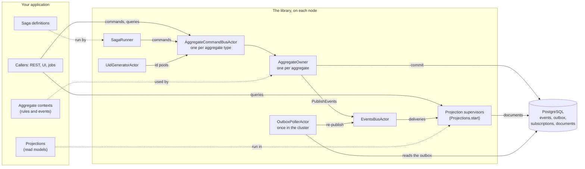
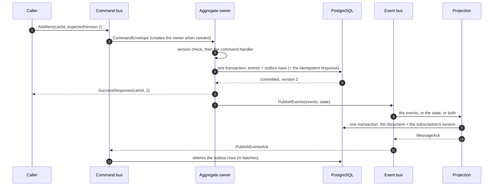
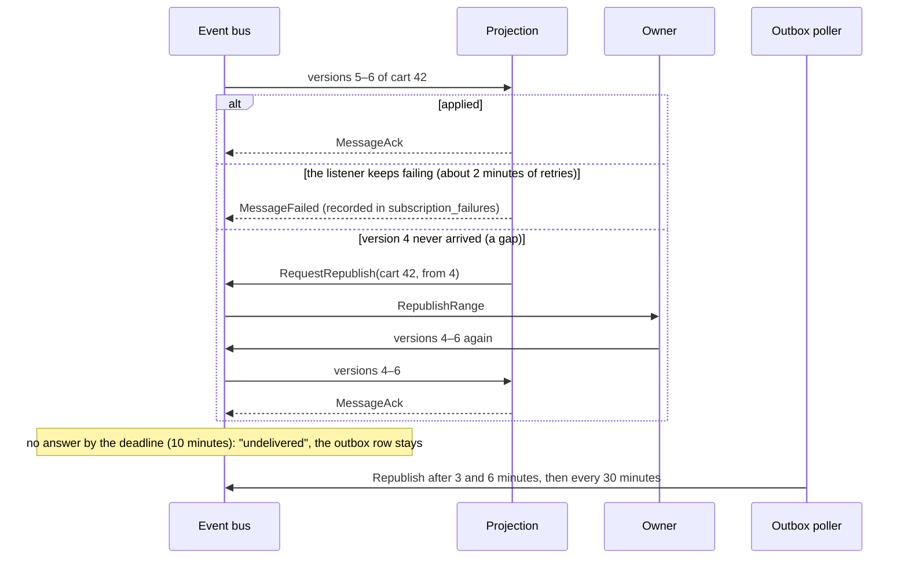
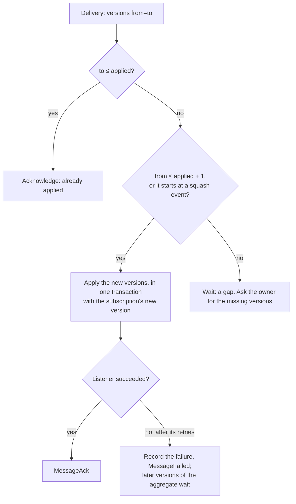
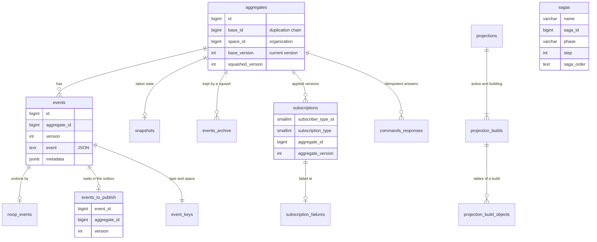
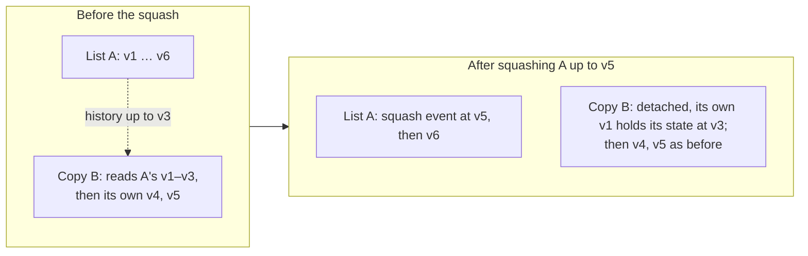
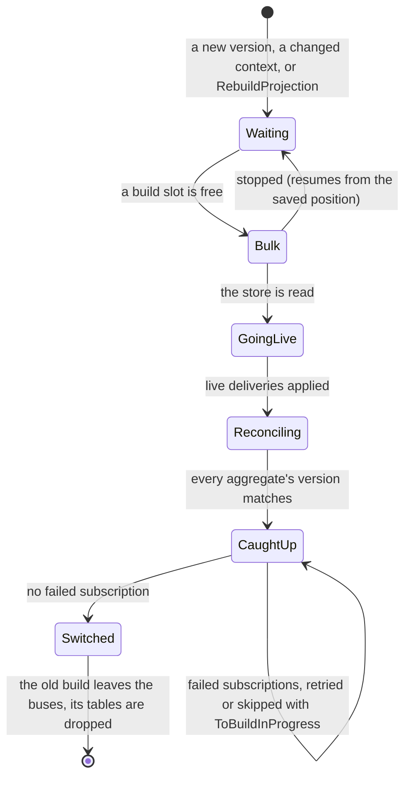
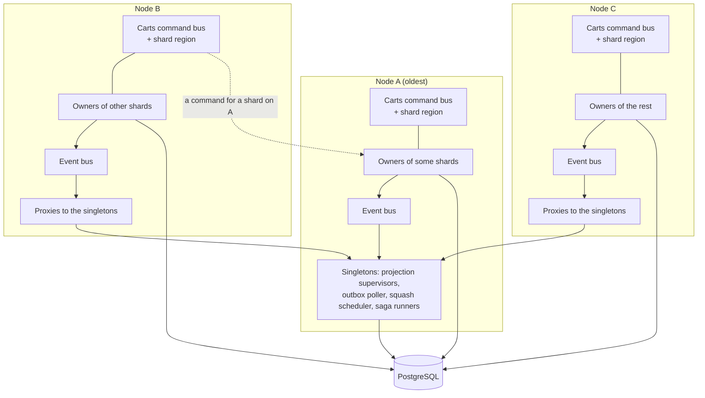
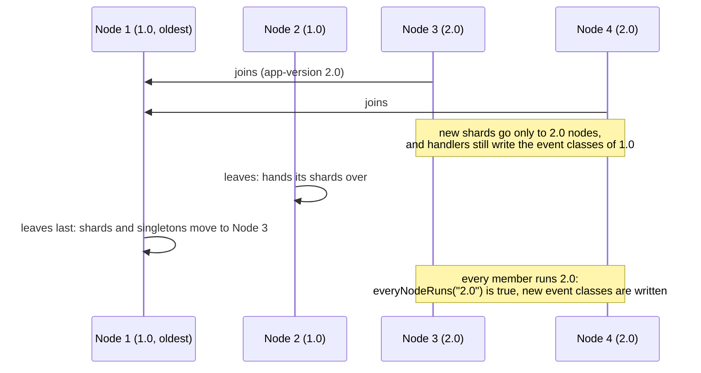
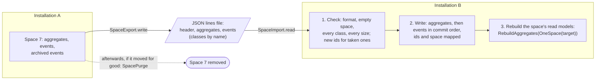

# Appendix D. The Architecture in Pictures

The chapters explain ReactiveCQRS one piece at a time. This appendix puts the pieces side by side, as
diagrams: what runs where, what happens to a command, how an event reaches a read model, what is in
the database, how a read model is built again, and how the nodes of a cluster share the work. GitHub
draws them from their text; elsewhere, paste a block into any Mermaid viewer.

Each diagram names the chapter that explains it. [ARCHITECTURE.md](../ARCHITECTURE.md) has the full
story, for contributors.

---

## The parts

Your application gives the library its aggregate contexts and read models, and creates a handful of
actors when it starts ([chapter 2](02-setting-up.md)). Everything durable lives in one PostgreSQL
database.

## A command, from the caller to the read model

What chapter 4 tells in words: one transaction stores the events and their outbox rows, the caller
gets the new version, and the read model gets the events after the commit.

## Delivery: acknowledged, failed, missing or late

A projection answers every delivery ([chapter 9](09-projection-failures.md)). What it does not
acknowledge stays in the outbox, and the outbox poller has it published again.

## The sequence gate

Each projection keeps the last version it applied per aggregate (and listener kind). Every delivery
goes through one decision ([chapter 8](08-projections.md)):

## What is in the database

The tables the library writes ([chapters 2](02-setting-up.md), [10](10-rebuilding-projections.md) and
[18](18-production.md)). Your read models add one `projection_<name>` table per document store.

## Copies, detaching and squash

A copy (`DuplicationEvent`, [chapter 6](06-events.md)) reads its base's history up to the version
it was made at. A squash ([chapter 14](14-squash.md)) replaces the oldest events with one squash event;
a copy that still reads them is detached first: it gets a first event of its own.

## Building a read model again

A managed projection builds a new version in tables of its own while the active build serves, then
switches in one update ([chapter 10](10-rebuilding-projections.md)):

## A cluster of three nodes

Every node runs a uid generator, an event bus and a command bus per type. What must run once runs on
the oldest node, and every node reaches it through a proxy ([chapter 17](17-cluster.md)).

## A rolling upgrade

New nodes join, old ones leave one at a time, the oldest last, so what runs once moves once. A new
event class is written only when every node can read it ([chapter 17](17-cluster.md)).

## Moving an organization

An organization's events leave one installation as a file and arrive in an empty space of another,
under ids of its own ([chapter 16](16-organizations.md)):

---

Next: back to [the contents](README.md).
