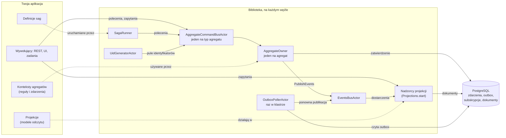
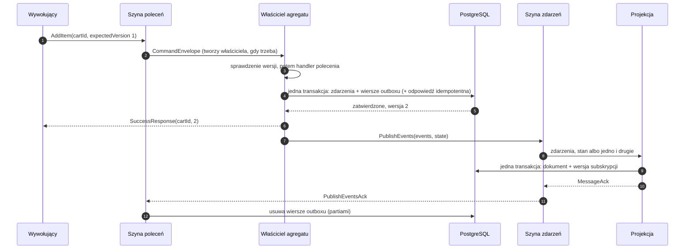
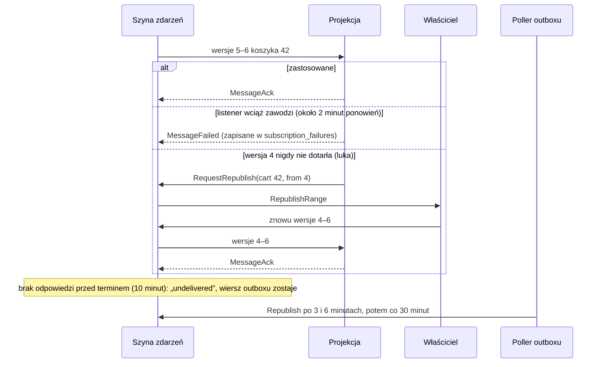
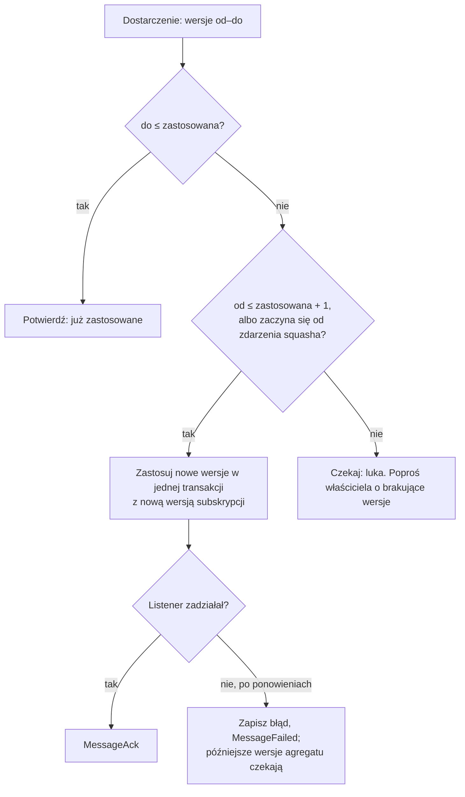
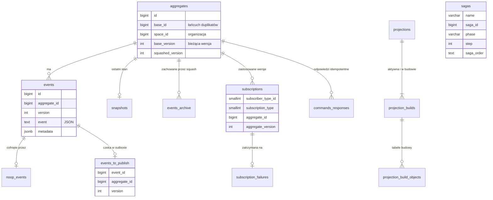
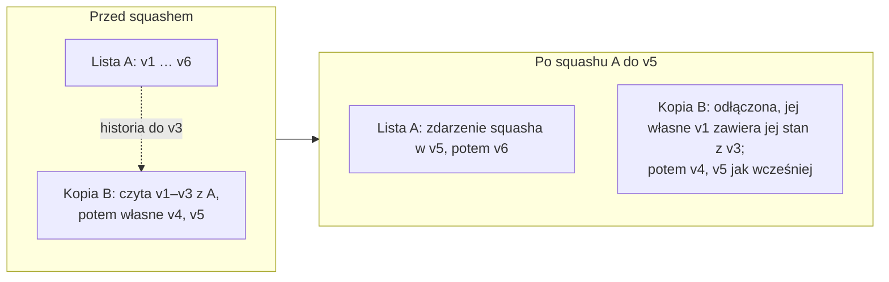
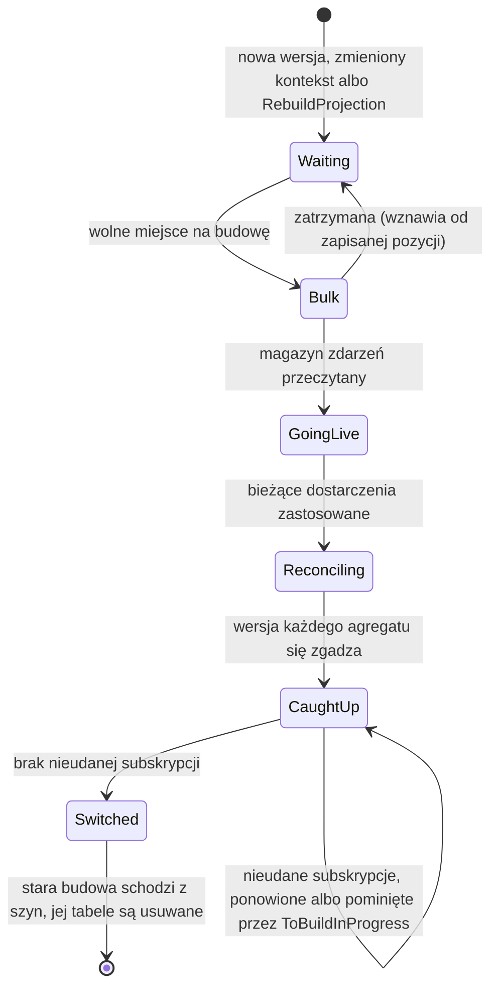
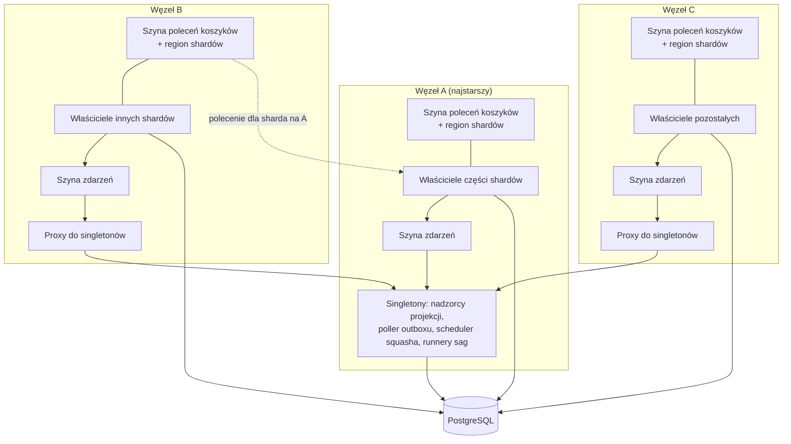
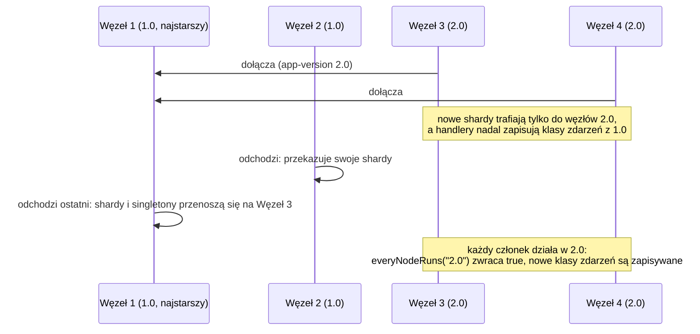
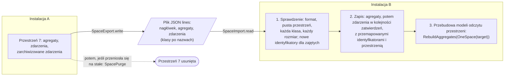

# Dodatek D. Architektura w obrazkach

Rozdziały tłumaczą ReactiveCQRS kawałek po kawałku. Ten dodatek kładzie te kawałki obok siebie,
w postaci diagramów: co gdzie działa, co dzieje się z poleceniem, jak zdarzenie trafia do modelu
odczytu, co jest w bazie danych, jak model odczytu powstaje od nowa i jak węzły klastra dzielą się pracą.
GitHub rysuje je z tekstu; gdzie indziej wklej blok do dowolnej przeglądarki diagramów Mermaid.

Przy każdym diagramie podany jest rozdział, który go objaśnia. Pełną historię, dla osób rozwijających
bibliotekę, opisuje [ARCHITECTURE.md](../ARCHITECTURE.md).

---

## Części składowe

Twoja aplikacja daje bibliotece swoje konteksty agregatów i modele odczytu, a przy starcie tworzy garść
aktorów ([rozdział 2](02-setting-up.md)). Wszystko, co trwałe, mieszka w jednej bazie PostgreSQL.

## Polecenie, od wywołującego do modelu odczytu

To, co rozdział 4 opowiada słowami: jedna transakcja zapisuje zdarzenia i ich wiersze w outboxie,
wywołujący dostaje nową wersję, a model odczytu dostaje zdarzenia po zatwierdzeniu transakcji.

## Dostarczenie: potwierdzone, nieudane, brakujące albo spóźnione

Projekcja odpowiada na każde dostarczenie ([rozdział 9](09-projection-failures.md)). To, czego nie
potwierdzi, zostaje w outboxie, a poller outboxu zleca ponowną publikację.

## Bramka kolejności

Każda projekcja pamięta ostatnią zastosowaną wersję dla każdego agregatu (i rodzaju listenera). Każde
dostarczenie przechodzi przez jedną decyzję ([rozdział 8](08-projections.md)):

## Co jest w bazie danych

Tabele, które zapisuje biblioteka ([rozdziały 2](02-setting-up.md), [10](10-rebuilding-projections.md)
i [18](18-production.md)). Twoje modele odczytu dodają po jednej tabeli `projection_<name>` na każdy
magazyn dokumentów.

## Kopie, odłączanie i squash

Kopia (`DuplicationEvent`, [rozdział 6](06-events.md)) czyta historię swojego oryginału do wersji, przy
której powstała. Squash ([rozdział 14](14-squash.md)) zastępuje najstarsze zdarzenia jednym zdarzeniem
squasha; kopia, która wciąż je czyta, zostaje najpierw odłączona: dostaje własne pierwsze zdarzenie.

## Ponowna budowa modelu odczytu

Projekcja zarządzana buduje nową wersję we własnych tabelach, podczas gdy aktywna budowa obsługuje
zapytania, a potem przełącza się jedną aktualizacją ([rozdział 10](10-rebuilding-projections.md)):

## Klaster trzech węzłów

Każdy węzeł uruchamia generator identyfikatorów, szynę zdarzeń i szynę poleceń dla każdego typu. To, co
musi działać raz, działa na najstarszym węźle, a każdy węzeł dociera do tego przez proxy
([rozdział 17](17-cluster.md)).

## Aktualizacja krocząca

Nowe węzły dołączają, stare odchodzą po jednym, najstarszy na końcu, więc to, co działa raz, przenosi
się raz. Nowa klasa zdarzenia jest zapisywana dopiero wtedy, gdy każdy węzeł umie ją przeczytać
([rozdział 17](17-cluster.md)).

## Przenoszenie organizacji

Zdarzenia organizacji opuszczają jedną instalację jako plik i trafiają do pustej przestrzeni w innej,
pod jej własnymi identyfikatorami ([rozdział 16](16-organizations.md)):

---

Dalej: [dodatek E](appendix-e-configuration.md), czyli wszystkie ustawienia w jednym miejscu.
